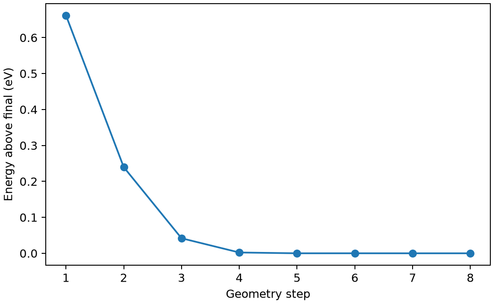

# OpenMX 几何优化

**适用环境：Linux + PBS 运行计算；Windows / macOS / Linux 可准备结构与分析结果。**

几何优化沿受力调整原子位置。优化结束后，检查受力是否达到阈值，并核对最终结构；程序正常退出还不足以判断结构收敛。

## 模型与计算思路

以 1 Å 的 H₂ 为起点，沿用单点案例的 PBE、PAO 和赝势，将 `MD.Type` 改为 `Opt`，最多 80 个原子步，目标最大力 1e−4 Hartree/bohr。两原子模型易于检查最终键长与相反受力。

## 准备输入与环境

[最小案例](../../../examples/openmx/minimal/geometry-optimization)包含：

- [system.dat](../../../examples/openmx/minimal/geometry-optimization/system.dat)
- [structure.xyz](../../../examples/openmx/minimal/geometry-optimization/structure.xyz)
- [run.py](../../../examples/openmx/minimal/geometry-optimization/run.py)：组织计算步骤。
- [job.pbs](../../../examples/openmx/minimal/geometry-optimization/job.pbs)：单节点 PBS 作业。
- [postprocess.py](../../../examples/openmx/minimal/geometry-optimization/postprocess.py)：检查并提取结果。
- [requirements.txt](../../../examples/openmx/minimal/geometry-optimization/requirements.txt)：Python 分析依赖。

在集群加载 OpenMX，并将 `OPENMX_DATA` 设为安装中的 `DFT_DATA19` 目录；其中应包含所选 PAO 和 VPS。势与基组由安装提供，案例不附带这些数据。`run.py` 将输入中的 `@DATA_PATH@` 替换为该目录，生成 `runtime.dat`；结构和电子参数均来自 `system.dat`。

在案例目录安装 Python 依赖并提交：

```bash
python3 -m pip install -r requirements.txt
qsub job.pbs
```

作业结束后会自动执行后处理。重新分析已有输出时，可单独运行 `python3 postprocess.py`。PBS 中的软件加载方式与资源语法按集群配置调整；此例不需要多节点。

## 参数怎样选

| 设置 | 怎样理解 |
| --- | --- |
| `MD.Type Opt` | 原子结构优化，不是有限温度 MD |
| `MD.maxIter 80` | 最大允许步数，达到上限不代表收敛 |
| `MD.Opt.criterion 1e-4` | 受力标准，Hartree/bohr；约 0.00514 eV/Å |
| SCF 与网格 | 电子数值噪声应低于要辨别的受力变化 |

周期材料还需决定是否优化晶胞；固定晶胞原子优化与零压力晶格优化不是同一任务。

## 结果与检查

本例约 8 个原子步完成，最终 H—H 距离约 0.75556 Å，最大力约 2.45×10⁻⁵ Hartree/bohr。后处理从最终 `coordinates.forces` 块独立核对坐标和力，再画各步能量相对最终值。

优化能量不必每一步严格单调；但持续振荡、位移异常或力不下降时，应检查 SCF、坏接触和优化参数。结构续算需要明确最后有效结构，`scf.restart on` 不能代替几何状态恢复。



图由案例的 `postprocess.py` 从计算输出生成。

图中后期微小能量波动不影响本例达到受力阈值。若研究振动或很小的能量差，需要进一步测试基组、网格与几何精度。

进一步了解方法与文件规则，可看[OpenMX 基础知识](OpenMX基础知识.md)。参考：[OpenMX 4.0 手册](https://openmx-square.org/openmx_man4.0/)。
