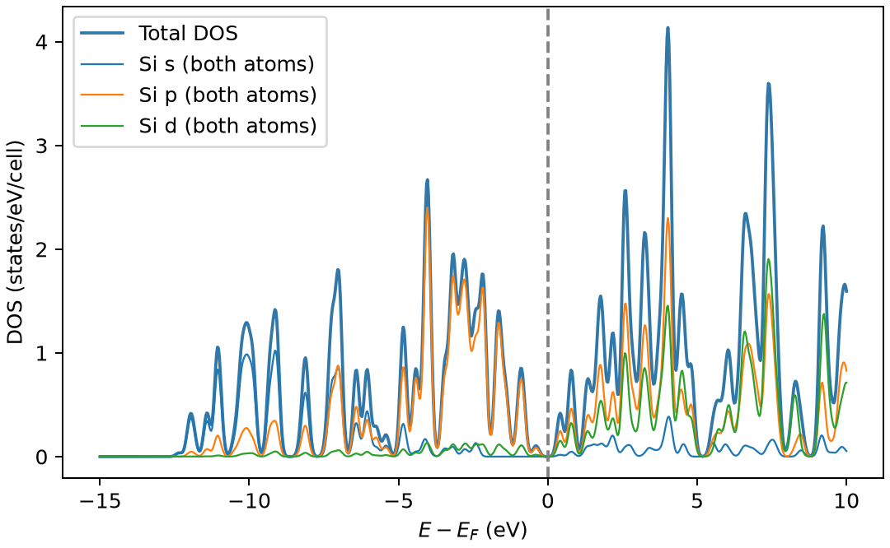

# OpenMX 态密度与投影态密度

**适用环境：Linux + PBS 运行计算；Windows / macOS / Linux 可准备结构与分析结果。**

DOS 统计单位能量内的电子态数量，PDOS 进一步按选定原子或轨道投影。它们依赖布里渊区采样与积分/展宽，不能从一条高对称路径直接得到。

## 在 Si 的收敛势上计算 DOS

沿用 Si 双原子原胞和 PBE 设置，先用 4×4×4 网格做 SCF，再通过 `Dos.Kgrid 6 6 6` 在收敛势上生成 DOS 数据。`Dos.Erange -15 10` 指定费米能附近的能量窗口。

计算后使用官方 `DosMain` 做 Gaussian 总 DOS 和两原子 PDOS；Python 负责检查和绘图，不自行替代原生投影定义。将 `DosMain` 加入 PATH，或设置 `DOSMAIN_EXEC`。

## 准备案例与 DosMain

[最小案例](../../../examples/openmx/minimal/density-of-states)包含：

- [system.dat](../../../examples/openmx/minimal/density-of-states/system.dat)
- [structure.cif](../../../examples/openmx/minimal/density-of-states/structure.cif)
- [run.py](../../../examples/openmx/minimal/density-of-states/run.py)：组织计算步骤。
- [job.pbs](../../../examples/openmx/minimal/density-of-states/job.pbs)：单节点 PBS 作业。
- [postprocess.py](../../../examples/openmx/minimal/density-of-states/postprocess.py)：检查并提取结果。
- [requirements.txt](../../../examples/openmx/minimal/density-of-states/requirements.txt)：Python 分析依赖。

在集群加载 OpenMX，并将 `OPENMX_DATA` 设为安装中的 `DFT_DATA19` 目录；其中应包含所选 PAO 和 VPS。势与基组由安装提供，案例不附带这些数据。`run.py` 将输入中的 `@DATA_PATH@` 替换为该目录，生成 `runtime.dat`；结构和电子参数均来自 `system.dat`。

在案例目录安装 Python 依赖并提交：

```bash
python3 -m pip install -r requirements.txt
qsub job.pbs
```

作业结束后会自动执行后处理。重新分析已有输出时，可单独运行 `python3 postprocess.py`。PBS 中的软件加载方式与资源语法按集群配置调整；此例不需要多节点。

## 采样、展宽与投影选项

| 设置/交互 | 本例 | 选择依据 |
| --- | --- | --- |
| `Dos.fileout` | `on` | 输出 `.Dos.val/.Dos.vec` |
| DOS k 网格 | 6×6×6 | 小例粗采样；实际需加密测试 |
| `DosMain` 方法 | `2`：Gaussian | 另一选项四面体法有不同采样需求 |
| 展宽 | 0.15 eV | 影响峰宽、细节与带边尾部 |
| 内容 | `1`：总 DOS；`2`：PDOS，原子 `1 2` | 原子/轨道分量按工具输出解释 |

## 总 DOS 与原子投影怎样对应

后处理调用两次 `DosMain`，保留总 DOS 文件 `system.DOS.Gaussian` 与两原子的原生 PDOS 分量，并检查两原子 PDOS 之和是否与总 DOS 一致。图中叠加的是两个 Si 的 s/p/d 分量之和。

读取总 DOS 文件时，第一列是相对费米能的能量 E−EF（eV），第二列是 DOS，单位为 states/eV/cell，第三列是累计态数。非自旋极化输出已包含两种自旋，绘图时无需再乘 2。

图展示有限 k 网格和有限展宽的谱形。费米能以下积分应结合占据和完整能窗检查；整个窗口上界的累计态数包括空态，不能当作价电子数。



图由案例的 `postprocess.py` 从计算输出生成。

PDOS 依赖局域基组及投影约定，不能仅由某轨道峰高推断唯一原子电荷。正式分析应比较 k 网格、能量窗口和展宽，并按原子轨道字符核对分量；本例保存原生 PDOS 文件便于继续分析。

进一步了解方法与文件规则，可看[OpenMX 基础知识](../基础与结构/OpenMX基础知识.md)。参考：[OpenMX DOS 方法](https://openmx-square.org/openmx_man4.0/s23_2_many-k.html)。
