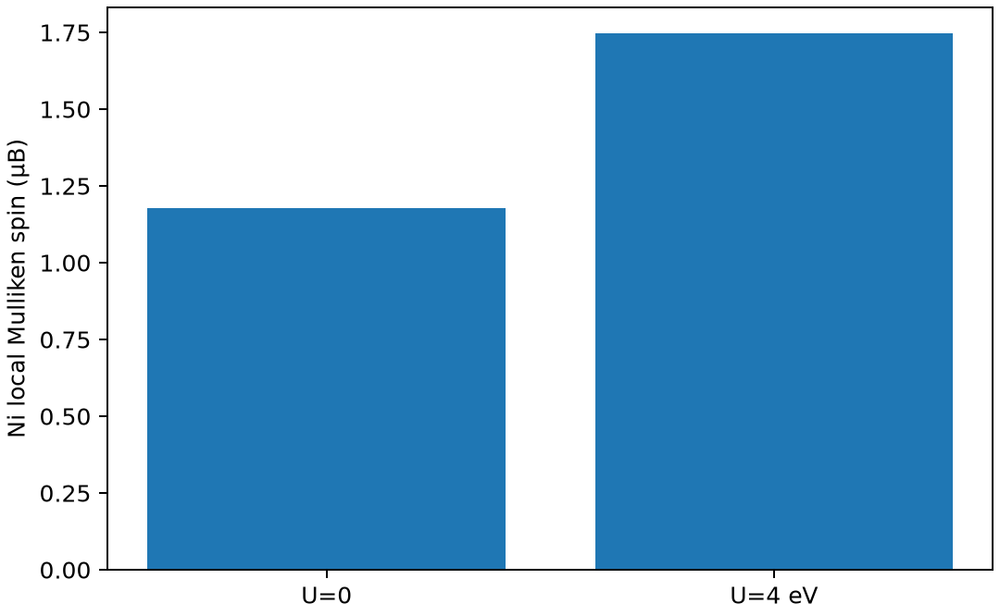

# OpenMX 的 DFT 加 U 计算

**适用环境：Linux + PBS 运行计算；Windows / macOS / Linux 可准备输入与分析结果。**

DFT+U 对选定局域轨道的占据加入修正，常用于 d/f 电子体系。它不只改变带隙，也可能改变磁态、轨道占据与结构。

## 方法与物理量

简化的旋转不变形式使用有效 U，常写为与 Tr[n−n²] 有关的修正。占据矩阵依赖投影定义，U 的数值也与轨道空间和方法相关；不能把其他软件/投影下的同名数值无条件移植。

OpenMX 4.0 还支持更一般的 U/J 与双计数形式。本例明确选 `scf.DFTU.Type 1` 和 `dual` 占据算符，不把不同算符与双计数方案混在一次对比中。

## 最小模型与输入

使用 NiO 双原子岩盐原胞，常规晶格常数 4.17 Å；固定铁磁初态，对比 U=0 与作用于 Ni 第一套 d 径向轨道的 U=4 eV。此最小胞不能描述 NiO 的真实 AFM-II 磁胞，目的在于学习投影和局域磁矩响应。

[案例目录](../../../examples/openmx/minimal/hubbard-u)包含以下科学输入：

[stages.json](../../../examples/openmx/minimal/hubbard-u/stages.json)、[u0.dat](../../../examples/openmx/minimal/hubbard-u/u0.dat)、[u4.dat](../../../examples/openmx/minimal/hubbard-u/u4.dat)。

结构写在坐标文件或各输入的原子/晶胞段；`stages.json` 列出计算阶段。配套 [run.py](../../../examples/openmx/minimal/hubbard-u/run.py) 顺序组织任务，[job.pbs](../../../examples/openmx/minimal/hubbard-u/job.pbs) 提交作业，[postprocess.py](../../../examples/openmx/minimal/hubbard-u/postprocess.py) 检查结果并绘图。

## 参数与提交

加载 OpenMX 4.0，设置 `OPENMX_DATA` 为包含 PAO、VPS 的 `DFT_DATA19` 路径。运行脚本仅替换输入中的数据库路径，不复制势和基组；每步单进程、单线程。

| 输入 | 含义 |
| --- | --- |
| `scf.Hubbard.U on` | 启用相应占据与修正流程 |
| `scf.DFTU.Type 1` | 简化 Dudarev 类形式 |
| `scf.Hubbard.Occupation dual` | 明确占据算符 |
| `Hubbard.U.values` | 为已定义的所有轨道逐项给值，单位 eV |
| 原子坐标末列 `on` | DFT+U 所需的逐原子轨道极化标志；遗漏可能使程序提前退出 |

不要只检查退出码；OpenMX 某些输入错误会返回零，仍需查正常结束和目标占据矩阵。

在干净案例目录安装[Python 依赖](../../../examples/openmx/minimal/hubbard-u/requirements.txt)并提交：

```bash
python3 -m pip install -r requirements.txt
qsub job.pbs
```

PBS 中的资源语法和软件加载方式按集群调整。计算结束后自动执行后处理；若只分析已保存的结果，运行 `python3 postprocess.py`。各阶段独立保存输出，便于定位失败步骤。

## 结果与判断

后处理核对 SCF 与 `Occupation Number in LDA+U` 输出，并比较 Ni 的局域磁矩。图展示同一铁磁最小模型中 U 对局域自旋分布的影响；O 也可能带有诱导磁矩。

本例 Ni 的局域磁矩从 U=0 时约 1.1784 μB 增至 U=4 eV 时约 1.7457 μB；这对应当前铁磁最小模型。

跨 U 的绝对总能不应被用来“选出能量最低的最佳 U”。需要根据物理问题、线性响应/文献依据及可验证物性选择参数，再比较同一 U 下的竞争态。



图由案例后处理脚本读取实际计算输出生成。

## 扩展到实际研究

实际 NiO 研究应采用合适 AFM 磁胞，收敛基组、网格、k 点并尝试不同轨道/磁性初态。需要解释带隙变化时，另输出自旋分辨能带/PDOS，核对局域轨道字符，而非只根据局域磁矩判断是否打开带隙。

参考：[OpenMX 4.0 DFT+U](https://openmx-square.org/openmx_man4.0/s40_1_standard.html)。
