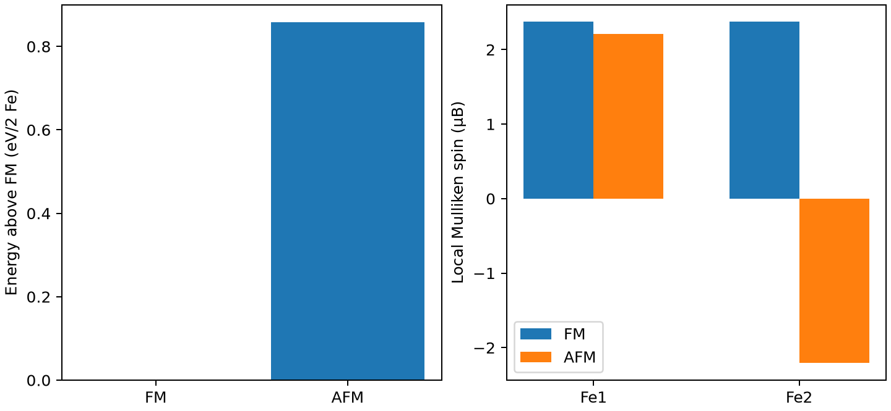

# OpenMX 磁序与局域磁矩

**适用环境：Linux + PBS 运行计算；Windows / macOS / Linux 可准备输入与分析结果。**

磁性计算要比较多个合理磁序，并确认自洽后仍处于目标态。输入的初始磁矩只是建立初猜，不代表最终局域磁矩被固定。

## 方法与物理量

共线自旋在同一量子化轴上描述上下自旋电子。原子输入中的两列电子数之和应与赝势价电子相容，其差用于构造初始磁矩；最终自旋密度由自洽决定。

总磁矩接近零既可能是反铁磁，也可能是非磁态。应同时查看各磁性原子的局域磁矩与空间排列。Mulliken 局域磁矩依赖局域基组与分区方式，跨软件比较时尤其要说明定义。

## 最小模型与输入

使用 a=2.86 Å 的 bcc Fe 常规双原子胞，PBE、Fe6.0S-s2p2d1 与 Fe_PBE19S。FM 分支两原子初始为 9/5，AFM 分支第二原子改为 5/9；所选势每个 Fe 显式含 14 个价电子。固定同一结构，比较两种磁排列。

[案例目录](../../../examples/openmx/minimal/magnetic-order)包含以下科学输入：

[afm.dat](../../../examples/openmx/minimal/magnetic-order/afm.dat)、[fm.dat](../../../examples/openmx/minimal/magnetic-order/fm.dat)、[stages.json](../../../examples/openmx/minimal/magnetic-order/stages.json)。

结构写在坐标文件或各输入的原子/晶胞段；`stages.json` 列出计算阶段。配套 [run.py](../../../examples/openmx/minimal/magnetic-order/run.py) 顺序组织任务，[job.pbs](../../../examples/openmx/minimal/magnetic-order/job.pbs) 提交作业，[postprocess.py](../../../examples/openmx/minimal/magnetic-order/postprocess.py) 检查结果并绘图。

## 参数与提交

加载 OpenMX 4.0，设置 `OPENMX_DATA` 为包含 PAO、VPS 的 `DFT_DATA19` 路径。运行脚本仅替换输入中的数据库路径，不复制势和基组；每步单进程、单线程。

| 设置 | 本例 | 注意事项 |
| --- | --- | --- |
| 自旋 | `scf.SpinPolarization on` | 共线；SOC 关闭 |
| k 点 | 4×4×4 | 金属需与电子温度联合收敛 |
| 电子温度 | 300 K | 占据展宽，不等于模拟有限温度磁相变 |
| SCF | 1e−8 Hartree | 核对每个分支最后的 dUele 与残差 |
| 几何 | 同一晶胞 | 比较固定结构能量，不混合弛豫约定 |

在干净案例目录安装[Python 依赖](../../../examples/openmx/minimal/magnetic-order/requirements.txt)并提交：

```bash
python3 -m pip install -r requirements.txt
qsub job.pbs
```

PBS 中的资源语法和软件加载方式按集群调整。计算结束后自动执行后处理；若只分析已保存的结果，运行 `python3 postprocess.py`。各阶段独立保存输出，便于定位失败步骤。

## 结果与判断

本例 FM 两个 Fe 局域磁矩均约 2.3744 μB；AFM 则约为 +2.2075/−2.2075 μB，总磁矩接近零。因此 AFM 分支确实保留了反平行局域磁矩。

在当前模型与粗网格下，AFM 比 FM 高约 0.8574 eV/双原子胞。图同时展示能量和局域磁矩，以免把一次零总磁矩计算误当作已验证的 AFM。



图由案例后处理脚本读取实际计算输出生成。

## 扩展到实际研究

扩大磁胞比较更多磁序，并检查结构、基组、k 点与展宽收敛。将能量差映射到 Heisenberg 模型时，要给出交换路径、自旋归一化、符号和重复计数约定；两态差值不能直接当作一个普适 J。OpenMX 可结合 TB2J 导出交换模型，再用 Vampire 等做统计模拟，接口依赖见[磁性工具笔记](../基础与结构/OpenMX与磁性计算工具安装.md)。

参考：[OpenMX 自旋与输入规则](https://openmx-square.org/openmx_man4.0/s8_2_keywords.html)。
