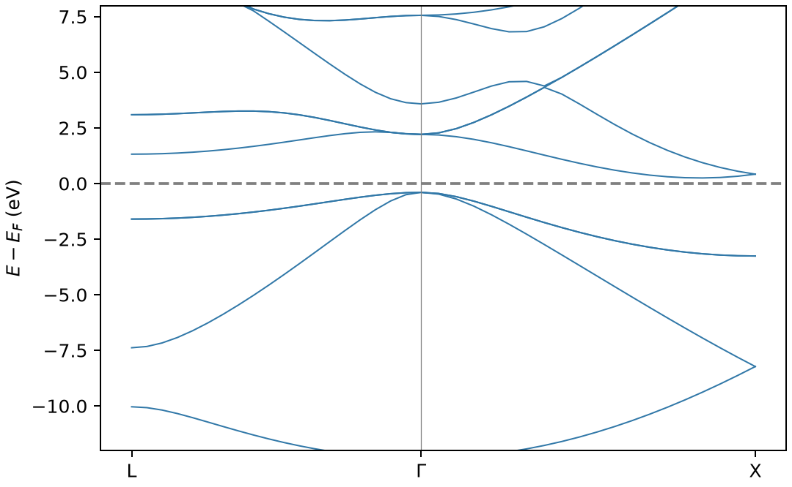

# OpenMX 能带计算

**适用环境：Linux + PBS 运行计算；Windows / macOS / Linux 可准备结构与分析结果。**

要看硅的价带与导带沿哪些方向接近，先在三维 k 网格上收敛电子态，再沿 L—Γ—X 追踪本征值。三维网格控制自洽积分，路径点控制曲线的取样密度。若想统计各能量上的态数，则沿同一结构改用[态密度采样](OpenMX态密度与投影态密度.md)。

## 一、Si 原胞与 L—Γ—X 路径

采用两个 Si 原子的金刚石原胞，常规晶格常数 5.43 Å；PBE、Si7.0-s2p2d1 与 Si_PBE19，SCF 网格 4×4×4。输入在完成 SCF 后输出 L—Γ—X 路径，每段 20 点。

路径坐标按当前原胞倒易矢量定义：L=(0.5,0.5,0.5)、Γ=(0,0,0)、X=(0,0.5,0.5)。更换晶胞后需重新生成/变换路径。可先用 VASPKIT、SeeK-path 等工具确认高对称点，再转换到 OpenMX 约定。

## 二、运行能带案例

在[案例目录](../../../examples/openmx/minimal/band-structure/README.md)中，OpenMX 读取 [system.dat](../../../examples/openmx/minimal/band-structure/system.dat)，[structure.cif](../../../examples/openmx/minimal/band-structure/structure.cif) 供查看几何。

在集群加载 OpenMX，并将 `OPENMX_DATA` 设为安装中的 `DFT_DATA19` 目录；其中应包含所选 PAO 和 VPS。势与基组由安装提供，案例不附带这些数据。`run.py` 将输入中的 `@DATA_PATH@` 替换为该目录，生成 `runtime.dat`；结构和电子参数均来自 `system.dat`。

在案例目录安装 [Python 依赖](../../../examples/openmx/minimal/band-structure/requirements.txt)并提交 [job.pbs](../../../examples/openmx/minimal/band-structure/job.pbs)：

```bash
python3 -m pip install -r requirements.txt
qsub job.pbs
```

作业结束后会自动执行后处理。重新分析已有输出时，可单独运行 `python3 postprocess.py`。PBS 中的软件加载方式与资源语法按集群配置调整；此例不需要多节点。

## 三、区分 SCF 网格与能带路径

| 设置 | 作用 |
| --- | --- |
| `scf.EigenvalueSolver Band` | 周期求解器 |
| `scf.Kgrid 4 4 4` | SCF 积分网格，与路径点数独立 |
| `Band.dispersion on` | 输出能带 |
| `Band.Nkpath` / `Band.kpath` | 路径段数、各段点数、端点与标签 |

正式任务应收敛 PAO、网格和 k 点，并用目标方法优化或确认结构。

## 四、怎样读这张能带图

[后处理脚本](../../../examples/openmx/minimal/band-structure/postprocess.py)读取原生 `system.Band` 中的费米能、倒易矢量和本征值，将 Hartree 转为 eV，横轴按倒空间距离累计。图中零点为该计算的费米能。

本例是非自旋极化的两原子 Si 原胞，8 个价电子填满四条带。脚本沿整条路径取第 5 条带的最低值，减去第 4 条带的最高值，得到约 0.6470 eV。两个极值可以来自不同的 k 点。这一数值只对应当前路径、方法与粗采样；要确定整个布里渊区的带边，还需进一步采样，与实验准粒子带隙比较时也要区分计算方法。



分析金属时需更多能带与密集采样；SOC/非共线结果还涉及自旋器和能带排序，本例解析器只针对非自旋极化输出。

进一步了解方法与文件规则，可看[OpenMX 基础知识](../基础与结构/OpenMX基础知识.md)。参考：[OpenMX 输出文件](https://openmx-square.org/openmx_man4.0/s9_output-files.html)。
