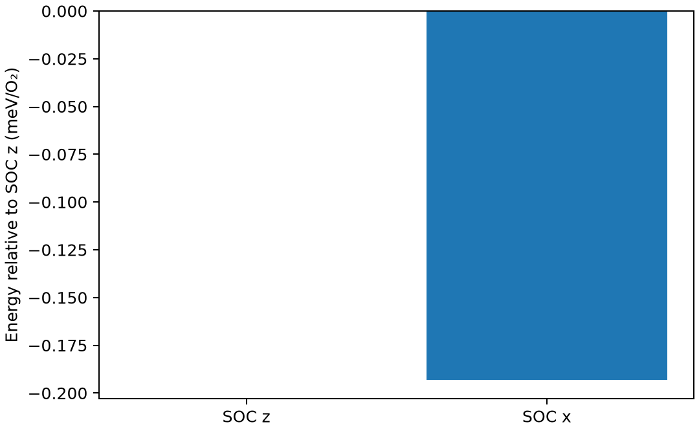

# OpenMX 非共线磁性与自旋轨道耦合

**适用环境：Linux + PBS 运行计算；Windows / macOS / Linux 可准备输入与分析结果。**

非共线计算允许自旋密度方向随空间变化，SOC 进一步耦合自旋与轨道。启用非共线并不自动等于启用 SOC，也不意味着给定的初始方向被硬性约束。

## 自旋方向与 SOC 是两项设置

OpenMX 用两分量自旋器描述非共线态。原子坐标后的角度用于定义局域场/自旋与轨道的初始方向；角度、投影和全局坐标应按 OpenMX 约定解释，不能照搬其他软件的 `MAGMOM` 格式。

磁各向异性能来自含 SOC 时不同磁化方向的微小能量差；它通常比普通结构能量差更难收敛。如果方向在 SCF 中旋转，比较的就未必是原先指定的方向。

## 用 O₂ 比较三个自旋设置

用键长 1.21 Å 的 O₂ 三重态演示，置于 12 Å 盒子，采用 PBE、O6.0-s2p2d1 与 O_PBE19，`Cluster` 求解器。两个 O 初始上下自旋电子数均为 3.5/2.5，总初始自旋矩为 2 μB。分子轴沿 z，比较无 SOC、SOC 自旋沿 z 和 SOC 自旋沿 x。

三分支使用相同几何、200 Ry 网格、300 K 电子温度与 1e−9 Hartree SCF 标准。均为非共线模式，并施加 0.5 eV 系数的原子自旋方向约束，使分子中的方向比较具有明确含义。

[案例目录](../../../examples/openmx/minimal/noncollinear-soc)包含以下科学输入：

[no-soc.dat](../../../examples/openmx/minimal/noncollinear-soc/no-soc.dat)、[soc-x.dat](../../../examples/openmx/minimal/noncollinear-soc/soc-x.dat)、[soc-z.dat](../../../examples/openmx/minimal/noncollinear-soc/soc-z.dat)、[stages.json](../../../examples/openmx/minimal/noncollinear-soc/stages.json)。

结构写在坐标文件或各输入的原子/晶胞段；`stages.json` 列出计算阶段。配套 [run.py](../../../examples/openmx/minimal/noncollinear-soc/run.py) 顺序组织任务，[job.pbs](../../../examples/openmx/minimal/noncollinear-soc/job.pbs) 提交作业，[postprocess.py](../../../examples/openmx/minimal/noncollinear-soc/postprocess.py) 检查结果并绘图。

## 方向约束与计算设置

加载 OpenMX 4.0，设置 `OPENMX_DATA` 为包含 PAO、VPS 的 `DFT_DATA19` 路径。运行脚本仅替换输入中的数据库路径，不复制势和基组；每步单进程、单线程。

| 设置 | 作用 |
| --- | --- |
| `scf.SpinPolarization NC` | 非共线自旋器 |
| `scf.SpinOrbit.Coupling on/off` | 独立控制 SOC |
| 原子角度 | z 用 θ=0°，x 用 θ=90°、φ=0° |
| `rmm-diis` | 本例的混合方案；不能假设某个方案对所有磁性体系都稳定 |
| 第 12 列 / 第 13 列 | `1` 选择施加方向约束的原子；`off` 是 DFT+U 轨道极化标志，不是方向约束开关 |
| `scf.Constraint.NC.Spin` / `.v` | `on` / 0.5 eV；后处理同时核对约束能 |

SCF 判据是此处电子能量变化；同时保留密度残差，避免将输出终止等同于充分自洽。

在干净案例目录安装[Python 依赖](../../../examples/openmx/minimal/noncollinear-soc/requirements.txt)并提交：

```bash
python3 -m pip install -r requirements.txt
qsub job.pbs
```

PBS 中的资源语法和软件加载方式按集群调整。计算结束后自动执行后处理；若只分析已保存的结果，运行 `python3 postprocess.py`。各阶段独立保存输出，便于定位失败步骤。

## 检查最终方向、约束能和能量差

后处理先检查三个分支是否正常结束、电子能量变化是否达到各自阈值，再提取总磁矩、局域磁矩以及 SOC-x 与 SOC-z 的能量差。

本例最终总自旋矩约 2 μB。z/x 分支的最终 θ 分别接近 0°/90°，在打印精度下约束能为零；扣除约束项后，x−z 约为 −0.1933 meV/O₂。图中同时给出方向与能量，便于核对输入和结果的对应关系。

当前基组、网格与占据设置用于验证流程，图中的方向差尚不是收敛的分子磁各向异性参数。正式比较时，需要核对最终 θ/φ，并扣除或控制方向约束的罚能影响。

另一个容易混淆之处是方向约定：OpenMX 输出的自旋/轨道磁矩方向与电子物理磁矩的方向符号相反。与其他程序比较矢量前，应先统一定义。



图由案例后处理脚本读取实际计算输出生成。

## 扩展到实际研究

正式计算逐步加密 k 点、降低并收敛电子展宽，检查 PAO、网格和 SCF 噪声。计算 DMI、交换张量或复杂自旋纹理时，要进一步明确哈密顿量、旋转约定和采样模型；本例没有计算 DMI，也不从一个 SOC 能量差推出居里温度。

参考：[OpenMX 非共线 DFT](https://openmx-square.org/openmx_man4.0/s37_ncl-dft.html)。
