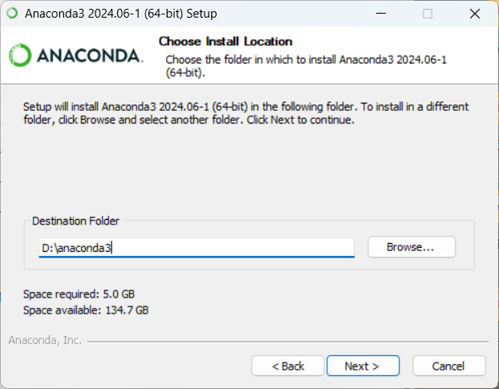
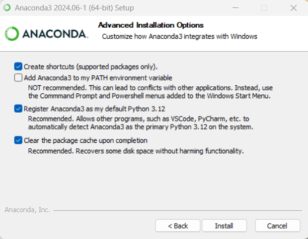
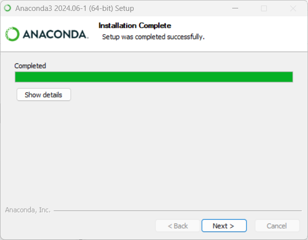
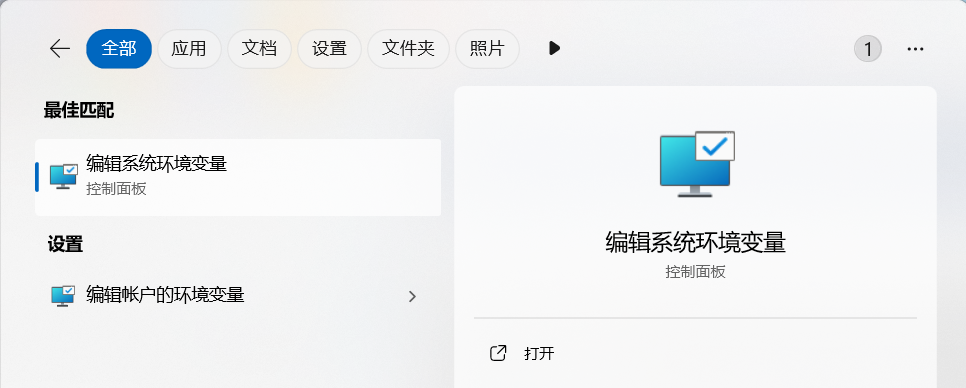
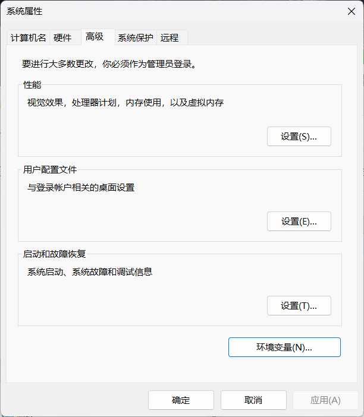
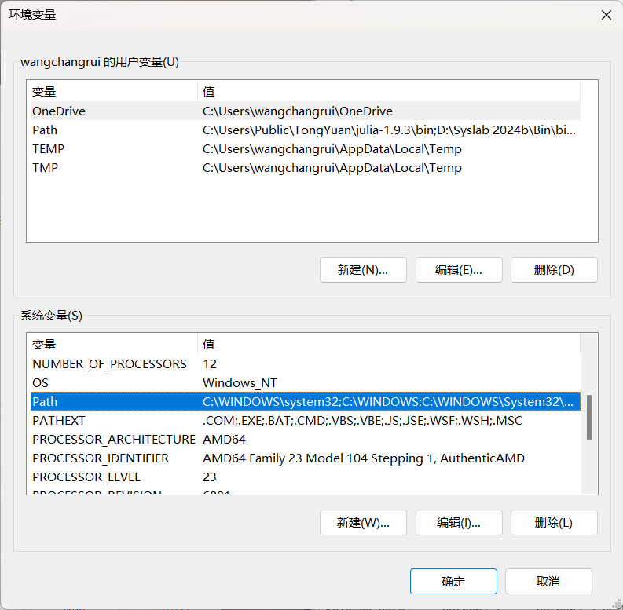
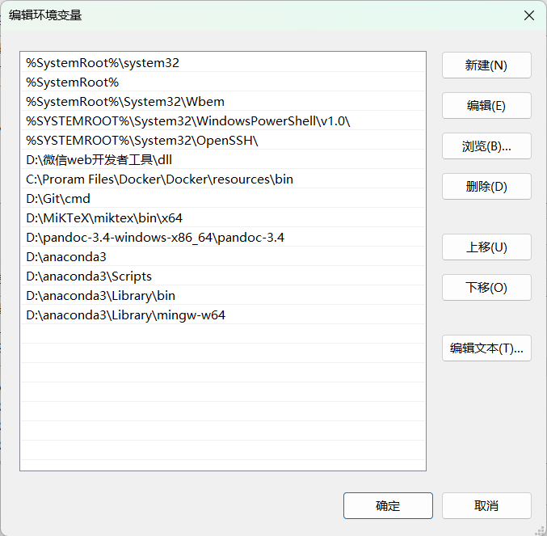

# Anaconda 安装

**适用环境：Windows；保留 Anaconda 图形安装示例。跨平台环境管理见 [Anaconda、Miniconda、Mamba](../../getting-started/Anaconda、Miniconda、Mamba安装与使用.md)。**

## Windows 系统安装 Anaconda

从 [Anaconda 官网](https://www.anaconda.com/download/) 下载 Windows 安装程序。运行安装向导，选择 **Just Me**，设置安装目录（如 `D:\anaconda3`），并按图选择安装选项。

<div align="left">



</div>

安装后优先使用开始菜单中的 Anaconda Prompt。下面保留此前手动配置 PATH 的界面供识别；通常无需将整套 Anaconda 路径加入系统 PATH，以免影响其他 Python。

<div align="left">




</div>

## 创建环境并运行 Jupyter

在 Anaconda Prompt 中执行，不需要管理员权限：

```bash
conda --version
conda create -n notebook-demo python=3.12 jupyter
conda activate notebook-demo
python -c "import sys; print(sys.executable)"
jupyter notebook
```

浏览器打开后可以新建 Notebook。结束时在启动 Jupyter 的终端按 `Ctrl+C` 并按提示确认停止，关闭浏览器标签页不等于停止服务器。

## 安装第三方库

以 ASE 为例，在已激活的目标环境中执行：

```bash
python -m pip install ase
python -m pip check
python -c "import ase; print(ase.__version__)"
```

Linux / Mac 安装、Mamba、环境导出与离线准备见 [Conda 环境管理](../../getting-started/Anaconda、Miniconda、Mamba安装与使用.md)，依赖安装和 uv 项目管理见 [pip 与 uv](../../getting-started/pip与uv安装与使用.md)。

`--no-deps` 会跳过依赖安装，并非避免版本冲突的通用办法；`pip freeze` 是环境快照，不保证重新安装后能完整恢复系统库或消除多余包。正式复现应保留环境声明并在独立环境检查。
