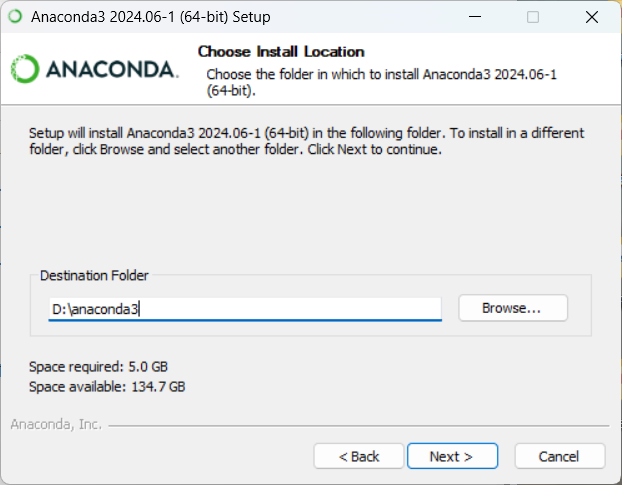
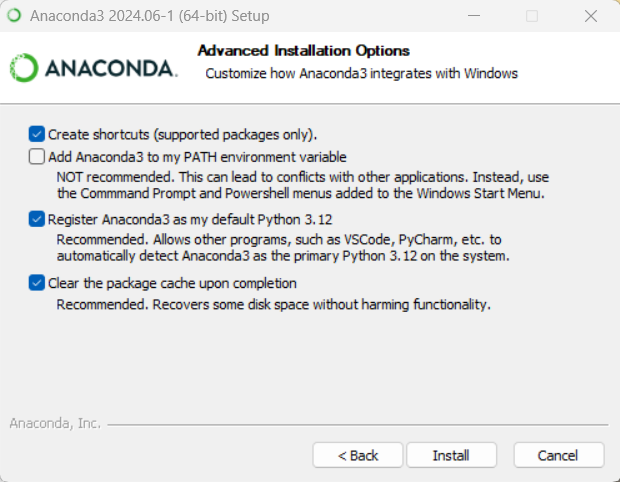
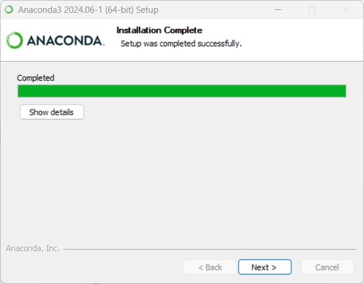
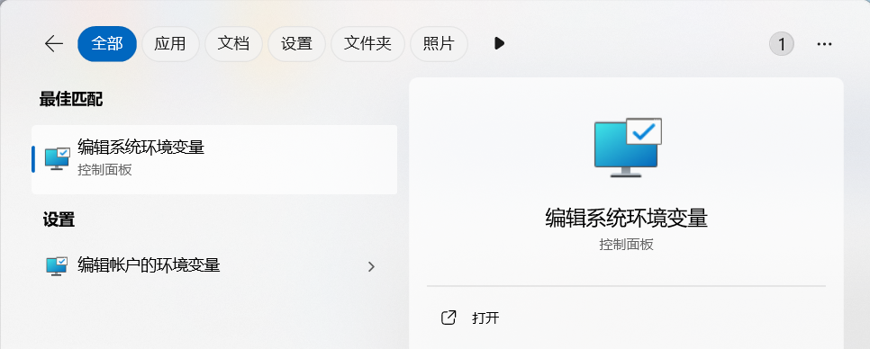
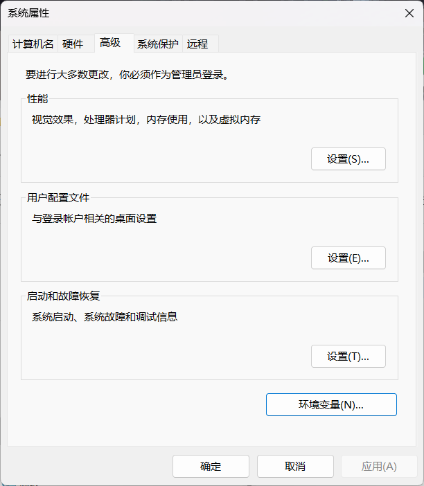
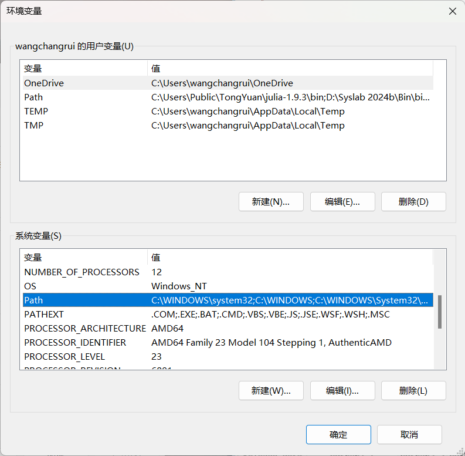
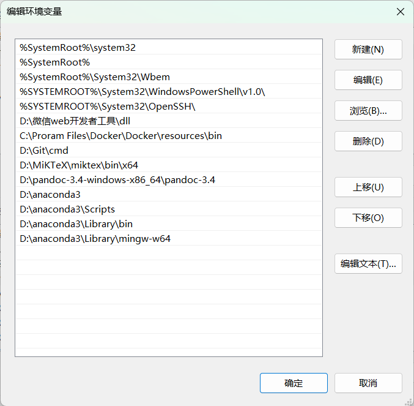

# Anaconda 安装

在 Windows 上第一次跑手册里的绘图示例，常见的问题是包装好了，脚本或 Notebook 却找不到它。先用独立环境跑通导入，再核对终端和 Notebook 实际用的是哪个 Python。已经有可用的 Conda 时，可以直接从创建环境开始。跨平台安装与环境选择见 [Conda 环境管理](../../getting-started/Anaconda、Miniconda、Mamba安装与使用.md)。

## 一、在 Windows 上安装并找到 Anaconda Prompt

从 [Anaconda 官网](https://www.anaconda.com/download/) 下载 Windows 安装程序。运行安装向导，选择 **Just Me**，设置安装目录（如 `D:\anaconda3`），并按图选择安装选项。

<div align="left">



</div>

安装后优先使用开始菜单中的 Anaconda Prompt。下面保留此前手动配置 PATH 的界面供识别；通常无需将整套 Anaconda 路径加入系统 PATH，以免影响其他 Python。

<div align="left">




</div>

## 二、用同一路径核对终端和 Notebook

在 Anaconda Prompt 中执行，不需要管理员权限：

```bash
conda --version
conda create -n notebook-demo python=3.12 jupyter
conda activate notebook-demo
python -c "import sys; print(sys.executable)"
jupyter notebook
```

浏览器打开后新建 Notebook，运行 `import sys; print(sys.executable)`，与启动前在终端打印的路径比较。若路径不同，先切换到对应环境的内核。终端能导入包而 Notebook 提示 `ModuleNotFoundError` 时，这一步能帮你判断包是否装在了另一个环境里。结束时在启动 Jupyter 的终端按 `Ctrl+C` 并按提示确认停止，关闭浏览器标签页不等于停止服务器。

## 三、按任务安装依赖并检查导入

以 ASE 为例，在已激活的目标环境中执行：

```bash
python -m pip install ase
python -m pip check
python -c "import ase; print(ase.__version__)"
```

`python -m pip` 使用当前解释器调用 pip。`pip check` 检查已安装包声明的依赖，后面的导入测试确认当前解释器能加载 ASE。若只是做[体积—能量绘图练习](科研数据读写与绘图.md)，按那篇的依赖安装并检查对应库即可。项目采用 uv 时，见 [pip 与 uv](../../getting-started/pip与uv安装与使用.md)。

`--no-deps` 会跳过依赖安装，并非避免版本冲突的通用办法；`pip freeze` 是环境快照，不保证重新安装后能完整恢复系统库或消除多余包。正式复现应保留环境声明并在独立环境检查。
