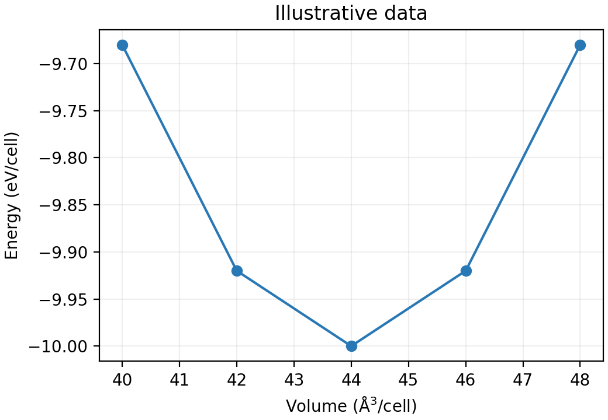

# 科研数据读写与绘图

**适用环境：Windows、macOS、Linux；Python + NumPy + pandas + Matplotlib。**

以 GeTe 的体积—能量数据为例，先把列名、单位与数据来源写清，再读取、检查和画图。下面使用人工演示数据，不是实际 DFT 计算结果。

## 一、准备环境与输入

在自己的 Python 环境执行：

```bash
python -m pip install numpy pandas matplotlib
```

新建一个练习目录，将下面内容保存为 `energy.csv`：

```csv
volume_A3,energy_eV
40,-9.68
42,-9.92
44,-10.00
46,-9.92
48,-9.68
```

这里的体积和能量都按同一个演示晶胞计，不是每原子值。真实数据比较时保持原子数、计算设置和归一化方式一致。

## 二、读取并检查

将下面两个代码块依次保存为 `plot_energy.py`：

```python
from pathlib import Path
import numpy as np
import pandas as pd
import matplotlib.pyplot as plt

root = Path(__file__).resolve().parent
data = pd.read_csv(root / "energy.csv")
columns = ["volume_A3", "energy_eV"]
if not set(columns).issubset(data.columns):
    raise ValueError(f"required columns: {columns}")
for column in columns:
    data[column] = pd.to_numeric(data[column], errors="raise")
if not np.isfinite(data[columns].to_numpy()).all():
    raise ValueError("input contains missing or non-finite values")
if (data["volume_A3"] <= 0).any():
    raise ValueError("volume must be positive")
if data["volume_A3"].duplicated().any():
    raise ValueError("duplicate volumes: inspect repeated calculations first")
data = data.sort_values("volume_A3")
best = data.loc[data["energy_eV"].idxmin()]
print("sampled minimum:", best.to_dict())
```

`Path(__file__)` 按脚本所在目录找输入，不依赖终端当前目录。这个练习只接受每个体积一个记录；真实重复计算应先明确平均或保留规则，不能随手删掉重复行。

## 三、绘图并另存数据

```python
fig, ax = plt.subplots(figsize=(5.2, 3.6), constrained_layout=True)
ax.plot(data["volume_A3"], data["energy_eV"], "o-", color="#2878B5")
ax.set_xlabel(r"Volume ($\mathrm{\AA}^3$/cell)")
ax.set_ylabel("Energy (eV/cell)")
ax.set_title("Illustrative data")
ax.grid(alpha=0.2)
output = root / "outputs"
output.mkdir(exist_ok=True)
fig.savefig(output / "energy-volume.png", dpi=200)
fig.savefig(output / "energy-volume.pdf")
plt.close(fig)
data.to_csv(output / "energy-sorted.csv", index=False)
```

运行 `python plot_energy.py`，应得到采样最低点 `44 ų/cell、-10 eV/cell`，以及 `outputs` 下的图片、PDF 和排序后的表格。



连线仅帮助阅读，不是状态方程拟合。采样最低点也不是拟合平衡体积；要提取体模量等参数，需要选择合适的状态方程并核对拟合范围、单位和误差。

## 四、批量读取时保留来源

多个计算目录中提取数值时，在汇总表加入 `source_file`、计算条件和单位。没有读到能量时保留明确的失败或缺失记录，不把失败计算填成零。

小 CSV 用标准库 `csv` 也能处理；更复杂的表格可用 pandas。大轨迹和原子结构优先用计算软件或 ASE、OVITO 等格式解析器，不用自行按固定行号截取。

参考：[pandas CSV 读取](https://pandas.pydata.org/docs/reference/api/pandas.read_csv.html)、[Matplotlib 入门](https://matplotlib.org/stable/users/explain/quick_start.html)、[pathlib](https://docs.python.org/3/library/pathlib.html)。
