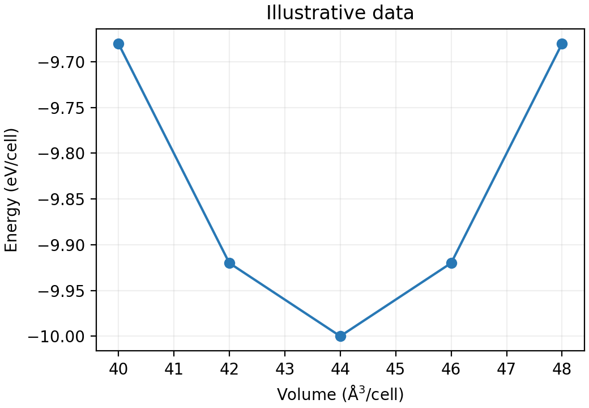

# 科研数据读写与绘图

从几个计算目录收集体积和能量后，最先要确认的是这批点能否画在同一张图上。晶胞大小、计算设置或归一化口径一旦混用，程序照样能连出一条曲线。本文用一组人工构造的 GeTe 体积—能量数据，在 Windows、macOS 或 Linux 上演示从原始表格到可追溯图件的过程。

## 一、在表格里先写清体积和能量的口径

在自己的 Python 环境执行：

```bash
python -m pip install numpy pandas matplotlib
```

新建一个练习目录，将下面内容保存为 `energy.csv`：

```csv
volume_A3,energy_eV
40,-9.68
42,-9.92
44,-10.00
46,-9.92
48,-9.68
```

这里的体积和能量都按演示晶胞计。真实计算若混用了原胞和超胞，先查清各自的原子数和能量设置，再决定是否能统一换算到每原子或每化学式单位。

## 二、让脚本在画图前发现坏数据

将下面两个代码块依次保存为 `plot_energy.py`：

```python
from pathlib import Path
import numpy as np
import pandas as pd
import matplotlib.pyplot as plt

root = Path(__file__).resolve().parent
data = pd.read_csv(root / "energy.csv")
columns = ["volume_A3", "energy_eV"]
if not set(columns).issubset(data.columns):
    raise ValueError(f"required columns: {columns}")
for column in columns:
    data[column] = pd.to_numeric(data[column], errors="raise")
if not np.isfinite(data[columns].to_numpy()).all():
    raise ValueError("input contains missing or non-finite values")
if (data["volume_A3"] <= 0).any():
    raise ValueError("volume must be positive")
if data["volume_A3"].duplicated().any():
    raise ValueError("duplicate volumes: inspect repeated calculations first")
data = data.sort_values("volume_A3")
best = data.loc[data["energy_eV"].idxmin()]
print("sampled minimum:", best.to_dict())
```

`Path(__file__)` 按脚本所在目录找输入，不依赖终端当前目录。这个练习只接受每个体积一个记录；真实重复计算应先明确平均或保留规则，不能随手删掉重复行。

## 三、把图和实际使用的数据一起导出

```python
fig, ax = plt.subplots(figsize=(5.2, 3.6), constrained_layout=True)
ax.plot(data["volume_A3"], data["energy_eV"], "o-", color="#2878B5")
ax.set_xlabel(r"Volume ($\mathrm{\AA}^3$/cell)")
ax.set_ylabel("Energy (eV/cell)")
ax.set_title("Illustrative data")
ax.grid(alpha=0.2)
output = root / "outputs"
output.mkdir(exist_ok=True)
fig.savefig(output / "energy-volume.png", dpi=200)
fig.savefig(output / "energy-volume.pdf")
plt.close(fig)
data.to_csv(output / "energy-sorted.csv", index=False)
```

运行 `python plot_energy.py`，应得到采样最低点 `44 ų/cell、-10 eV/cell`，以及 `outputs` 下的图片、PDF 和排序后的表格。



从这张图可以读到最低的已采样点。点之间的线段用于引导视线。若要估计平衡体积或体模量，还要决定拟合模型与范围，并检查残差。下一篇用同一份 `energy.csv` 接着比较插值和拟合。见[科研数据的拟合、插值与残差](科研数据的拟合插值与残差.md)。

## 四、批量读取时保留来源

多个计算目录中提取数值时，在汇总表加入 `source_file`、计算条件和单位。没有读到能量时保留明确的失败或缺失记录，不把失败计算填成零。

小 CSV 用标准库 `csv` 也能处理；更复杂的表格可用 pandas。大轨迹和原子结构优先用计算软件或 ASE、OVITO 等格式解析器，不用自行按固定行号截取。

参考：[pandas CSV 读取](https://pandas.pydata.org/docs/reference/api/pandas.read_csv.html)、[Matplotlib 入门](https://matplotlib.org/stable/users/explain/quick_start.html)、[pathlib](https://docs.python.org/3/library/pathlib.html)。

## 五、图像不清晰时先查哪一层

能带、态密度和声子曲线优先保留 PDF 或 SVG 等矢量版本，供排版与后续编辑；PNG 便于在 GitHub 中预览。三维结构、密度等值面和连续场也可导出 PNG。文件扩展名不能保证内部全部为矢量对象，PDF 中的嵌入位图仍受像素数限制。

| 现象 | 优先检查 | 调整方式 |
| --- | --- | --- |
| 文字、线条放大后模糊 | 导出像素和最终显示尺寸 | 使用矢量输出，或按目标宽度重新导出位图 |
| 边缘出现压缩块、文字周围有噪点 | 是否经过 JPEG 或反复有损保存 | 从原始绘图重新导出 PNG，保留原文件 |
| 插入文档后变糊 | 文档软件是否降采样、再次压缩 | 核对插入前后的像素尺寸与导出设置 |
| 三维物体边缘呈锯齿 | 渲染采样与抗锯齿 | 使用程序的渲染导出，并提高采样或导出尺寸 |
| 等值面有棱角、窄连接断裂 | 原始场的网格间距及范围 | 检查更细网格的结果；放大截图不能补回场信息 |
| 原子太暗、太细或互相遮挡 | 光源、深度雾化、显示风格与视角 | 调整照明和球棍尺寸，必要时补充另一视角 |

位图是否清晰，要结合像素数和最终排版宽度判断。例如，1200 像素宽的图按 4 英寸宽放置，对应 300 ppi；只改 DPI 元数据不会增加图像细节。

[Matplotlib 的 `savefig`](https://matplotlib.org/stable/api/_as_gen/matplotlib.pyplot.savefig.html)可以设置格式与 `dpi`。本例未额外裁剪的 PNG，以 `5.2 × 3.6` 英寸和 `200 dpi` 导出，约为 `1040 × 720` 像素。提高 `dpi` 主要增加位图或矢量文件中栅格化对象的采样。

在最终使用尺寸下检查坐标、单位、图例和最细曲线，再检查导出的文件。用图片编辑器插值放大、平滑等值面或提高渲染分辨率，都不能增加原始计算的采样精度；等值面定量比较仍需检查[原始网格与阈值的收敛](../计算化学/等值面面积、体积与网格收敛.md)。保留数据和绘图脚本，使清晰度调整可以从源头重做。
