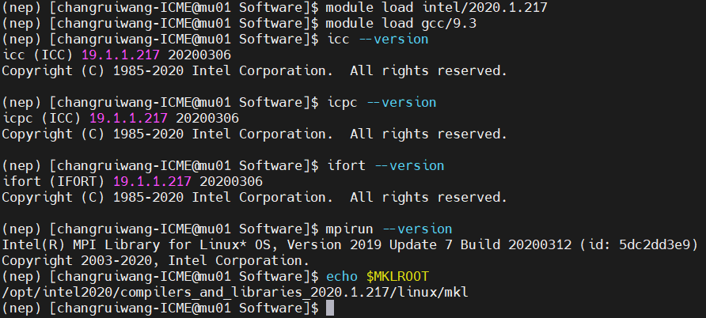

# QE 编译

**适用环境：Linux 集群。**

需要复现 QE 7.3.1 的计算时，可以沿用下面的 Intel MPI 与 MKL 配置。编译后先用硅原胞跑通 `pw.x`，再检查研究所需的后处理程序是否齐全。

## 一、确认编译器、MPI 与 MKL 来自配套环境

下面保留集群 3 的 QE 7.3.1 编译记录，编译器版本、路径和节点名对应当时环境；在其他集群使用时需相应替换。先用 `ssh cu02` 进入编译节点，再加载编译环境：

```bash
module load intel/2020.1.217
module load gcc/9.3
```

执行以下命令查看编译环境是否加载成功：

```bash
icc --version
icpc --version
ifort --version
mpirun --version
echo $MKLROOT
```

核对编译器、MPI 版本与 MKL 路径，原环境的输出示例如下：

<div align="left">

</div>

## 二、配置链接库后再编译

访问 [QE 官网](https://www.quantum-espresso.org/) 下载 QE 安装包，以 `qe-7.3.1-ReleasePack.tgz` 为例。
依次执行以下命令：

```bash
tar -zvxf qe-7.3.1-ReleasePack.tgz
cd qe-7.3.1/
./configure --with-cuda=no --with-scalapack=intel --with-scalapack-qrcp=yes MPIF90=mpiifort FC=ifort FCFLAGS=-O3 CC=mpiicc CFLAGS=-O3
```

注意修改 `make.inc` 对应字段为以下内容：

```makefile
FFLAGS = -O3 -assume byterecl -g -traceback
BLAS_LIBS = -L${MKLROOT}/lib/intel64 -lmkl_scalapack_lp64 -lmkl_intel_lp64 -lmkl_sequential -lmkl_core -lmkl_blacs_intelmpi_lp64 -lpthread -lm -ldl
LAPACK_LIBS = -L${MKLROOT}/lib/intel64 -lmkl_scalapack_lp64 -lmkl_intel_lp64 -lmkl_sequential -lmkl_core -lmkl_blacs_intelmpi_lp64 -lpthread -lm -ldl
SCALAPACK_LIBS = -L${MKLROOT}/lib/intel64 -lmkl_scalapack_lp64 -lmkl_intel_lp64 -lmkl_sequential -lmkl_core -lmkl_blacs_intelmpi_lp64 -lpthread -lm -ldl
FFT_LIBS = -L${MKLROOT}/lib/intel64 -lmkl_scalapack_lp64 -lmkl_intel_lp64 -lmkl_sequential -lmkl_core -lmkl_blacs_intelmpi_lp64 -lpthread -lm -ldl
MPI_LIBS = -L/opt/intel2020/impi/2019.7.217/intel64/lib
```

保存后执行 `make all -j4`，并按分配的编译资源调整并发数。需要电子声子计算时再执行 `make epw`。

编译完成后，检查 `qe-7.3.1/bin` 中是否生成所需的 `.x` 可执行程序。完成操作后，用 `logout` 退出编译节点。

## 三、用硅原胞验收二进制与 MPI

先按[硅原胞 SCF 练习](QE基础知识.md)准备输入和 UPF，使用新编译的 `pw.x` 跑一个小任务。检查程序报告的版本、MPI 布局、电子收敛和 `si.save`。如果进程还没读到输入就退出，优先查 MPI 或动态库；如果输出报 UPF 找不到，按实际工作目录检查 `pseudo_dir`。

### PBS 启动示例

下面给出 QE 在集群 3 适用的 PBS 提交脚本：

```bash
#PBS -N qe
#PBS -l nodes=1:ppn=24
#PBS -l walltime=600:00:00
#PBS -q batch
#PBS -V
#PBS -S /bin/bash

export MODULEPATH=/opt/modulefiles
module load intel/2020.1.217
module load gcc/9.3

NP=$(wc -l < "$PBS_NODEFILE")
cd "$PBS_O_WORKDIR" || exit 1
ulimit -s unlimited

EXEC=/home/your-user/Software/qe-7.3.1/bin/pw.x
mpirun -machinefile "$PBS_NODEFILE" -np "$NP" "$EXEC" -in pw.inp > output
```

## 四、让 UPF 文件与输入对应

[QE 官网](https://www.quantum-espresso.org/pseudopotentials/) 给出了 SSSP 赝势的下载链接，赝势文件可以直接下载。
以 `SSSP_1.3.0_PBE_efficiency.tar.gz` 为例，下载后上传到集群，解压到统一的赝势目录，并在输入中指定该路径。
