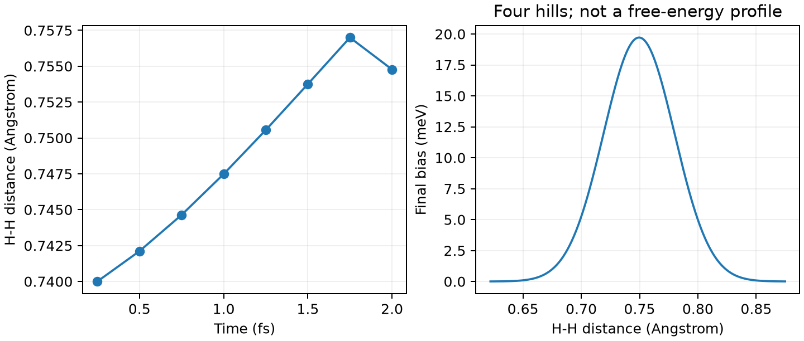

# VASP Metadynamics 元动力学

**适用环境：Linux + PBS（VASP）；Windows / macOS / Linux 可绘图。**

Metadynamics 在选定集体变量上不断加入高斯偏置，帮助体系离开已访问区域。集体变量应能区分关注的亚稳态；选错变量，即使不断加丘也未必能促进相关慢过程。

## 给 H—H 距离加偏置

[最小案例](../../../examples/vasp/minimal/metadynamics)采用 [H₂ 结构](../../../examples/vasp/minimal/metadynamics/POSCAR)和 [Γ 点](../../../examples/vasp/minimal/metadynamics/KPOINTS)。[ICONST](../../../examples/vasp/minimal/metadynamics/ICONST)为：

```text
R 1 2 5
```

末尾 `5` 指定该距离为 Metadynamics 集体变量，不再是固定键长约束。[INCAR](../../../examples/vasp/minimal/metadynamics/INCAR)采用 VASP 6 的 `MDALGO=1`、100 K Andersen 温控，并设置：

```text
HILLS_H = 0.005
HILLS_W = 0.03
HILLS_BIN = 2
```

高斯丘高度为 0.005 eV，宽度为 0.03 Å，每两步加一次。步长 0.25 fs、共 8 步；如此密集加丘仅便于观察功能，生产采样的加丘间隔通常应明显长于 MD 步长，并依据体系弛豫时间选择。

准备授权 H `POTCAR`，安装 [依赖](../../../examples/vasp/minimal/metadynamics/requirements.txt)，加载具备高级 MD 功能的 VASP 后执行 `qsub job.pbs`（[PBS 文件](../../../examples/vasp/minimal/metadynamics/job.pbs)）。

## 轨迹、偏置与自由能

[后处理](../../../examples/vasp/minimal/metadynamics/postprocess.py)检查逐步 SCF、`REPORT` 的偏置记录，以及 `HILLSPOT` 中四个高斯丘的中心、高度和宽度。[plot.py](../../../examples/vasp/minimal/metadynamics/plot.py)绘出实际键长和由高斯丘重建的最终偏置。



本例键长约在 0.740—0.757 Å 之间变化，展示了短轨迹中的集体变量与偏置记录。右图为四个高斯丘叠加的最终偏置；收敛自由能和解离过程需要充分采样后另行分析。

生产计算需先明确目标亚稳态，测试变量、丘高、丘宽和采样长度，检查反复跨越与独立重复。续算时应同步保留结构、速度、温控状态及偏置历史；VASP 可用 `HILLSPOT` 作为续算的 `PENALTYPOT`，避免丢掉已累积偏置。

参考：[VASP Metadynamics 操作](https://vasp.at/wiki/Metadynamics_calculations)、[HILLS_H](https://vasp.at/wiki/HILLS_H)、[HILLS_W](https://vasp.at/wiki/HILLS_W)。
