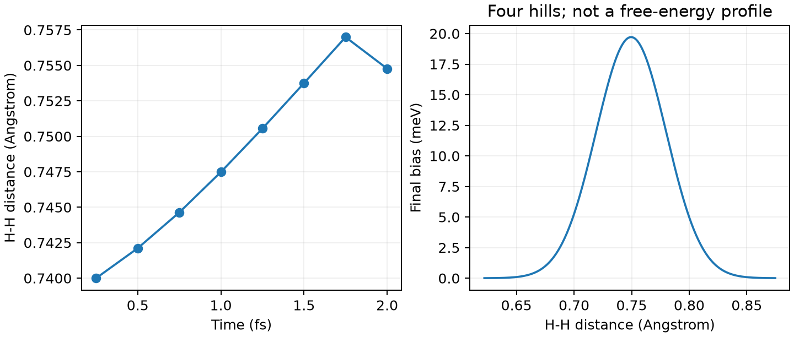

# VASP Metadynamics 元动力学

**适用环境：Linux + PBS（VASP）；Windows / macOS / Linux 可绘图。**

在[约束 MD](VASP约束分子动力学.md)的 H₂ 案例中，键长始终固定在初始值。若想让键长继续涨落，同时减少体系停留在已访问距离的时间，可以改用元动力学，为每次访问累积偏置。正式采样前，先确认所选变量能区分关心的亚稳态。

## 一、从固定键长改为沿距离加丘

[最小案例](../../../examples/vasp/minimal/metadynamics)采用 [H₂ 结构](../../../examples/vasp/minimal/metadynamics/POSCAR)和 [Γ 点](../../../examples/vasp/minimal/metadynamics/KPOINTS)。[ICONST](../../../examples/vasp/minimal/metadynamics/ICONST)为：

```text
R 1 2 5
```

末尾 `5` 指定该距离为 Metadynamics 集体变量，不再是固定键长约束。[INCAR](../../../examples/vasp/minimal/metadynamics/INCAR)采用 VASP 6 的 `MDALGO=1`、100 K Andersen 温控，并设置：

```text
HILLS_H = 0.005
HILLS_W = 0.03
HILLS_BIN = 2
```

高斯丘高度为 0.005 eV，宽度为 0.03 Å，每两步加一次。步长 0.25 fs、共 8 步，即每隔 0.5 fs 加丘，最终应记录四条；如此密集加丘仅便于观察功能，生产采样的加丘间隔通常应明显长于 MD 步长，并依据体系弛豫时间选择。

准备授权 H `POTCAR`，安装 [依赖](../../../examples/vasp/minimal/metadynamics/requirements.txt)，加载具备高级 MD 功能的 VASP 后执行 `qsub job.pbs`（[PBS 文件](../../../examples/vasp/minimal/metadynamics/job.pbs)）。

## 二、把四条丘记录还原成最终偏置

[后处理脚本](../../../examples/vasp/minimal/metadynamics/postprocess.py)会检查每一步的 SCF 收敛情况、`REPORT` 中的偏置记录，以及 `HILLSPOT` 中四个高斯丘的中心、高度和宽度，再由 [plot.py](../../../examples/vasp/minimal/metadynamics/plot.py) 绘出实际键长与由高斯丘重建的最终偏置。



本例键长约在 0.740—0.757 Å 之间变化，展示了短轨迹中的集体变量与偏置记录。右图在每个距离上将四条丘记录分别代入高斯函数，再求和。本例键长的全程变化约 0.017 Å，小于单丘宽度 0.03 Å，四条丘仍集中在同一段距离。要讨论解离或重建自由能，需先采到目标状态间的反复跨越。

生产计算需先明确目标亚稳态，测试变量、丘高、丘宽和采样长度，检查反复跨越与独立重复。续算时应同步保留结构、速度、温控状态及偏置历史；VASP 可用 `HILLSPOT` 作为续算的 `PENALTYPOT`，避免丢掉已累积偏置。

参考：[VASP Metadynamics 操作](https://vasp.at/wiki/Metadynamics_calculations)、[HILLS_H](https://vasp.at/wiki/HILLS_H)、[HILLS_W](https://vasp.at/wiki/HILLS_W)。
