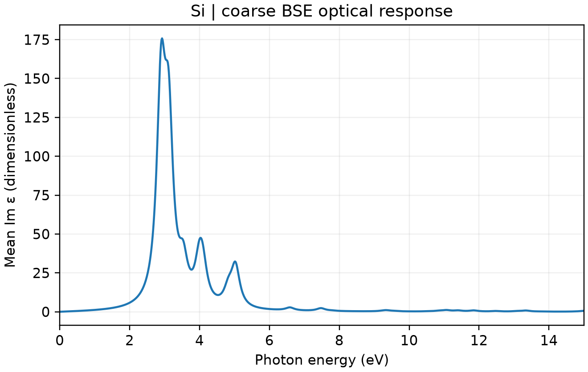

# VASP BSE 光学响应

**适用环境：Linux + PBS（支持 GW/BSE 的 VASP）；Windows / macOS / Linux 可绘图。**

已有硅的独立粒子光谱，想进一步判断电子与空穴相互作用怎样改变谱线，可以求解 Bethe–Salpeter 方程（BSE）。这一步需要准粒子能级和相容的屏蔽库仑核。下面用一套硅输入说明如何从 GW 交接到 BSE，再读出可比较的介电谱。

## 一、把硅的波函数和屏蔽核交给 BSE

[最小案例](../../../examples/vasp/minimal/bse-optics)包含 [POSCAR](../../../examples/vasp/minimal/bse-optics/POSCAR)、[KPOINTS](../../../examples/vasp/minimal/bse-optics/KPOINTS)，以及 [PBE](../../../examples/vasp/minimal/bse-optics/INCAR.scf)、[空带对角化](../../../examples/vasp/minimal/bse-optics/INCAR.exact)、[GW](../../../examples/vasp/minimal/bse-optics/INCAR.gw)、[BSE](../../../examples/vasp/minimal/bse-optics/INCAR.bse)输入。准备授权 `Si_GW` POTCAR 和 [依赖](../../../examples/vasp/minimal/bse-optics/requirements.txt)，加载 VASP 后提交 [PBS 作业](../../../examples/vasp/minimal/bse-optics/job.pbs)。

[run.py](../../../examples/vasp/minimal/bse-optics/run.py)依次完成四阶段，并把 GW 的 `WAVECAR`、`WAVEDER`、完整筛选核 `WFULL*.tmp` 等文件传给 BSE。本例 GW 和 BSE 都用 `ENCUTGW = 80` eV，保持屏蔽核对应的响应基组一致。若重跑 GW 改了截断或结构，BSE 应一并更新相配的文件。

```text
ALGO = BSE
NBANDS = 24
NBANDSO = 4
NBANDSV = 4
ENCUTGW = 80
OMEGAMAX = 15
CSHIFT = 0.15
```

`NBANDSO`、`NBANDSV` 选择电子—空穴空间中的占据与空带，不等同于总能带数。`OMEGAMAX` 限制纳入的激发对能量范围；展宽 `CSHIFT` 影响图示峰形，需要结合网格与目标谱线测试。

[后处理](../../../examples/vasp/minimal/bse-optics/postprocess.py)核对完整计算链、截断一致性、实际跃迁与介电谱，再调用 [plot.py](../../../examples/vasp/minimal/bse-optics/plot.py)。已有输出可执行 `python3 postprocess.py`。

## 二、比较同一物理量和同一参考下的谱线



图为实际介电张量虚部的三个对角分量平均，反映吸收相关响应；若要和 [LOPTICS 案例](VASP光学性质计算.md)并排看，优先比较两张图的介电虚部；要比较吸收系数，则应对两组复介电函数采用相同的转换。现有两个硅案例的数值设置也有差异，定量拆分 GW 与电子–空穴作用的影响需另做同条件对照。本例采用二原子硅、300 eV、`3×3×3` 网格和较小的空带/筛选基组，仅用于认识计算链，峰位和强度均不作定量材料结论。

在讨论激子束缚能前，应比较一致精度下的准粒子连续谱阈值和相应光学激发，区分明、暗态；不能将一个粗谱峰与任意带隙相减。分子、表面及低维体系还需特别处理完整筛选、真空和库仑相互作用收敛。

参考：[VASP 的 BSE 指南](https://vasp.at/wiki/BSE_calculations)。
