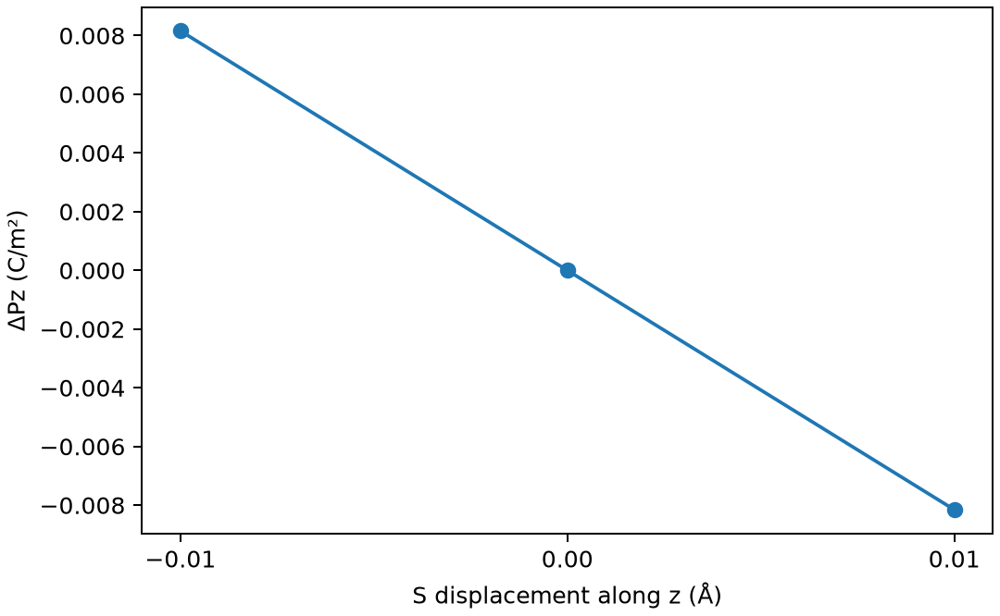

# VASPBerry 相极化与 Born 有效电荷

**适用环境：Linux + PBS 运行计算；Windows / macOS / Linux 可准备输入与分析结果。**

周期绝缘体的极化涉及 Berry 相，绝对极化具有分支不唯一性。研究可观测的极化变化时，应沿连续绝缘路径跟踪同一分支。

## 方法与物理量

晶体极化模一个极化量子 eR/Ω，其中 R 是晶格向量、Ω 是胞体积。离子与电子偶极相加后仍需处理分支；仅把两个原始数字相减，可能得到多出一个量子的跳变。

Born 有效电荷是原子位移引起的极化响应，不是 Bader 或 Mulliken 静态电荷。本例只计算 S 原子沿 z 位移对应的一个分量：$Z^{*}_{zz}=\frac{\Omega}{e}\frac{\partial P_z}{\partial u_z}$。

## 最小模型与输入

采用 ZnS 双原子原胞，常规晶格常数 5.41 Å；固定晶胞与 Zn，S 沿笛卡尔 z 分别移动 −0.01、0、+0.01 Å。PBE、450 eV、5×5×5 网格，三个分支启用 `LCALCPOL`。

[案例目录](../../../examples/vasp/minimal/berry-polarization)包含以下科学输入：

[INCAR.minus](../../../examples/vasp/minimal/berry-polarization/INCAR.minus)、[INCAR.plus](../../../examples/vasp/minimal/berry-polarization/INCAR.plus)、[INCAR.zero](../../../examples/vasp/minimal/berry-polarization/INCAR.zero)、[KPOINTS](../../../examples/vasp/minimal/berry-polarization/KPOINTS)、[POSCAR](../../../examples/vasp/minimal/berry-polarization/POSCAR)、[POTCAR.spec](../../../examples/vasp/minimal/berry-polarization/POTCAR.spec)、[stages.json](../../../examples/vasp/minimal/berry-polarization/stages.json)。

`POSCAR` 提供参考结构，`stages.json` 列出正、负及零位移阶段。配套 [run.py](../../../examples/vasp/minimal/berry-polarization/run.py) 顺序组织任务，[job.pbs](../../../examples/vasp/minimal/berry-polarization/job.pbs) 提交作业，[postprocess.py](../../../examples/vasp/minimal/berry-polarization/postprocess.py) 检查结果并绘图。

## 参数与提交

从授权安装中按 `POTCAR.spec` 准备 `POTCAR`，元素顺序与 POSCAR 一致。`VASP_EXEC` 在本例中指定 `vasp_std`；授权势文件不随案例分发。

| 设置 | 检查点 |
| --- | --- |
| `LCALCPOL` | 原生 Berry 相电子偶极与离子偶极 |
| 相同晶胞/势/k 点 | 避免无关的参考变化 |
| 小位移中心差分 | 减少单边截断误差；仍需改变位移幅度测试 |
| 绝缘路径 | 金属占据或带隙闭合时不能沿用此简单分析 |

`run.py` 用 ASE 明确修改笛卡尔位移，避免斜原胞分数坐标误读。

在干净案例目录安装[Python 依赖](../../../examples/vasp/minimal/berry-polarization/requirements.txt)并提交：

```bash
python3 -m pip install -r requirements.txt
qsub job.pbs
```

PBS 中的资源语法和软件加载方式按集群调整。计算结束后自动执行后处理；若只分析已保存的结果，运行 `python3 postprocess.py`。各阶段独立保存输出，便于定位失败步骤。

## 结果与判断

后处理从 OUTCAR 读取 p[ion] 与 p[elc]，先相加，再在晶格基底中把相邻小位移差归入最近的连续分支，转为 C/m² 并求中心差分有效电荷。

本例得到 S 的 $Z^{*}_{zz}$ 约为 −2.0155 e；它与静态原子电荷的定义不同。

这个最近分支选择适用于本例的小位移，不能用于任意大结构变化或跨相路径。图中极化对小位移近似线性；有限差分结果是 S 的一个张量分量，并非整个 Born 张量。



图由案例后处理脚本读取实际计算输出生成。

## 扩展到实际研究

对铁电翻转，应沿保持绝缘的路径分步计算，跟踪分支和体积约定；不要将两个任意端点的“绝对极化”直接相减。完整 Born 电荷可与 DFPT 结果、声学和规则一起核对；相关响应输入见[压电张量](VASP压电张量.md)。

参考：[VASP LCALCPOL](https://vasp.at/wiki/LCALCPOL)。
