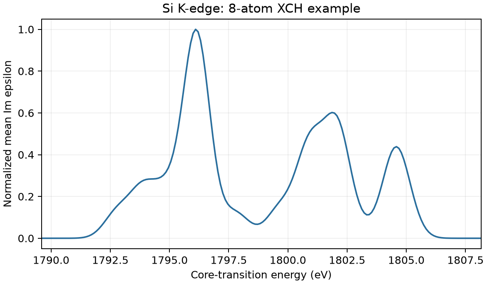

# VASP 的 XAS/XANES 核吸收谱

**适用环境：Linux + PBS（VASP）；Windows / macOS / Linux 可绘图。**

XAS 描述芯电子向未占据态的跃迁；XANES 关注吸收边附近的结构。这里以 Si K 边为例，用超胞核空穴法演示激发原子设置、谱线提取与展宽。

## 指定核空穴

[最小案例](../../../examples/vasp/minimal/xas-core-hole)使用 8 原子常规晶胞。[POSCAR](../../../examples/vasp/minimal/xas-core-hole/POSCAR)将第一个 Si 独立为一种原子类型，元素行写 `Si Si`，数量为 `1 7`。按此顺序将两份相同的授权 `Si_GW` 势拼接为 `POTCAR`（[势清单](../../../examples/vasp/minimal/xas-core-hole/POTCAR.spec)）。

[INCAR](../../../examples/vasp/minimal/xas-core-hole/INCAR)的核心设置为：

```text
ICORELEVEL = 2
CLNT = 1
CLN = 1
CLL = 0
CLZ = 1.0
CH_LSPEC = .TRUE.
CH_NEDOS = 2000
CH_SIGMA = 0.3
NBANDS = 48
```

`CLNT` 是原子类型序号；`CLN=1, CLL=0` 指定 1s 芯态。默认 XCH 方案将一个芯电子放入价带计算空间，VASP 自动增加电子数，本例从 32 变为 33，勿再手动多加一次。空带数决定能覆盖的跃迁范围。

加载 VASP，安装 [Python 依赖](../../../examples/vasp/minimal/xas-core-hole/requirements.txt)，使用 [2×2×2 k 网格](../../../examples/vasp/minimal/xas-core-hole/KPOINTS)和 [PBS 文件](../../../examples/vasp/minimal/xas-core-hole/job.pbs)提交：

```bash
qsub job.pbs
```

## 提取与读图

[后处理脚本](../../../examples/vasp/minimal/xas-core-hole/postprocess.py)检查 SCF、电子数和核谱结束标记，从 `OUTCAR` 提取虚部介电张量，取三个对角分量平均，再由 [plot.py](../../../examples/vasp/minimal/xas-core-hole/plot.py)绘图。图中纵轴归一化，不是绝对吸收系数。



`OUTCAR` 的横轴采用相对于所选芯态的跃迁能；`vasprun.xml` 的谱线能量参考不同，不能混用。计算吸收边通常还需与实验对齐，不把图中的绝对位置直接解释为实验边能。

本例采用 0.3 eV 的内置高斯展宽，并追加标准差 0.5 eV 的绘图展宽，以便观察粗网格的小案例。正式研究宜使用足够密的能量网格保存更窄的原始谱，再按芯空穴寿命与仪器分辨率后处理；展宽参数不能代替 k 点和空带收敛。

8 原子晶胞含周期重复的高浓度核空穴，仅用于练习流程。定量 XANES 必须测试超胞尺寸、空带、k 点和芯空穴处理方式，再讨论近边峰形与各向异性。

参考：[VASP 超胞核空穴指南](https://vasp.at/wiki/Supercell_core-hole_calculations)。
