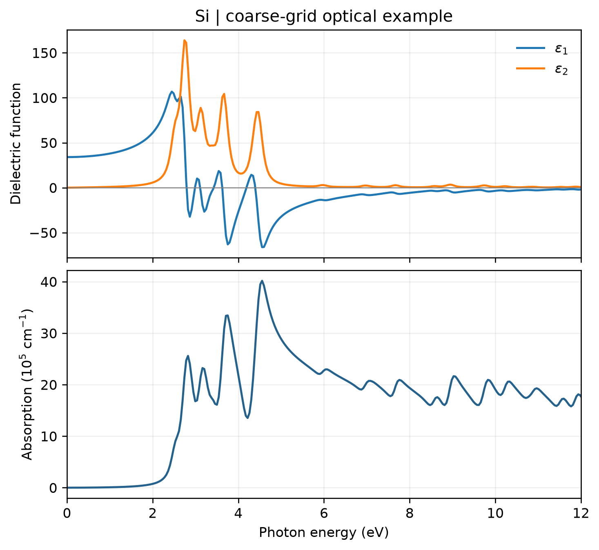

# VASP 光学性质计算

**适用环境：Linux（PBS 计算）；macOS / Linux（VASPKIT 后处理）；Windows（查看结果，运行可用 WSL）。**

贡献者：张烜广、王昌锐

`LOPTICS` 在电子基态计算之后得到随频率变化的介电函数，再用 VASPKIT 提取吸收系数、折射率等光学量。

## 计算与提取

[配套案例](../../../examples/vasp/minimal/optical-properties)采用硅的两原子原胞。准备授权 Si 势，在已收敛结构的静态计算中加入：

```text
LOPTICS = .TRUE.
NBANDS = 16
NEDOS = 401
CSHIFT = 0.1
```

`NBANDS` 控制包含的能带数，需有足够空带；`NEDOS` 控制频率网格，`CSHIFT` 为洛伦兹展宽参数，单位 eV。本例保留较小设置以演示流程；正式计算需同时检查 k 点、空带数、频率网格和展宽。[VASP 官方说明](https://vasp.at/wiki/index.php/LOPTICS)介绍了参数含义及独立粒子近似的范围。

加载 VASP、VASPKIT 和案例 `requirements.txt` 中的依赖后，提交：

```bash
qsub job.pbs
```

作业完成后，`analyze.py` 依照 `vaspkit.in` 调用 VASPKIT 的 `711`，选择 `1`（按能量输出），生成 `REAL.in`、`IMAG.in`、`ABSORPTION.dat` 等文件，再调用 `plot.py`。

已有 VASP 输出时可直接后处理：

```bash
python3 analyze.py
```

## 结果图



图由配套脚本读取 VASPKIT 实际输出生成，上图为介电函数实部和虚部，下图为吸收系数，均取三个对角分量的平均。该模型为立方硅，三个对角分量相同。

这里使用 `ENCUT = 350 eV`、`3 × 3 × 3` k 网格、16 条能带和 `0.1 eV` 洛伦兹展宽；粗网格导致明显尖峰，图用于理解输出和绘图流程，不能据此报告硅的定量光谱。比较实验时，还要考虑带隙误差、激子及电子声子效应；`LOPTICS` 的独立粒子结果不包含这些修正。

## 从光谱到样品颜色

吸收峰的补色可作定性教学判断；定量颜色应从进入观察者眼中的光谱计算。

对透射样品，将照明光谱 $S(\lambda)$ 乘以透射率 $T(\lambda)$；对反射样品，使用相应测量几何下的反射光谱。再与所选标准观察者的配色函数积分得到 XYZ，注明光源、观察者、波长范围与归一化，参见 [CIE 色度学说明](https://www.cie.co.at/publications/colorimetry-4th-edition)。仅有相对吸收峰强度，还不能唯一确定样品颜色与明暗。

均匀、无散射且忽略界面反射的吸收介质可用 $T(\lambda)=\exp[-a(\lambda)L]$，其中 a 是吸收系数、L 是光程，二者长度单位匹配；十进制吸光度 A 则对应 $T=10^{-A}$。因此溶液浓度、光程或薄膜厚度都会影响透射颜色。

固体还涉及界面反射、偏振、晶向、基底、干涉与散射；不能把 VASP 的吸收系数曲线或分子 TDDFT 棒状谱直接当作反射谱，也不能仅用带隙指定颜色。

**为什么不能直接把吸收谱的 RGB 取补色？** 光谱到颜色的转换还涉及光传播和颜色积分，逐通道取补色不能替代这个过程。显示色块时，区分线性 RGB 与编码后的 sRGB，采用相应传递函数并记录白点及超色域处理，见 [W3C 色彩规范](https://www.w3.org/TR/css-color/)。对吸收谱转换得到的 RGB 逐通道做 `255-R`，或把最大通道拉到 255，都不能代替光传播和颜色积分；后者还会改变明暗信息。比较计算与实验时先对齐样品状态、光谱展宽和观测条件，再比较色坐标，屏幕色块仅作辅助展示。

输入文件：[POSCAR](../../../examples/vasp/minimal/optical-properties/POSCAR)、[INCAR](../../../examples/vasp/minimal/optical-properties/INCAR)、[KPOINTS](../../../examples/vasp/minimal/optical-properties/KPOINTS)；作业入口：[job.pbs](../../../examples/vasp/minimal/optical-properties/job.pbs)；绘图脚本：[plot.py](../../../examples/vasp/minimal/optical-properties/plot.py)。

延伸阅读：[知乎帖子 1](https://www.zhihu.com/question/287951798)；[知乎帖子 2](https://zhuanlan.zhihu.com/p/669635613)；[公众号文章](https://mp.weixin.qq.com/s/or3KbvwAv_h3B68AJAB1fA)。
