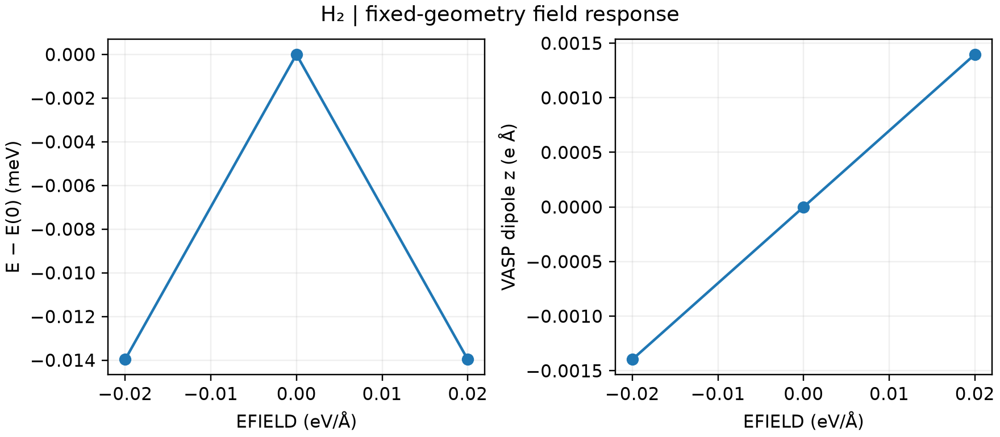

# VASP 外加电场计算

**适用环境：Linux + PBS（VASP）；Windows / macOS / Linux 可绘图。**

分子或薄膜的静电场可用 `EFIELD` 配合偶极修正描述。它与周期体相的有限电场/Berry 相位方法不同，不能把同一套真空盒输入直接用于任意三维晶体。

## H₂ 的正负场对照

[最小案例](../../../examples/vasp/minimal/electric-field)将 H₂ 沿 z 放置，在相同结构上分别施加 `−0.02`、`0`、`+0.02` 的 `EFIELD`。输入为 [POSCAR](../../../examples/vasp/minimal/electric-field/POSCAR)、[KPOINTS](../../../examples/vasp/minimal/electric-field/KPOINTS)及 [负场](../../../examples/vasp/minimal/electric-field/INCAR.minus)、[零场](../../../examples/vasp/minimal/electric-field/INCAR.zero)、[正场](../../../examples/vasp/minimal/electric-field/INCAR.plus)参数。

```text
IDIPOL = 3
LDIPOL = .TRUE.
DIPOL = 0.5 0.5 0.5
EFIELD = 0.02
```

`IDIPOL = 3` 选择第三方向，`DIPOL` 给出分数坐标参考中心。VASP 将该参数称为电力场，单位写作 eV/Å，方向与通常物理电场定义相反：电子沿正 `EFIELD` 方向移动。解释偶极或力的方向时，须先明确符号约定。

准备授权 H `POTCAR`，安装 [依赖](../../../examples/vasp/minimal/electric-field/requirements.txt)，加载 VASP 后提交 [PBS 作业](../../../examples/vasp/minimal/electric-field/job.pbs)：

```bash
qsub job.pbs
```

[run.py](../../../examples/vasp/minimal/electric-field/run.py)完成三次自洽计算。[后处理](../../../examples/vasp/minimal/electric-field/postprocess.py)核对实际场强和偶极输出；对于无永久偶极的 H₂，检查正负场能量近似相同、诱导偶极近似反号，再由 [plot.py](../../../examples/vasp/minimal/electric-field/plot.py)绘图。



图使用 8 Å 周期盒、450 eV、Γ 点，保持几何不变。正负场下 VASP 输出的 z 偶极约为 ±0.001397 eÅ。三个点用于检验弱场响应与对称性，不能代替场强、真空尺寸和采样收敛，也没有包含离子弛豫贡献。

对表面，应保证真空区和势的不连续位置远离电子密度；强场可能造成电子溢出。需要极化率时，应使用更多弱场点，统一物理场、偶极与体积的单位和定义。

参考：[VASP 的 EFIELD 说明](https://vasp.at/wiki/EFIELD)。
