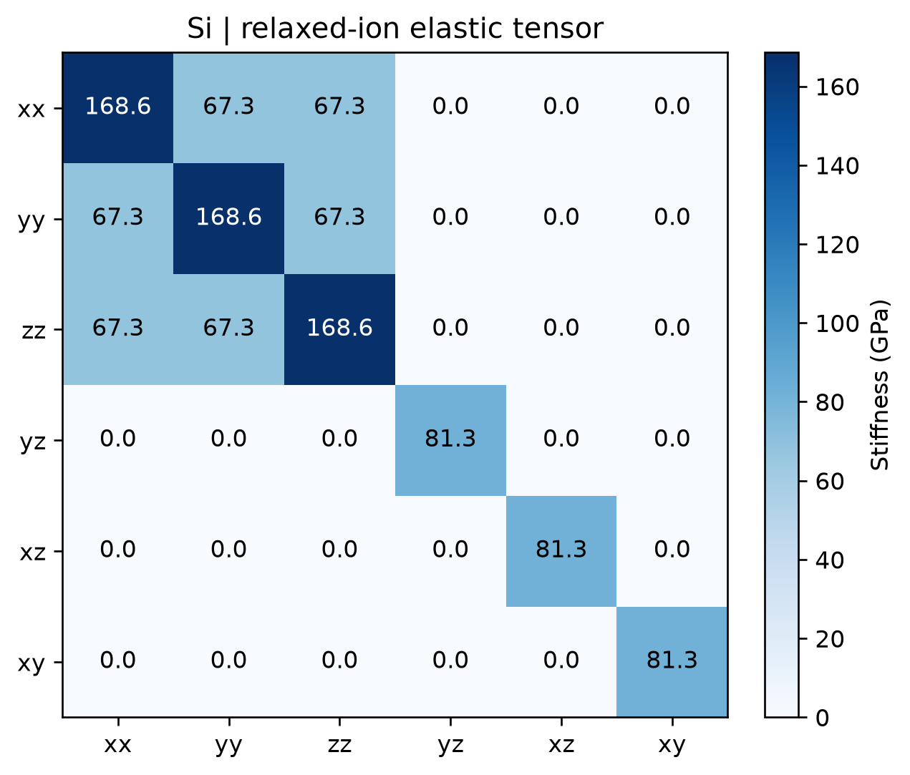

# VASP 弹性常数计算

**适用环境：Linux（PBS 计算）；macOS / Linux（VASPKIT 后处理）；Windows（查看结果，运行可用 WSL）。**

贡献者：张烜广、王昌锐

弹性常数描述小应变下的应力响应。体积曲线可以给出体积模量，但完整弹性张量还需要剪切等独立应变信息，不能只由 $E(V)$ 决定。

## 有限差分计算

[最小案例](../../../examples/vasp/minimal/elastic-constants)采用硅的两原子原胞。研究计算应先优化结构并检查残余应力，再测试截断能、k 点和差分步长。

| 文件 | 用途 |
| --- | --- |
| [POSCAR](../../../examples/vasp/minimal/elastic-constants/POSCAR) | 硅原胞 |
| [INCAR](../../../examples/vasp/minimal/elastic-constants/INCAR) | 有限差分与弹性响应设置 |
| [KPOINTS](../../../examples/vasp/minimal/elastic-constants/KPOINTS) | Γ 中心 `3 × 3 × 3` 网格 |
| [job.pbs](../../../examples/vasp/minimal/elastic-constants/job.pbs) | PBS 计算与后处理 |
| [vaspkit.in](../../../examples/vasp/minimal/elastic-constants/vaspkit.in) | VASPKIT `203` 交互输入 |
| [analyze.py](../../../examples/vasp/minimal/elastic-constants/analyze.py) | 提取矩阵、核对单位并检查立方硅 |
| [plot.py](../../../examples/vasp/minimal/elastic-constants/plot.py) | 绘制弹性矩阵 |

关键设置为：

```text
IBRION = 6
ISIF = 3
NSW = 1
NFREE = 2
POTIM = 0.01
EDIFF = 1E-8
```

`IBRION=6` 利用对称性减少有限差分计算；配合 `ISIF>=3` 计算弹性响应。`IBRION=5` 是不利用对称性的有限差分，并不是“5 算频率、6 算弹性”的区分。`NSW=1` 在这里启动差分流程，不表示只算一个扰动。[VASP 官方说明](https://vasp.at/wiki/index.php/IBRION)给出了方法及参数组合。

本例 `POTIM=0.01` 对应原子位移步长，单位 Å；应变扰动由 VASP 的弹性流程处理。差分计算对数值噪声敏感，不能将某个截断能或 k 点间距当作所有材料的固定标准。并行设置也应按所用版本和算法验证，无需一概禁止 `NCORE`。

准备授权 Si 势，加载软件和案例 Python 依赖，执行：

```bash
qsub job.pbs
```

作业完成后自动运行 VASPKIT `203`，从 OUTCAR 读取弹性常数。已有输出时执行 `python3 analyze.py` 即可提取和绘图。

## 结果与检查

OUTCAR 的 `TOTAL ELASTIC MODULI` 包含离子弛豫贡献，单位为 kBar，`1 kBar = 0.1 GPa`。注意原始行列顺序为 `xx, yy, zz, xy, yz, zx`；案例统一成 `xx, yy, zz, yz, xz, xy`，并与 VASPKIT 输出交叉核对。



图由实际 VASPKIT 输出生成。本例 `ENCUT=350 eV`、粗 k 网格得到 $C_{11}\approx168.575$、$C_{12}\approx67.334$、$C_{44}\approx81.262$ GPa，满足立方对称性，矩阵特征值均为正。它演示数据提取流程；定量机械稳定性分析还需结合平衡结构、残余应力和参数收敛。

对立方体系，体积模量为 $B=(C_{11}+2C_{12})/3$。案例用 Voigt–Reuss–Hill 平均得到多晶剪切模量、杨氏模量和泊松比，分别约为 `67.21 GPa`、`165.06 GPa`、`0.228`。这些是多晶平均值，不能替代单晶特定方向的模量。

若 VASPKIT 的密度为零，或声速、德拜温度出现 `Infinity/NaN`，先核对其读取的元素、质量和晶胞体积。本例介绍弹性矩阵及由矩阵直接得到的平均模量；硬度、脆韧性等经验模型结果应结合各模型的材料适用范围判断。

## 能量—应变与应力—应变方法

也可以在平衡晶胞上施加正负小应变，固定各应变晶胞、只弛豫内部原子，再拟合能量曲率或应力斜率。[VASPKIT 教程](https://vaspkit.com/tutorials.html#determine-elastic-constants-based-on-energy-strain-method)介绍了 `201` 的能量—应变工作流；生成应变时采用其要求的标准常规晶胞，不能直接把上述原胞当作通用输入。

使用时先准备 `VPKIT.in`，生成应变目录并检查结构，完成各子目录计算后再切换到拟合阶段。应变应有正负值，并比较不同应变范围的拟合稳定性。固定应变后的晶胞时，可用 `ISIF=2` 弛豫内部原子，避免用 `ISIF=3` 把应变又优化掉。不要为合金或低对称结构强制指定不真实的高对称空间群。

二维材料的三维输出随真空层厚度变化，不能直接按 GPa 比较。应结合面内边界条件消除不需要的耦合，并明确转换后的二维单位（通常 N/m）。

延伸阅读：[公众号文章](https://mp.weixin.qq.com/s?__biz=MzI2OTQ4OTExOA==\&mid=2247487112\&idx=1\&sn=bfa1e8c7981b15e880cd8426c7f8a8ab\&chksm=eadec839dda9412f12c9020b189fd767a1d9d1bfbc1929822c9410bc8c24834a330b663b0038\&mpshare=1\&scene=1\&srcid=1104qk2jJQfIvkhhJR8u318F\&sharer_sharetime=1604472889425\&sharer_shareid=dbb0734284422c0aebeb989a7ec537c0#rd)；[ELATE](https://progs.coudert.name/elate)。
