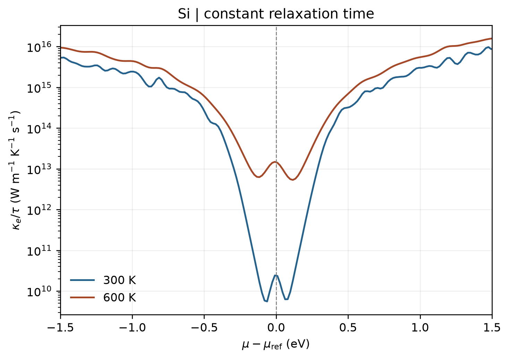

# VASP 电子输运与电子热导率

**适用环境：Linux（PBS 计算）；macOS / Linux（BoltzTraP2 后处理）；Windows（查看结果，运行可用 WSL）。**

贡献者：张烜广、王昌锐

[BoltzTraP2](https://arxiv.org/abs/1712.07946)通过能带插值和半经典 Boltzmann 输运方程计算输运系数。常数弛豫时间近似下，输出包含电导率除以弛豫时间 $\sigma/\tau$、Seebeck 系数和电子热导率除以弛豫时间 $\kappa_e/\tau$。

总热导率可写为 $\kappa=\kappa_l+\kappa_e$，这里仅处理电子部分。若要从 $\kappa_e/\tau$ 得到 $\kappa_e$，还需有依据地确定弛豫时间 $\tau$（单位 s），不能把程序输出直接当作 W/(m·K) 的热导率。

## 计算输入

[最小案例](../../../examples/vasp/minimal/electronic-transport)使用硅的两原子原胞，先做规则 k 网格的自洽静态计算，再进行插值；不要使用高对称线上的能带路径替代布里渊区采样。

| 文件 | 用途 |
| --- | --- |
| [POSCAR](../../../examples/vasp/minimal/electronic-transport/POSCAR) | 硅原胞 |
| [INCAR](../../../examples/vasp/minimal/electronic-transport/INCAR) | 静态计算，`ENCUT=350 eV` |
| [KPOINTS](../../../examples/vasp/minimal/electronic-transport/KPOINTS) | Γ 中心 `9 × 9 × 9` 网格 |
| [job.pbs](../../../examples/vasp/minimal/electronic-transport/job.pbs) | PBS 作业与后处理 |
| [postprocess.py](../../../examples/vasp/minimal/electronic-transport/postprocess.py) | 调用 BoltzTraP2 并检查输运结果 |
| [plot.py](../../../examples/vasp/minimal/electronic-transport/plot.py) | 绘制电子热导率除以弛豫时间 |

准备授权 Si 势，并在计算环境安装案例 `requirements.txt` 中的依赖。加载软件后执行 `qsub job.pbs`；已有完整 VASP 输出时，可运行 `python3 postprocess.py`。

## BoltzTraP2 后处理

脚本调用以下流程，单进程运行以降低资源开销：

```bash
btp2 -n 1 interpolate -m 3 .
btp2 -n 1 integrate -b 1000 interpolation.bt2 300,600
```

第一步读取当前目录的 `vasprun.xml`，按空间对称性插值并生成 `interpolation.bt2`；`-m 3` 是插值增密系数。第二步在 300、600 K 积分，生成 `.trace` 文本表和 `.btj` 结果文件。该例没有施加剪刀修正，也没有计算散射时间。

本例采用 BoltzTraP2 26.3.1。`.trace` 第一列为化学势，单位 Ry；第五、六、八列分别为 Seebeck 系数、$\sigma/\tau$、$\kappa_e/\tau$，具体单位以文件表头为准。标量输运量为相应张量对角元的平均。脚本从 `.btj` 读取电中性参考能量，将化学势转换成 eV 后绘图，避免把 Ry 直接标成 eV。

## 结果图



图读取实际 `.trace` 输出，显示相对电中性参考能量 $\mu_{\mathrm{ref}}$ 的化学势窗口；纵轴使用对数刻度。化学势扫描不是定载流子浓度的温度扫描，比较指定掺杂条件时应另外使用 BoltzTraP2 的 `dope` 功能并明确浓度定义。

本例只演示小体系的输运流程。研究计算需收敛 DFT k 网格、插值增密系数、积分网格，以及目标化学势附近的空带覆盖；窄带隙和高温结果还可能受带隙误差与双极输运影响。插值更密不能补回原始采样缺失的能带信息。
