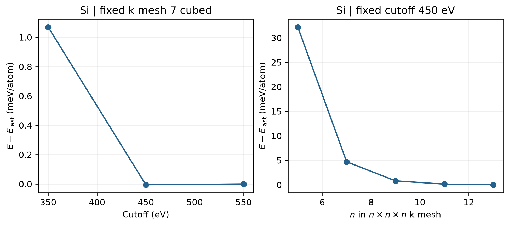

# VASP 参数收敛测试

**适用环境：Linux（PBS 计算）；Windows / macOS / Linux（准备输入、分析与绘图）。**

先确定需要收敛的量：相对能量、受力、应力、能隙或其他目标性质。总能量的每原子差达到阈值，不自动代表其他性质也收敛。下面以硅的固定结构为例，分别测试平面波截断能和 k 网格。

## 单变量扫描

[最小案例](../../../examples/vasp/minimal/parameter-convergence)包含：

| 文件 | 用途 |
| --- | --- |
| [POSCAR](../../../examples/vasp/minimal/parameter-convergence/POSCAR) | 两原子硅原胞，所有测试保持结构不变 |
| [INCAR](../../../examples/vasp/minimal/parameter-convergence/INCAR) | 共用电子精度与静态参数模板 |
| [KPOINTS](../../../examples/vasp/minimal/parameter-convergence/KPOINTS) | 参考 Γ 中心网格，扫描脚本生成各测试网格 |
| [run.py](../../../examples/vasp/minimal/parameter-convergence/run.py) | 生成扫描任务，顺序计算并复用重复参数组合 |
| [job.pbs](../../../examples/vasp/minimal/parameter-convergence/job.pbs) | PBS 入口 |
| [postprocess.py](../../../examples/vasp/minimal/parameter-convergence/postprocess.py)、[plot.py](../../../examples/vasp/minimal/parameter-convergence/plot.py) | 收敛检查与绘图 |

脚本在 `7³` k 网格下测试 `350、450、550 eV`，在 `ENCUT=450 eV` 下测试 `5³、7³、9³、11³、13³` 网格，共七个不同组合。准备授权 Si 势并加载 Python 依赖后，执行 `qsub job.pbs`；已有输出时执行 `python3 postprocess.py` 即可重绘。

`ENCUT` 的单位为 eV，可从所用势的 `ENMAX` 附近建立测试范围，但 `ENMAX` 不是所有目标性质的收敛证明。[官方 ENCUT 说明](https://vasp.at/wiki/index.php/ENCUT)强调应检查目标量并显式统一截断能。

k 网格可由 VASPKIT 生成，也可使用 `KSPACING` 自动生成。后者在没有 KPOINTS 文件时生效，单位为 Å⁻¹；不要在保留 KPOINTS 时以为修改 `KSPACING` 就改变了采样。不同工具的间距定义还需核对 $2\pi$ 因子和网格取整方式，最终比较实际网格。参见 [KSPACING 说明](https://vasp.at/wiki/index.php/KSPACING)。

## 结果与判断

图读取实际计算的每原子 `energy(sigma→0)`，左右分别以各自最后一个扫描点为参考。示例最后两点的差为：

- `450 → 550 eV`：约 `0.0053 meV/atom`，固定 `7³` k 网格。
- `11³ → 13³`：约 `0.1291 meV/atom`，固定 `450 eV` 截断能。

二者均小于本例的 `1 meV/atom` 阈值，阈值和扫描范围可在脚本开头调整。

能否找到第一对接近的点就停止？还不够。应看连续多个点的变化，排除偶然抵消；截断与 k 网格分别稳定后，再在拟采用的组合上复核目标量。

比较能量时保持势、泛函、结构、展宽与能量定义一致；金属尤其需要同时考察 k 网格和展宽。原胞得到的参数可以作为超胞起点，但缺陷、表面、应变、磁性或化学环境变化后仍需复核，不能无条件迁移。

[配套 Notebook](INCAR参数收敛测试.ipynb)用于读取扫描生成的 JSON 并交互查看；PBS 计算和输入生成统一使用案例脚本。
