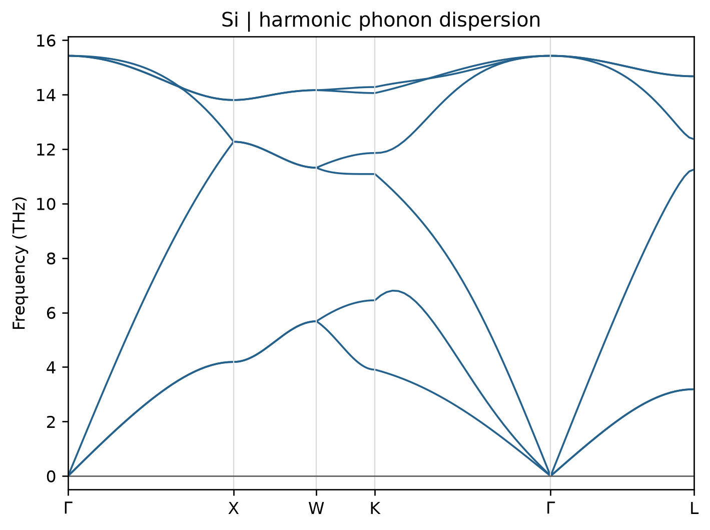

# VASP 与 Phonopy 声子谱

**适用环境：Windows、macOS、Linux（查看输入与绘图）；Linux + PBS（VASP、Phonopy 或频率计算）。**

用有限位移法计算声子谱，可以将任务分成三步：Phonopy 生成位移超胞，VASP 计算受力，Phonopy 根据力常数求声子色散。这里使用两个原子的硅原胞和 $2\times2\times2$ 超胞。

## 准备输入并提交 PBS

案例包括[原胞 POSCAR](../../../examples/vasp/minimal/phonon-dispersion/POSCAR)、[正位移结构](../../../examples/vasp/minimal/phonon-dispersion/POSCAR-001)、[负位移结构](../../../examples/vasp/minimal/phonon-dispersion/POSCAR-002)、[INCAR](../../../examples/vasp/minimal/phonon-dispersion/INCAR)、[KPOINTS](../../../examples/vasp/minimal/phonon-dispersion/KPOINTS)、[job.pbs](../../../examples/vasp/minimal/phonon-dispersion/job.pbs) 和[工作流脚本](../../../examples/vasp/minimal/phonon-dispersion/run.py)。

先完成结构优化，再按[元素说明](../../../examples/vasp/minimal/phonon-dispersion/POTCAR.spec)准备授权 Si `POTCAR`。本例使用近似平衡晶格的小模型演示，正式计算仍需收敛晶格和受力精度。在集群加载 VASP、MPI 与 Phonopy 后执行：

```bash
qsub job.pbs
```

作业脚本生成两份 16 原子位移结构，分别写入 `disp-001/`、`disp-002/` 并进行静态受力计算。电子设置为 `ENCUT=450 eV`、`EDIFF=1E-8`、超胞 $3\times3\times3$ Γ 中心网格。位移结构不能再做离子优化，否则会失去所需的位移与受力关系。

## Phonopy 实际做了什么

[run.py](../../../examples/vasp/minimal/phonon-dispersion/run.py) 调用以下命令，位移幅度单位为 Å：

```bash
phonopy-init -d --dim 2 2 2 --amplitude 0.01 --pm
```

`--pm` 为正负位移。Phonopy 利用对称性减少独立任务，并生成 `phonopy_disp.yaml`。对称性或结构改变时，不能沿用旧的位移编号与受力文件。

计算结束后，[postprocess.py](../../../examples/vasp/minimal/phonon-dispersion/postprocess.py) 收集两份 `vasprun.xml`：

```bash
phonopy-init -f disp-001/vasprun.xml disp-002/vasprun.xml
phonopy --config band.conf
phonopy --config thermal.conf
```

[band.conf](../../../examples/vasp/minimal/phonon-dispersion/band.conf) 给出原胞的高对称 q 路径；[thermal.conf](../../../examples/vasp/minimal/phonon-dispersion/thermal.conf) 给出用于热力学积分的 q 网格。本例按 Phonopy 4.x 的命令组织，接口说明见[官方 VASP 工作流](https://phonopy.github.io/phonopy/vasp.html)。

## 怎么判断结果

`band.yaml` 保存路径上的频率；使用 Phonopy 绘图工具或其他支持该格式的软件查看色散。硅原胞有两个原子，共六支声子，其中三支声学支在 Γ 点应接近零。输出的微小负数需结合量级判断；明显的负频率要检查相应模式、结构稳定性和数值收敛。

本例通过力常数对称化满足平移等约束，但这种处理不能修复错误的模型或未收敛的受力。应分别测试超胞尺寸、位移幅度、电子 k 网格与 q 积分网格。电子 k 点控制 DFT 受力，q 点控制声子采样，两者不能相互代替。

只想学习 Γ 点频率时，可用更小的 [VASP 内置有限差分](VASP有限差分振动频率.md)或 [DFPT 案例](VASP密度泛函微扰振动频率.md)。原胞 Γ 点的动力学矩阵只描述该点的振动，不能替代完整布里渊区的声子谱。

## 结果图

后处理会调用 [plot.py](../../../examples/vasp/minimal/phonon-dispersion/plot.py) 绘图。已有提取数据时，在结果目录单独执行 `python3 plot.py` 即可重画，无需重算 VASP；绘图依赖见 [requirements.txt](../../../examples/vasp/minimal/phonon-dispersion/requirements.txt)。



硅的简谐声子色散；2×2×2 超胞、正负 0.01 Å 位移、超胞 3×3×3 电子 k 网格。

## 极性晶体的长程电场修正

对极性绝缘晶体，Γ 附近的集体离子位移可产生宏观电场，普通有限超胞力常数还需配合非解析修正描述相应长波行为，包括 LO–TO 分裂。

所需输入为与同一结构、方法和原子顺序相容的完整 Born 有效电荷张量及离子固定的电子介电张量 $\epsilon_\infty$，不是含离子响应的总静态介电常数，也不是 Bader 电荷。定义见[响应电荷](../../计算化学/原子电荷、片段电荷与方法选择.md#响应电荷gapt-与-born-有效电荷)。

VASP 可按所用泛函的支持选择 `LEPSILON` 的 DFPT 或 `LCALCEPS` 的有限电场路线，具体限制和局域场设置见 [LEPSILON](https://vasp.at/wiki/LEPSILON)与[Born 张量说明](https://vasp.at/wiki/Born_effective_charges)。将响应数据交给 Phonopy 前，核对原胞选择、原子映射、单位和张量指标顺序；非解析项还取决于 q 趋近 Γ 的方向，见[Phonopy 公式](https://phonopy.github.io/phonopy/formulation.html#non-analytical-term-correction)。

非解析修正不能修复未收敛的短程力常数，也不自动证明全布里渊区稳定。二维材料和带真空的 slab 具有不同的长程库仑边界，不能把三维体相公式和含任意真空体积的介电常数直接套用；需采用与维度和边界相容的处理。
