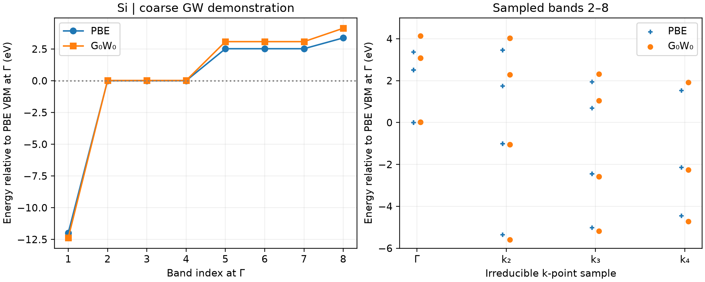

# VASP GW 准粒子能带

**适用环境：Linux + PBS（支持 GW 的 VASP）；Windows / macOS / Linux 可绘图。**

GW 用近似自能修正单粒子能级。它回答的是准粒子加减电子激发能问题，与包含电子—空穴相互作用的光学激发不同；后者可继续使用 [BSE](../响应与输运/VASPBSE光学响应.md)。

## 硅的三阶段小案例

[最小案例](../../../examples/vasp/minimal/gw-quasiparticles)提供 [POSCAR](../../../examples/vasp/minimal/gw-quasiparticles/POSCAR)、[KPOINTS](../../../examples/vasp/minimal/gw-quasiparticles/KPOINTS)，以及 [PBE 自洽](../../../examples/vasp/minimal/gw-quasiparticles/INCAR.scf)、[空带对角化](../../../examples/vasp/minimal/gw-quasiparticles/INCAR.exact)、[GW 参数](../../../examples/vasp/minimal/gw-quasiparticles/INCAR.gw)。准备授权 `Si_GW` POTCAR，安装 [依赖](../../../examples/vasp/minimal/gw-quasiparticles/requirements.txt)，加载 VASP 后提交 [job.pbs](../../../examples/vasp/minimal/gw-quasiparticles/job.pbs)：

```bash
qsub job.pbs
```

[run.py](../../../examples/vasp/minimal/gw-quasiparticles/run.py)先收敛 PBE，再用 `ALGO = Exact` 在固定电荷密度下求 24 条能带、输出 `WAVECAR` 与 `WAVEDER`，最后计算一次 G₀W₀：

```text
ALGO = EVGW0
NELMGW = 1
NBANDS = 24
NBANDSGW = 8
ENCUTGW = 80
NOMEGA = 16
LSPECTRAL = .TRUE.
```

`NBANDS` 为参与响应计算的能带总数，`NBANDSGW` 是输出准粒子修正的目标带数；二者用途不同。`ENCUTGW` 控制响应基组截断。`LSPECTRAL` 选择谱表示的计算方式，本例检查只产生一组预期 QP 表；不能简单把任意输出中的内部能级求解迭代数等同于屏蔽自洽次数。

一次固定密度的精确对角化不是新的 SCF 循环，应检查原始 PBE 已收敛、后续正常结束及实际 QP 表，而不是要求每个后处理阶段都出现电子自洽收敛标记。[结果检查](../../../examples/vasp/minimal/gw-quasiparticles/postprocess.py)还核对本征值、占据和重整化因子 Z，并由 [plot.py](../../../examples/vasp/minimal/gw-quasiparticles/plot.py)绘图。

## 能级与采样能带



本例在 `3×3×3` 网格的四个不可约点上得到 32 条目标能级，采样 PBE/G₀W₀ 带隙约为 0.6895/1.0255 eV，Z 约 0.662—0.723。图中离散点来自实际计算，不是插值后的连续高对称路径。

300 eV 平面波截断、24 条能带、80 eV 响应截断和 16 个频率点仅用于低成本流程验证，不能作为收敛的硅 GW 带隙。正式计算需逐项测试空带、响应截断、频率和 k 点；绘制连续准粒子能带还需更密采样及经过检查的 Wannier/其他插值方案。

参考：[VASP 的 GW 实用指南](https://vasp.at/wiki/Practical_guide_to_GW_calculations)。
