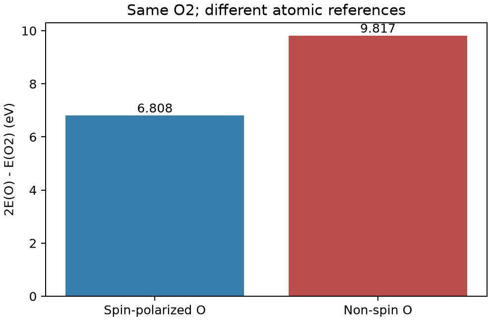

# VASP 原子自旋与分子解离能

**适用环境：Linux + PBS（VASP）；Windows / macOS / Linux 可绘图。**

计算分子解离能时，原子参考态与分子本身同样重要。以 O₂ 为例，若忽略孤立 O 原子的自旋，会抬高原子参考能，从而高估解离能。

## 三个参考计算

[最小案例](../../../examples/vasp/minimal/oxygen-spin-reference)包含一个 8 Å 立方盒中的 [O 原子](../../../examples/vasp/minimal/oxygen-spin-reference/POSCAR.atom)和 [O₂](../../../examples/vasp/minimal/oxygen-spin-reference/POSCAR.molecule)，使用同一套授权 O PAW 势、400 eV 截断和 [Γ 点](../../../examples/vasp/minimal/oxygen-spin-reference/KPOINTS)。分别计算：

- [自旋极化 O](../../../examples/vasp/minimal/oxygen-spin-reference/INCAR.atom-spin)：`ISPIN=2`、`NUPDOWN=2`，总磁矩约束为 2 μB。
- [非自旋 O](../../../examples/vasp/minimal/oxygen-spin-reference/INCAR.atom-nonspin)：`ISPIN=1`，作为错误参考态的对照。
- [三重态 O₂](../../../examples/vasp/minimal/oxygen-spin-reference/INCAR.molecule)：`ISPIN=2`、`NUPDOWN=2`，并优化键长。

`MAGMOM` 给初始磁矩，`NUPDOWN` 约束上下自旋电子数之差，二者用途不同。这里保留孤立原子的对称性，并使用较小的混合参数，减少简并轨道附近的电荷振荡。原子与分子的 SCF 都必须分别收敛。

加载 VASP、准备授权 `POTCAR`，安装 [依赖](../../../examples/vasp/minimal/oxygen-spin-reference/requirements.txt)，提交 [PBS 作业](../../../examples/vasp/minimal/oxygen-spin-reference/job.pbs)：

```bash
qsub job.pbs
```

[run.py](../../../examples/vasp/minimal/oxygen-spin-reference/run.py)顺序执行三项计算。[后处理](../../../examples/vasp/minimal/oxygen-spin-reference/postprocess.py)核对电子收敛、O₂ 受力和总磁矩，再取最终 `e_0_energy` 计算：

$$D_e=2E(\mathrm O)-E(\mathrm O_2).$$

此处正值表示解离需要吸收能量；它尚未包含零点振动能或温度修正。

## 读图与参考态误差



本例 O₂ 优化键长约 1.2344 Å。自旋极化使 O 原子能量降低约 1.5045 eV，得到的电子解离能约 6.8081 eV；使用非自旋原子参考则约为 9.8171 eV，差值恰好为两倍原子自旋稳定能。

这些数值用于说明参考态的影响。定量研究需检查盒子尺寸、截断能、展宽与原子占据，并考虑泛函对开壳层原子和 O₂ 的误差。三重态分子的键长收敛不意味着解离能已经接近实验；若比较热化学数据，还需加入一致的零点能和热力学校正。

参考：单斌、陈征征、陈蓉《计算材料学》配套仓库[第四章 4.4 原子与分子](https://github.com/stanfordbshan/CompMatBook/tree/main/edition-1-2023/Chapter04)。本例重新编写三态对照与检查流程。
