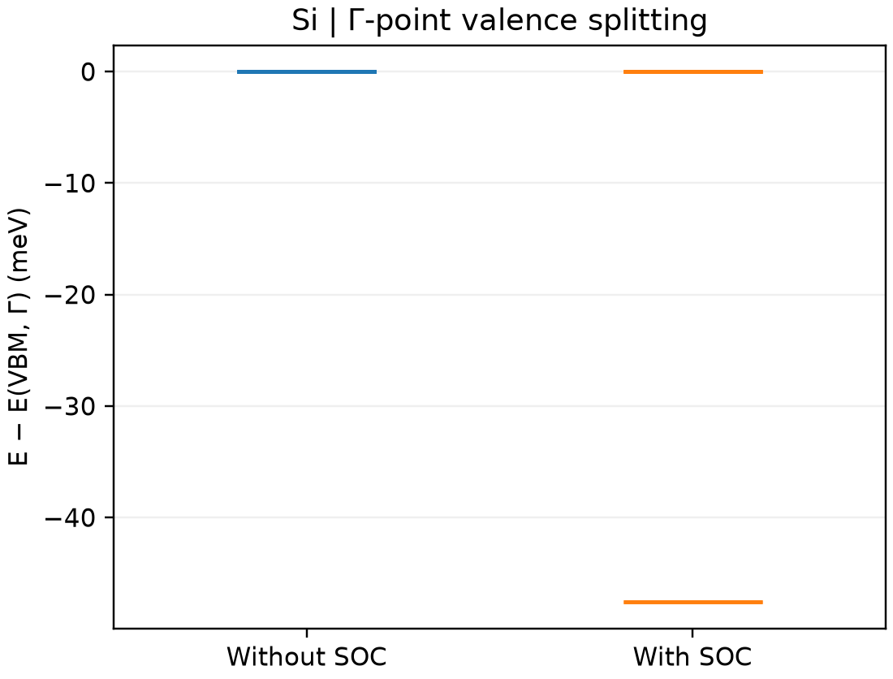

# VASP 自旋轨道耦合

**适用环境：Linux + PBS（`vasp_ncl`）；Windows / macOS / Linux 可绘图。**

自旋轨道耦合（SOC）把自旋与轨道自由度联系起来，可改变简并能级、磁各向异性及能带。先用有明确简并关系的体系检查设置，比仅查看能量变化更直观。

## 硅 Γ 点对照

[最小案例](../../../examples/vasp/minimal/spin-orbit-coupling)在同一二原子硅晶胞上比较无 SOC 与有 SOC 的自洽计算。两者均用 `vasp_ncl`，保留相同的自旋量子态表示；无 SOC 对照仍包含 PAW 数据中的标量相对论处理，不能称为完全非相对论计算。

输入：[POSCAR](../../../examples/vasp/minimal/spin-orbit-coupling/POSCAR)、[KPOINTS](../../../examples/vasp/minimal/spin-orbit-coupling/KPOINTS)、[无 SOC 参数](../../../examples/vasp/minimal/spin-orbit-coupling/INCAR.scalar)、[SOC 参数](../../../examples/vasp/minimal/spin-orbit-coupling/INCAR.soc)。关键设置为：

```text
LSORBIT = .TRUE.
ISYM = -1
MAGMOM = 6*0
SAXIS = 0 0 1
```

`LSORBIT` 自动开启非共线处理；`MAGMOM` 为每个原子三个分量，这里两原子均从零磁矩开始。`SAXIS` 定义自旋坐标系，磁性体系须结合磁矩方向理解，不能把改变该参数自动解释为旋转晶格。

准备授权 Si `POTCAR`，安装 [依赖](../../../examples/vasp/minimal/spin-orbit-coupling/requirements.txt)，在集群加载非共线 VASP，提交 [job.pbs](../../../examples/vasp/minimal/spin-orbit-coupling/job.pbs)：

```bash
qsub job.pbs
```

[run.py](../../../examples/vasp/minimal/spin-orbit-coupling/run.py)顺序运行两组计算；[后处理](../../../examples/vasp/minimal/spin-orbit-coupling/postprocess.py)检查实际 SOC 开关、收敛与 Γ 点本征值，再调用 [plot.py](../../../examples/vasp/minimal/spin-orbit-coupling/plot.py)。已有输出可单独运行 `python3 postprocess.py`。

## 读图与检查



无 SOC 时六个 p 型价带自旋态简并；开启 SOC 后分为低处的二重态和高处的四重态，本例分裂约 47.6 meV。图只展示 Γ 点能级，并分别对齐 Γ 点价带顶，不是整条能带色散。参数为 450 eV、`3×3×3` 网格，正式研究应进一步收敛。

对于磁性或重元素体系，还需核对初始磁态、对称性及收敛到的磁矩。微小磁各向异性能尤其要求统一 k 点、数值精度和比较方案。

## SOC 对反应能的贡献按完整能量差计算

吸附、缺陷形成或解离能中，SOC 修正来自所有参与项，而不只是含重元素的目标结构。若反应能写为 $\Delta E=\sum_i\nu_iE_i$（产物系数为正），固定每项几何与电子态的对照可定义

$$
\delta_{\rm SOC}(\Delta E)=\sum_i\nu_i\left[E_i^{\rm SOC}-E_i^{\rm scalar}\right].
$$

分别核对材料、原子或分子参考态的磁态与占据；原子能级的 SOC 变化也可能明显影响解离或形成能。同一项的 SOC 与标量对照保持 PAW 数据、泛函、晶胞、k 点和数值精度相容。两个不同赝势或不同芯层处理的绝对能量不能直接相减当作纯 SOC 贡献。

固定几何的修正与分别弛豫后的差值含义不同，后者还包含结构响应。

将低层级的 SOC 差值加到另一层级的标量能量，是假设两种效应近似可加的组合方案；需检查相同参考态、几何与代表性体系，不因一个分子例子符合实验就视为对所有材料成立。零点能、温度和压力校正另按其计算条件报告，避免将电子能差与有限温度反应焓混为一项。

参考：[VASP 的 LSORBIT 说明](https://vasp.at/wiki/LSORBIT)。
