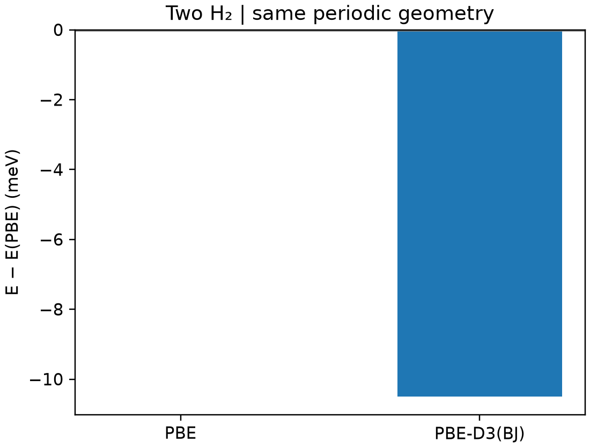

# VASP 范德华修正

**适用环境：Linux + PBS（VASP）；Windows / macOS / Linux 可绘图。**

半局域泛函对长程色散的描述有限。D3、D3(BJ)、非局域 vdW 泛函等是不同方案，应按体系选择并保持整个能量比较过程一致。

## PBE 与 D3(BJ) 对照

[最小案例](../../../examples/vasp/minimal/dispersion-d3)在同一 8 Å 周期盒中放置两个 H₂ 分子，只比较固定构型下的 PBE 与 PBE-D3(BJ)。配套 [POSCAR](../../../examples/vasp/minimal/dispersion-d3/POSCAR)、[KPOINTS](../../../examples/vasp/minimal/dispersion-d3/KPOINTS)、[PBE 参数](../../../examples/vasp/minimal/dispersion-d3/INCAR.pbe)和 [D3 参数](../../../examples/vasp/minimal/dispersion-d3/INCAR.d3)。

```text
IVDW = 12
```

`12` 对应 D3 的 Becke–Johnson 阻尼；`11` 对应另一种阻尼形式，两者不要混写。准备授权 H `POTCAR`，安装 [依赖](../../../examples/vasp/minimal/dispersion-d3/requirements.txt)，加载 VASP 后提交 [job.pbs](../../../examples/vasp/minimal/dispersion-d3/job.pbs)：

```bash
qsub job.pbs
```

[run.py](../../../examples/vasp/minimal/dispersion-d3/run.py)运行两套输入。[后处理](../../../examples/vasp/minimal/dispersion-d3/postprocess.py)核对电子收敛及 `OUTCAR` 中的实际 `Edisp`，并检查它与同构型总能差一致，再调用 [plot.py](../../../examples/vasp/minimal/dispersion-d3/plot.py)。



450 eV、Γ 点计算中，D3 修正约为 −10.50 meV。这里包含整个周期体系的色散贡献，既非单独的两分子相互作用能，也不代表优化后结合能。若要计算结合能，应在同一方案下另算各参考组分，检查盒子尺寸及几何，并按定义相减。

结构优化时色散也会影响受力与平衡几何。不要只在复合体系加修正、在参考分子却使用未修正的能量；也不要无依据地叠加多种色散方案。

原子对/多体色散校正的能量、受力和应力支持，与 DFPT 支持是不同条件。当前 `IVDW` 官方说明指出这类校正不用于 DFPT 声子，研究含色散模型的振动时应检查所用版本，并采用支持完整势能面受力的[有限差分流程](../振动与热力学/VASP有限差分振动频率.md)。D3/D4、阻尼与周期参考的共通判断见[色散一致性](../../计算化学/色散校正、阻尼与一致性检查.md)。

参考：[IVDW](https://vasp.at/wiki/IVDW)、[DFT-D3](https://vasp.at/wiki/DFT-D3)。
