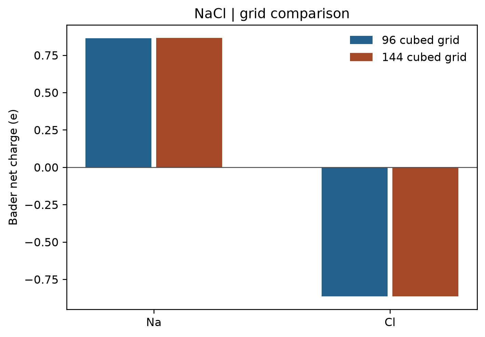

# VASP Bader 电荷分析

**适用环境：Linux（PBS 计算）；macOS / Linux（后处理）；Windows（查看结果，运行时可用 WSL）。**

贡献者：胡京京、王昌锐

Bader 方法沿电子密度的零通量面划分空间，积分各分区内的电子数。它能描述电荷转移，但净原子电荷不等于形式氧化态。

## 计算与后处理

[配套案例](../../../examples/vasp/minimal/bader-charge)采用岩盐 NaCl 的两原子原胞，晶格常数 5.64 Å，`ENCUT = 450 eV`、Γ 中心 `5 × 5 × 5` k 网格。按 `POTCAR.spec` 的顺序准备 `Na_pv`、`Cl` 势；可用 VASPKIT 生成 POTCAR，并核对元素顺序与 `ZVAL`。

在静态计算中设置：

```text
LAECHG = .TRUE.
LCHARG = .TRUE.
PREC = Accurate
NGXF = 96
NGYF = 96
NGZF = 96
```

`AECCAR0` 是芯电子密度，`AECCAR2` 是重构价电子密度。先相加得到划分空间所用的参考密度，再对 `CHGCAR` 的价电子积分：

```bash
chgsum.pl AECCAR0 AECCAR2
bader CHGCAR -ref CHGCAR_sum
```

这里使用 [VTST 脚本](https://theory.cm.utexas.edu/vtsttools/)和 [Henkelman 组 Bader 程序](https://github.com/henkelmangroup/bader)。`ACF.dat` 的 `CHARGE` 列是分区电子数，原子顺序与 POSCAR 一致。净原子电荷为：

$$q_i=Z_{\mathrm{VAL},i}-N_i^{\mathrm{Bader}}.$$

本例势的 `ZVAL` 分别为 7、7，总价电子数为 14；不要按元素的最外层电子数自行代入。正值表示该参考下失去电子，负值表示得到电子。

## 运行案例与结果图

安装案例 `requirements.txt` 中的依赖，加载软件环境后，在案例目录提交：

```bash
qsub job.pbs
```

作业自动运行 `96³`、`144³` 两组细 FFT 网格，调用 `chgsum.pl` 与 `bader`，检查电子数、转移方向和网格变化，再绘图。已有计算输出时无需重算：

```bash
python3 postprocess.py
```



图由案例中的 `plot.py` 根据实际分区结果生成。`96³` 与 `144³` 网格下，Na 的净电荷分别约为 `+0.86369 e`、`+0.86518 e`，Cl 为对应负值；最大变化约 `0.00149 e`。两组分区电子数之和均为 14。

比较网格时应检查各原子电荷的变化，同时留意真空电荷和非核吸引子。总电子数守恒不能单独证明原子电荷已收敛。本例演示检查方法；研究计算还需结合目标精度收敛 k 点、截断能和结构。

同一份 `96³` 价密度还可用于 Hirshfeld 和 CM5 对照；结果与分区差异见[原子电荷的方法选择](../../计算化学/原子电荷、片段电荷与方法选择.md#以同一份-nacl-密度比较)。不同方法的数值大小不构成精度排名，净原子电荷也不等于氧化态。

输入文件：[POSCAR](../../../examples/vasp/minimal/bader-charge/POSCAR)、[INCAR](../../../examples/vasp/minimal/bader-charge/INCAR)、[KPOINTS](../../../examples/vasp/minimal/bader-charge/KPOINTS)；作业入口：[job.pbs](../../../examples/vasp/minimal/bader-charge/job.pbs)；绘图脚本：[plot.py](../../../examples/vasp/minimal/bader-charge/plot.py)。
