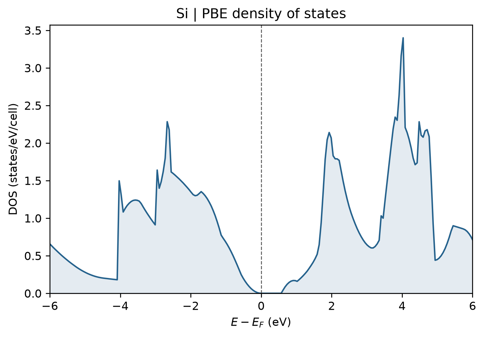

# VASP 态密度计算

**适用环境：Windows、macOS、Linux（准备输入与绘图）；Linux + PBS（VASP、VASPKIT）。**

以两个原子的金刚石型硅原胞为例，计算总态密度和原子轨道投影。先完成结构优化，再在固定结构上使用较密的均匀 k 点做静态计算。

## 准备与提交

案例提供 [POSCAR](../../../examples/vasp/minimal/density-of-states/POSCAR)、[INCAR](../../../examples/vasp/minimal/density-of-states/INCAR)、[KPOINTS](../../../examples/vasp/minimal/density-of-states/KPOINTS)、[POTCAR.spec](../../../examples/vasp/minimal/density-of-states/POTCAR.spec)、[job.pbs](../../../examples/vasp/minimal/density-of-states/job.pbs) 及[后处理入口](../../../examples/vasp/minimal/density-of-states/analyze.py)。

按 `POTCAR.spec` 从授权势库准备 Si 势；VASPKIT 中可用 `104` 显式选择元素势。`102` 可生成均匀 k 网格。本例采用 $5\times5\times5$ Γ 中心网格，目的是快速走通 DOS 流程；正式 DOS 应加密网格并比较峰形与带边。

`INCAR` 中的关键设置为：

```text
IBRION = -1
NSW = 0
ISMEAR = -5
LORBIT = 11
NEDOS = 401
```

`LORBIT=11` 输出原子与轨道投影，`NEDOS` 决定能量网格的点数，并不替代 k 点收敛。四面体积分需要合适的三维 k 网格，不能直接用于仅有 Γ 点的分子或大超胞计算。

在集群加载 VASP、MPI 和 VASPKIT 环境后，执行 `qsub job.pbs`。

## 用 VASPKIT 提取

作业脚本先检查 VASP 是否完成电子自洽，再调用 VASPKIT `111`，写出 `TDOS.dat` 与 `ITDOS.dat`。对应操作保存在 [vaspkit.in](../../../examples/vasp/minimal/density-of-states/vaspkit.in)，也可在结果目录手动运行：

```bash
vaspkit < vaspkit.in
```

需要分元素或原子投影时，可分别选择 `113` 或 `112`；用 `115` 选择特定原子和轨道。菜单与投影列以当前版本输出为准，相关说明见 [VASPKIT 教程](https://vaspkit.com/tutorials.html)。

绘图前检查能量参考：VASPKIT 通常按配置将费米能置零。半导体比较不同结构时可改用价带顶等统一基准；不要把各自置零的曲线当成绝对能级对齐。PDOS 是特定投影定义下的结果，原子与轨道投影之和不一定严格等于总 DOS。

## 结果图

后处理会调用 [plot.py](../../../examples/vasp/minimal/density-of-states/plot.py) 绘图。已有提取数据时，在结果目录单独执行 `python3 plot.py` 即可重画，无需重算 VASP；绘图依赖见 [requirements.txt](../../../examples/vasp/minimal/density-of-states/requirements.txt)。



硅原胞总态密度，PBE、5×5×5 k 网格；虚线为该 DOS 计算的费米能。
