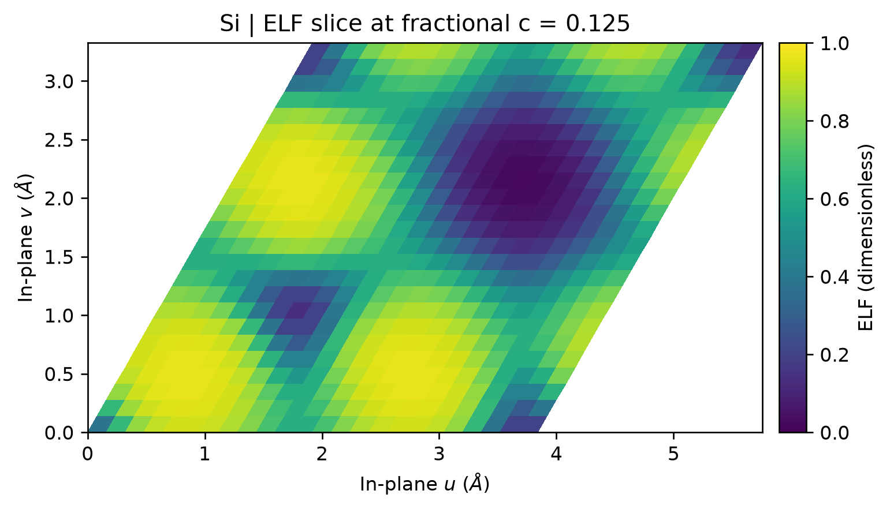

# VASP 电子局域函数 ELF

**适用环境：Windows、macOS、Linux（Multiwfn 与绘图）；Linux + PBS（VASP）。**

贡献者：胡京京、王昌锐

ELF 是描述电子局域性的无量纲函数，通常介于 0 和 1。较高值可帮助识别共价键、孤对电子等局域区域，0.5 是均匀电子气的参考值；低 ELF 不能简单解释成“电子完全离域”，也不能直接当作电荷或键能。

## 输入与提交

以硅原胞为例，案例提供 [POSCAR](../../../examples/vasp/minimal/electron-localization/POSCAR)、[INCAR](../../../examples/vasp/minimal/electron-localization/INCAR)、[KPOINTS](../../../examples/vasp/minimal/electron-localization/KPOINTS)、[POTCAR.spec](../../../examples/vasp/minimal/electron-localization/POTCAR.spec)、[job.pbs](../../../examples/vasp/minimal/electron-localization/job.pbs) 和 [postprocess.py](../../../examples/vasp/minimal/electron-localization/postprocess.py)。

准备授权 Si 势，加载 VASP、MPI、Multiwfn 和 Python [绘图依赖](../../../examples/vasp/minimal/electron-localization/requirements.txt)，执行 `qsub job.pbs`。

本例在静态计算中加入：

```text
LELF = .TRUE.
NPAR = 1
PREC = Accurate
LREAL = .FALSE.
```

`LELF` 输出 `ELFCAR`，`NPAR=1` 按 [LELF 手册](https://vasp.at/wiki/LELF)设置。例子采用非自旋极化方案；非共线等扩展计算的支持范围需另查相应版本。

## 用 Multiwfn 导出网格

后处理先检查 VASP，再由 [analyze.py](../../../examples/vasp/minimal/electron-localization/analyze.py) 载入 `ELFCAR`，按 [multiwfn.in](../../../examples/vasp/minimal/electron-localization/multiwfn.in) 的操作选择 `13 → 0`，导出 `elf.cub`。

`ELFCAR` 与 `CHGCAR` 的文件布局相似，但其中的 ELF **没有电荷密度单位**，不能按电子密度除以晶胞体积或对其积分求电荷，见 [ELFCAR 手册](https://vasp.at/wiki/ELFCAR)。脚本同时检查值域，并将网格尺寸和极值写入 `elf-analysis.json`。

## 查看切面

[plot.py](../../../examples/vasp/minimal/electron-localization/plot.py) 在第三分数坐标约为 0.125 的实际网格层取切面，画出由第一、第二晶格向量张成平面内的 ELF。图保留斜晶胞的夹角，未对网格做额外平滑。



本例使用 350 eV 截断能和 3×3×3 k 网格，展示的是一个切面，不是沿该方向的整体投影。修改脚本中的 `FRACTION_C` 可选择其他层；改变网格精度后应重新生成图，不应把粗网格经插值后的平滑外观当作更高精度。

已有 `ELFCAR` 时执行 `python3 analyze.py` 即可重新导出并绘图；已有 `elf.cub` 时执行 `python3 plot.py` 只重画。需要交互查看等值面或任意切面时，也可直接用 VESTA 打开 `ELFCAR`，并根据关注的区域调整等值面或色标。

ELF 的局域区域与电子密度临界点是不同对象。要分析密度梯度路径，使用相应电子密度及[拓扑分析](../../计算化学/电子密度拓扑、临界点与键径.md)；不要把 ELF 高值或显示器中的几何连线当作密度键径。

## 用局域分布提出反应取向初猜

表面配体、吸附羰基或其它局部反应基团的 ELF，可帮助观察孤对电子和成键区域的空间排布，结合价层密度、静电势或电子响应指标提出几种靠近方向。

低 ELF 表示相对所用参考的局域性特征，并不直接等于“缺电子”“核屏蔽最弱”或“进攻势垒最低”。真空和密度极小区域也可能出现不宜作化学解释的数值，分析时应同时查看匹配的密度、位置与网格收敛。

### ELF 临界点与密度临界点有什么区别？

对 ELF 寻找临界点时，得到的是 ELF 梯度为零的位置，不是电子密度的 QTAIM 临界点。即便两者使用相同的 `(3,+1)` 等分类记号，其对应函数、位置与意义仍不同。由目标原子指向某个 ELF 临界点的向量可作为几何描述，不能自动当作真实反应路径。对相似结构比较时，固定所用函数、临界点识别和角度定义，并核对是否跟踪了同一类局部区域。

### 怎样进一步筛选反应取向？

表面上的实际靠近方向还受吸附位点、覆盖度、溶剂配位、相邻原子位阻和基底重构影响。可据基态图保留多个候选取向，分别准备端点、寻找反应路径，再在相容的模型中比较[过渡态与势垒](../表面与反应/NEB过渡态搜索.md)。报告定量进攻角时，明确顶点原子、参考键或表面法向，并从所讨论的过渡结构或轨迹测量，而不是从等值面凹口读出一个普遍角度。

PAW 价密度、全电子价层密度和将核心轨道占据置零得到的分析密度，也不是默认可互换的对象。跨方法解释价层方向性时先核对密度表示；ELF 不能从普通密度 Cube 唯一恢复。相关方法选择见[反应位点与周期表面](../../计算化学/电子转移、极化与分析方法的选择.md#周期表面怎样使用这些线索)和[赝势密度与补芯](../../计算化学/赝势密度、补芯与近核分析.md)。

## 局域区域、电子数涨落与交换相关穴

电子密度在区域 $\Omega$ 的积分给出平均电子数 $\langle N_\Omega\rangle$。它即使恰好等于 2，也不能证明始终有两个电子留在其中，更不能给这两个全同电子指定固定身份。对固定总电子数 N 的态，采用积分为 $N(N-1)$ 的有序电子对密度 $\rho_2$，区域电子数方差满足

$$
\operatorname{Var}(N_\Omega)=\langle N_\Omega\rangle
+\int_\Omega\!\int_\Omega
\left[\rho_2(\mathbf r,\mathbf r')-\rho(\mathbf r)\rho(\mathbf r')\right]
\,d\mathbf r\,d\mathbf r'.
$$

这由 $N_\Omega^2=N_\Omega+N_\Omega(N_\Omega-1)$ 得到，描述所选区域内的量子数目涨落，不是 MD 轨迹中原子进出的频率。只知道平均密度或单条轨道图，一般不足以确定该方差。

### 交换相关穴描述什么？

在 $\rho(\mathbf r)>0$ 处，交换相关穴可写为

$$
h_{\rm xc}(\mathbf r;\mathbf r')=
\frac{\rho_2(\mathbf r,\mathbf r')}{\rho(\mathbf r)}-\rho(\mathbf r'),
\qquad \int h_{\rm xc}(\mathbf r;\mathbf r')\,d\mathbf r'=-1.
$$

它表示在参考位置已有一个电子的条件下，其余电子密度相对平均密度的改变；不是移走一个电子后留下的真实空间空洞，也不同于光激发中的空穴。定义与求和规则见[密度矩阵与交换相关穴讲义](https://dft.uci.edu/doc/g1.pdf)。相关穴局部可以有正贡献，不能要求它处处为负；交换穴与库仑相关穴的拆分还需说明参考。

### 高 ELF 能换算成区域电子数或概率吗？

ELF 是局部函数，区域方差则涉及整个区域内的电子对信息。高 ELF 可以帮助识别局域结构，但不能直接换算成“有两个电子的概率”、区域电子数或电子跃迁时间。实际计算中常用 Kohn–Sham 轨道构造 ELF 或近似的定域/离域指标，应保留该近似，不将其视为完整相关多体电子对密度。比较缺陷、磁性材料或强关联体系时，还需核对电子态、占据和所用区域；普通密度网格、ELF 网格及多体相关分析不是同一份输入。
