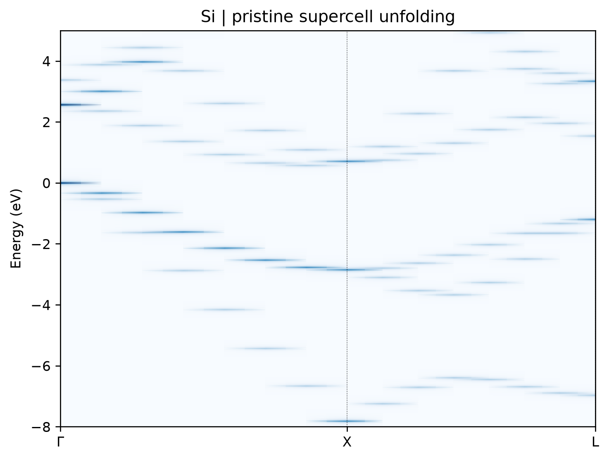

# VASP 能带反折叠

**适用环境：Linux + PBS（VASP 与 easyunfold）；Windows / macOS / Linux 可查看结果图。**

缺陷或掺杂计算常用超胞。直接画超胞能带会出现折叠，难以和原胞比较；反折叠将超胞波函数投影回原胞布里渊区，以谱权重显示原胞特征。

## 从完美超胞开始

[最小案例](../../../examples/vasp/minimal/band-unfolding)用二原子硅原胞及其 `2×1×1` 完美超胞，先核对反折叠能否恢复原胞价带，再扩展到缺陷体系。

- 结构：[原胞](../../../examples/vasp/minimal/band-unfolding/POSCAR.primitive)、[超胞](../../../examples/vasp/minimal/band-unfolding/POSCAR)。
- 输入：[自洽参数](../../../examples/vasp/minimal/band-unfolding/INCAR.scf)、[能带参数](../../../examples/vasp/minimal/band-unfolding/INCAR.band)、[原胞路径](../../../examples/vasp/minimal/band-unfolding/KPOINTS.primitive)。
- [流程入口](../../../examples/vasp/minimal/band-unfolding/run.py)、[结果检查](../../../examples/vasp/minimal/band-unfolding/postprocess.py)、[绘图](../../../examples/vasp/minimal/band-unfolding/plot.py)。

在案例副本中准备授权的 Si `POTCAR`，安装 [Python 依赖](../../../examples/vasp/minimal/band-unfolding/requirements.txt)，加载 VASP 环境后提交：

```bash
qsub job.pbs
```

[作业脚本](../../../examples/vasp/minimal/band-unfolding/job.pbs)调用 easyunfold 生成超胞 k 点，依次完成超胞、原胞自洽及各自的路径计算，然后读取超胞 `WAVECAR` 计算谱权重。原胞对照采用完全相同的路径点。两套自洽网格分别为 `4×7×7` 和 `8×7×7`，保持相容。

已有计算输出时，可单独运行 `python3 postprocess.py`；重新绘图用 `python3 plot.py`。

## 如何读图与检查



横轴为原胞 Γ—X—L 路径，零能量取超胞价带顶，颜色越深表示谱强度越高。这里仅用 15 个原胞路径点、450 eV 截断能及 0.03 eV 图示展宽，适合检查流程；细看色散时应加密路径。

完美超胞应恢复原胞特征。本例每个路径点的八条超胞价带权重之和约为 4，对应原胞四条价带；与独立原胞计算对齐价带顶后，显著权重价带的最大能量偏差约 0.64 meV。简并态之间可发生混合，应检查子空间权重总和，而非要求每一条能带权重都为 0 或 1。

用于缺陷时，保留原胞参考晶格与正确超胞变换矩阵，并按体系增加 `NBANDS`。本例的完美晶体验收条件不直接套用于缺陷谱。混合泛函也不能直接照搬这里的 `ICHARG = 11` 非自洽流程。

已有 VASPKIT 工作流可使用 `281/282` 生成 k 点与提取有效能带，需按其版本准备原胞路径和 `TRANSMAT.in`。不要混用两套工具生成的 k 点与权重文件。

参考：[easyunfold 教程](https://smtg-bham.github.io/easyunfold/tutorial.html)。
