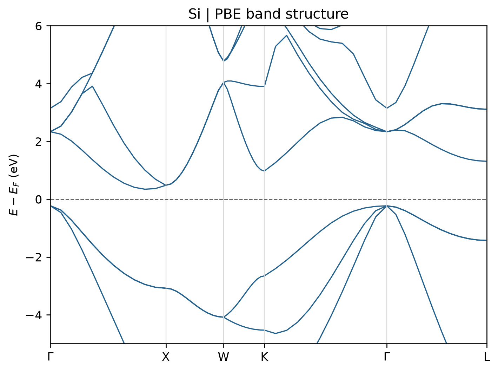

# VASP 能带计算

**适用环境：Windows、macOS、Linux（准备输入与绘图）；Linux + PBS（VASP、VASPKIT）。**

常规 PBE 能带通常分两步：先在均匀 k 网格上得到自洽电荷密度，再固定这份电荷密度计算高对称路径上的本征值。以下使用两个原子的硅原胞。

## 文件与计算顺序

案例目录为 [band-structure](../../../examples/vasp/minimal/band-structure)，主要文件如下：

| 文件 | 用途 |
| --- | --- |
| [POSCAR](../../../examples/vasp/minimal/band-structure/POSCAR) | 硅原胞；k 路径与这一晶胞基矢配套 |
| [INCAR.scf](../../../examples/vasp/minimal/band-structure/INCAR.scf)、[KPOINTS.scf](../../../examples/vasp/minimal/band-structure/KPOINTS.scf) | 均匀网格 SCF，保存 CHGCAR |
| [INCAR.band](../../../examples/vasp/minimal/band-structure/INCAR.band)、[KPOINTS.band](../../../examples/vasp/minimal/band-structure/KPOINTS.band) | `ICHARG=11`，在固定电荷下求能带 |
| [POTCAR.spec](../../../examples/vasp/minimal/band-structure/POTCAR.spec) | 授权势的元素顺序 |
| [run.py](../../../examples/vasp/minimal/band-structure/run.py)、[job.pbs](../../../examples/vasp/minimal/band-structure/job.pbs) | 依次运行两个阶段 |
| [postprocess.py](../../../examples/vasp/minimal/band-structure/postprocess.py)、[vaspkit.in](../../../examples/vasp/minimal/band-structure/vaspkit.in) | 调用 VASPKIT 导出能带 |

按 `POTCAR.spec` 准备 Si 的授权 `POTCAR`，放在案例根目录。加载 VASP、MPI、VASPKIT 环境后提交：

```bash
qsub job.pbs
```

脚本建立 `scf/` 与 `band/`，第一步使用 $7\times7\times7$ Γ 中心网格，随后将 `CHGCAR` 复制到第二步。两个阶段必须使用相同结构、势、泛函和截断能。路径计算的总能量不用于与均匀网格的自洽总能比较。

## k 路径怎么准备

本例已提供与硅原胞匹配的 Γ–X–W–K–Γ–L 路径。一般三维材料可用 VASPKIT `303` 生成标准原胞和路径，二维材料用对应的二维功能。若生成器改变了晶胞基矢，应使用其配套原胞重新计算 SCF，不能只把新路径放到原来的常规胞中。

`KPOINTS.band` 第二行控制每段采样点数，增加采样点会使曲线更平滑，但不能补足第一步自洽网格的精度。高对称路径也不保证包含整个布里渊区的带边极值。

## 提取与判断

第二步结束后由 VASPKIT `211` 写出 `BAND.dat`、`KLABELS` 等文件。后处理入口从第一步 `DOSCAR` 读取费米能，写入 `FERMI_ENERGY.in`，使曲线采用自洽网格的能量参考。该文件随新计算更新，避免沿用旧费米能；VASPKIT 的默认置零规则见[官方说明](https://vaspkit.com/tutorials.html#usage-faqs)。

绘图时按 `KLABELS` 设置横轴标签，观察价带顶、导带底的位置。对比 DOS 和投影能带有助于判断带边成分。本例的路径呈现间接带隙特征；PBE 本征值带隙不能直接替代实验光学带隙或准粒子带隙。

## 结果图

后处理会调用 [plot.py](../../../examples/vasp/minimal/band-structure/plot.py) 绘图。已有提取数据时，在结果目录单独执行 `python3 plot.py` 即可重画，无需重算 VASP；绘图依赖见 [requirements.txt](../../../examples/vasp/minimal/band-structure/requirements.txt)。



硅原胞 PBE 能带；SCF 使用 7×7×7 k 网格，路径每段 12 点，能量参考取自 SCF。

## 写带隙时说明是哪一种能量差

对具有清楚价带和导带划分的模型，在完整目标布里渊区中定义

$$
E_g^{\mathrm{eig}}=\min_{c,\mathbf k}\epsilon_{c\mathbf k}
-\max_{v,\mathbf k}\epsilon_{v\mathbf k},
\qquad
E_g^{\mathrm{dir}}=\min_{\mathbf k}
\left[\min_c\epsilon_{c\mathbf k}-\max_v\epsilon_{v\mathbf k}\right].
$$

前者允许价带顶、导带底处于不同 k 点；后者要求跃迁两端处于同一 k 点，因此 $E_g^{\mathrm{dir}}\geq E_g^{\mathrm{eig}}$。

实际有限网格或高对称路径给出的是所采样点的估计，遗漏非高对称位置的带边会使估计变化；分别报告带边位置和采样收敛。自旋、SOC、能带交叉、部分占据与电子展宽也需一并核对，不能只按某个带号或简单占据阈值判断金属与半导体。

| 名称 | 实际比较的量 | 与本篇的关系 |
| --- | --- | --- |
| PBE 等方法的本征值带隙 | 该有效单粒子模型的带边能量差 | 本篇能带流程直接给出的量 |
| 准粒子带隙 | 加、减电子激发所对应的带边能量 | 可通过 [GW](../泛函与磁性/VASPGW准粒子能带.md)等方法近似计算 |
| 光学吸收起始或激子能量 | 中性体系的激发与光学跃迁响应 | 需考虑电子—空穴相互作用、选择定则和谱线定义，见 [BSE](../响应与输运/VASPBSE光学响应.md) |

对于局域势的精确 Kohn–Sham 理论，基本能隙与 KS 本征值差之间还涉及交换相关的导数不连续，两者不能仅凭 DFT 对基态密度的精确描述划等号；见[原始理论讨论](https://doi.org/10.1103/PhysRevLett.51.1884)。杂化泛函的广义 KS 实现与 GW 又有不同的算符和近似，报告时保留方法名。带隙数值与某个实验值接近，不独自证明其它性质或整套方法均准确。

有限分子的对应区别是 HOMO–LUMO 轨道能量差、固定核坐标下的基本能隙 $I-A=E(N-1)+E(N+1)-2E(N)$，以及中性光学激发能。即使激发主要由一对前线轨道贡献，也不意味着激发能等于它们的本征值差。

周期超胞若直接采用加减电子总能差，还须处理补偿背景、有限尺寸与边界；不能把分子的真空计算步骤原样套到带电晶体上。

讨论激子束缚能时，选取同一动量与相容精度的准粒子连续谱阈值和相应激子态；暗态、最低亮态、吸收边与展宽后的主峰不是同一对象。间接材料的吸收还可能需要声子辅助过程，不能拿间接本征值带隙减某个直接吸收峰就称作激子束缚能。实验对比注明温度、相态、维度、环境和谱线提取方式。

带隙也不是导电性或稳定性的单一判据。电导还取决于载流子浓度、迁移率和散射；热力学稳定性、动力学分解和表面反应则分别需要相应能量与路径证据。比较掺杂、缺陷或表面模型时，将这些问题与带边变化分开讨论。

### 从有限寡聚物外推无限链

对同一结构族，可考察不同重复单元数 n 的 HOMO–LUMO 轨道能差，并尝试按 $1/n$ 或其它有依据的尺寸变量外推。保持端基、构象、键长交替、荷电与自旋状态、泛函和基组一致；先检查前线轨道是否局域在端基或缺陷上。若随长度发生构象或电子态变化，应分别分析对应分支，不能合并成一条尺寸拟合线。

短链的线性趋势未必延续到无限长。逐步增加链长、改变拟合区间并比较外推结果，再与相容结构和方法的周期计算核对；必要时同时跟踪轨道空间分布和链中部结构。即使两种模型的本征值差相符，也只支持该模型与外推方案的一致性。与实验比较仍需确认测得的是光学吸收、加减电子激发还是输运响应，并考虑固态堆积和环境，不能将端基封闭的孤立链当作体相聚合物。
