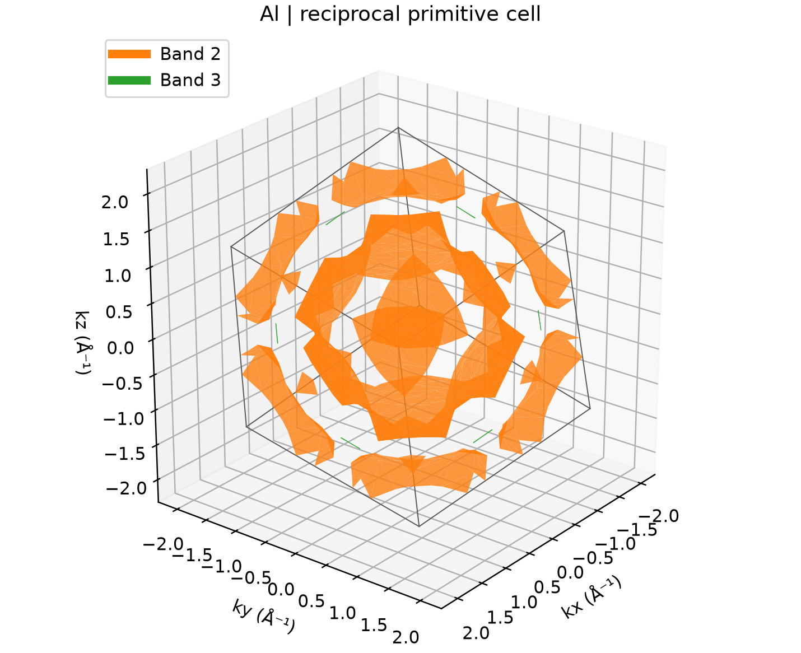

# VASP 费米面计算

**适用环境：Linux + PBS（VASP）；Windows / macOS / Linux 可用 Python 绘图。**

费米面是能带满足 `Eₙ(k) = EF` 的三维等能面。它需要覆盖整个倒易空间的网格数据，不能从几条高对称路径恢复。

## 铝原胞的完整网格

[最小案例](../../../examples/vasp/minimal/fermi-surface)提供 [POSCAR](../../../examples/vasp/minimal/fermi-surface/POSCAR)、[自洽参数](../../../examples/vasp/minimal/fermi-surface/INCAR.scf)、[完整网格参数](../../../examples/vasp/minimal/fermi-surface/INCAR.grid)与 [自洽 KPOINTS](../../../examples/vasp/minimal/fermi-surface/KPOINTS.scf)。准备授权 Al `POTCAR`，安装 [依赖](../../../examples/vasp/minimal/fermi-surface/requirements.txt)，加载 VASP 后提交 [job.pbs](../../../examples/vasp/minimal/fermi-surface/job.pbs)：

```bash
qsub job.pbs
```

[run.py](../../../examples/vasp/minimal/fermi-surface/run.py)先用 `11×11×11` 网格自洽，再读取电荷密度，在完整的 `9×9×9` 网格上计算本征值。`ISYM = -1` 保留全部 729 个点；[prepare.py](../../../examples/vasp/minimal/fermi-surface/prepare.py)生成 `KPOINTS.grid`，修改其中的 `GRID` 可加密。

[后处理](../../../examples/vasp/minimal/fermi-surface/postprocess.py)检查 k 点覆盖、非自旋电子数和穿越费米能的能带，再保存 `fermi-grid.npz`。[plot.py](../../../examples/vasp/minimal/fermi-surface/plot.py)用 scikit-image 的 marching cubes 提取实际等能面，按晶格倒易基矢换成 Å⁻¹，并补齐周期边界。

## 看图时区分倒易原胞与第一布里渊区



图中边框是倒易原胞平行六面体，并非按 Wigner–Seitz 边界裁剪后的第一布里渊区。穿过边界的面片按倒易周期性相接，不应把每个片段都认作独立费米口袋。

本例为 450 eV、0.1 eV 展宽的粗网格演示，第二、第三条能带跨越费米能；完整网格积分得到约 3 个价电子/原胞。费米能取这套均匀网格自身的电子填充结果。定量研究截面积、细小口袋或输运前，需加密网格并检查展宽。

如采用 VASPKIT 工作流，可用 `261` 生成其专用网格，再用 `262` 导出 BXSF、在 XCrySDen 等工具中查看。两套流程的网格格式不同，不直接把本例生成的列表交给另一流程的提取入口。

参考：[VASPKIT 费米面教程](https://vaspkit.com/tutorials.html#fermi-surface)。
