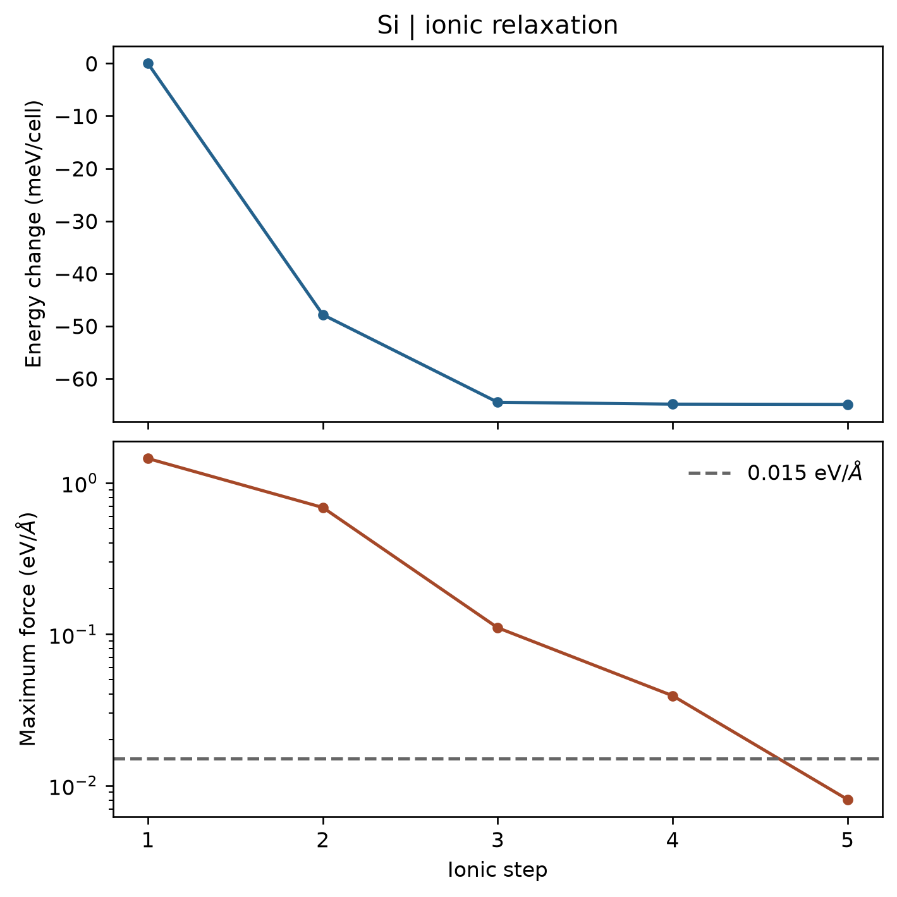

# VASP 原子位置优化

**适用环境：Windows、macOS、Linux（准备输入与分析）；Linux + PBS（VASP）。**

在固定晶胞内优化原子位置，适合寻找局部能量极小构型。本例对硅原胞中的一个原子施加小扰动，再用共轭梯度法恢复平衡位置。

## 输入与提交

案例提供 [POSCAR](../../../examples/vasp/minimal/ionic-relaxation/POSCAR)、[INCAR](../../../examples/vasp/minimal/ionic-relaxation/INCAR)、[KPOINTS](../../../examples/vasp/minimal/ionic-relaxation/KPOINTS)、[POTCAR.spec](../../../examples/vasp/minimal/ionic-relaxation/POTCAR.spec)、[job.pbs](../../../examples/vasp/minimal/ionic-relaxation/job.pbs) 和 [postprocess.py](../../../examples/vasp/minimal/ionic-relaxation/postprocess.py)。

VASPKIT `101` 的 `SR` 可生成弛豫骨架。准备授权 Si 势，核对参数，加载 VASP、MPI、Python 及[绘图依赖](../../../examples/vasp/minimal/ionic-relaxation/requirements.txt)后提交：

```bash
qsub job.pbs
```

关键参数为：

```text
IBRION = 2
ISIF = 2
NSW = 40
EDIFF = 1E-7
EDIFFG = -0.015
```

`IBRION=2` 使用共轭梯度，`ISIF=2` 保持晶胞不变并计算应力，`NSW` 是允许的最大离子步数。负的 `EDIFFG` 以受力判停，本例阈值为 0.015 eV/Å；它不等于电子收敛参数 `EDIFF`，详见 [EDIFFG 手册](https://vasp.at/wiki/EDIFFG)。

## 判断是否优化完成

检查电子自洽与 `reached required accuracy` 标记，再看最终受力。程序正常结束或达到 `NSW` 上限时，仍需根据上述标记和受力判断是否收敛。

`CONTCAR` 保存最后结构，`OUTCAR` 保存受力，`vasprun.xml` 记录优化各步。后处理会调用 [plot.py](../../../examples/vasp/minimal/ionic-relaxation/plot.py) 画出能量变化与最大原子受力：



本例使用 350 eV 截断能与 3×3×3 k 网格。图中能量相对第一步平移，受力虚线为输入阈值。该结构不含固定原子；存在约束时，应按允许的自由度判断，不能直接把固定原子上的原始受力计入优化失败。

已有输出可单独运行 `python3 postprocess.py` 检查并重画，或 `python3 plot.py` 只重画图。优化后若要比较高精度能量，建议以 `CONTCAR` 为新 `POSCAR` 做统一参数的静态计算。
