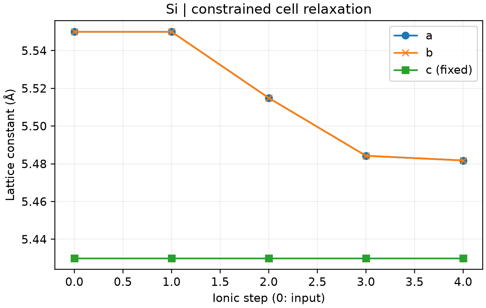

# VASP 固定晶格优化

**适用环境：Linux + PBS（含对应固定晶格补丁的 VASP）；绘图通用。**

薄膜或界面优化时，常需固定部分晶格方向，只放松其余方向。`Selective dynamics` 控制的是原子位置自由度，不能代替晶胞约束。

## 正交晶胞固定 c 方向

[最小案例](../../../examples/vasp/minimal/constrained-cell)使用八原子硅正交晶胞，初始 `a = b = 5.55 Å`、`c = 5.43 Å`，仅优化面内尺寸。

准备授权 Si `POTCAR`，选择能够读取三整数 `OPTCELL` 的 VASP 程序，安装 [Python 依赖](../../../examples/vasp/minimal/constrained-cell/requirements.txt)，在案例副本中提交 [PBS 作业](../../../examples/vasp/minimal/constrained-cell/job.pbs)：

```bash
qsub job.pbs
```

关键文件：[POSCAR](../../../examples/vasp/minimal/constrained-cell/POSCAR)、[INCAR](../../../examples/vasp/minimal/constrained-cell/INCAR)、[KPOINTS](../../../examples/vasp/minimal/constrained-cell/KPOINTS)、[OPTCELL](../../../examples/vasp/minimal/constrained-cell/OPTCELL)。本例使用 `ISIF = 3`、`IBRION = 2`，`OPTCELL` 内容为：

```text
1 1 0
```

该补丁保留 xx、yy 晶胞驱动力，将其余分量置零，适用于本例的正交晶胞。[后处理](../../../examples/vasp/minimal/constrained-cell/postprocess.py)检查电子与结构优化收敛、c 基矢在全过程不变，且面内尺寸确实发生变化。



图由 [plot.py](../../../examples/vasp/minimal/constrained-cell/plot.py)读取实际优化轨迹生成；a、b 重合，四步后均为约 5.48178 Å，c 保持 5.43 Å。450 eV、`3×3×3` 网格用于演示约束，不作为收敛后的硅晶格参数。

## 不同补丁不要混用

`OPTCELL` 的含义取决于所用补丁。旧式三行矩阵、三整数对角应力补丁与 `IOPTCELL` 九分量补丁是不同实现，使用前先核对程序来源和输入格式。

[VASP_OPT_AXIS](https://github.com/Chengcheng-Xiao/VASP_OPT_AXIS)还提供 `IOPTCELL = xx xy xz yx yy yz zx zy zz` 的应力掩码，以及直接恢复晶格分量的另一套补丁。后者要求 `IBRION = 2`；两种约束在斜晶胞中也不能等同。换补丁后应重新检查晶格轨迹，不能仅凭输入里存在该参数判断约束已生效。
