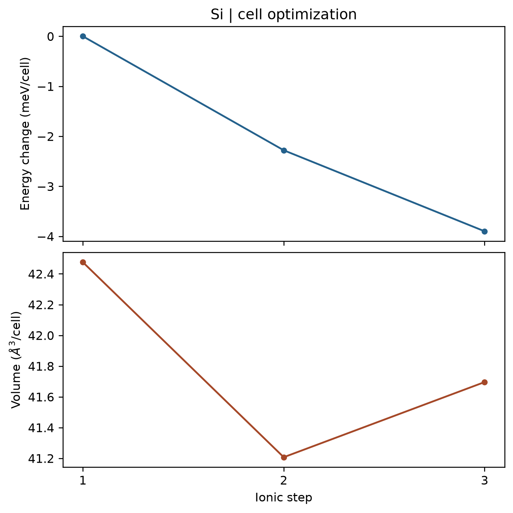

# VASP 晶胞优化

**适用环境：Windows、macOS、Linux（准备输入与分析）；Linux + PBS（VASP）。**

晶胞优化同时调整原子位置、晶胞形状和体积，用于寻找给定外压下的平衡结构。本例从稍放大的硅原胞出发，演示零外压下的优化过程。

## 输入与提交

案例包含 [POSCAR](../../../examples/vasp/minimal/cell-relaxation/POSCAR)、[INCAR](../../../examples/vasp/minimal/cell-relaxation/INCAR)、[KPOINTS](../../../examples/vasp/minimal/cell-relaxation/KPOINTS)、[POTCAR.spec](../../../examples/vasp/minimal/cell-relaxation/POTCAR.spec)、[job.pbs](../../../examples/vasp/minimal/cell-relaxation/job.pbs) 和 [postprocess.py](../../../examples/vasp/minimal/cell-relaxation/postprocess.py)。

VASPKIT `101` 的 `LR` 可生成晶格弛豫骨架。准备授权 Si 势，加载 VASP、MPI、Python 与[绘图依赖](../../../examples/vasp/minimal/cell-relaxation/requirements.txt)后，执行 `qsub job.pbs`。

```text
IBRION = 2
ISIF = 3
NSW = 35
EDIFF = 1E-7
EDIFFG = -0.02
```

`ISIF=3` 允许原子位置、晶胞形状和体积变化，不能简单理解为“只改体积”。若要固定形状或某些方向，需要选择适当自由度或约束，见 [ISIF 手册](https://vasp.at/wiki/ISIF)。

晶胞变化使平面波基组与应力误差更敏感，应测试截断能和 k 网格。对真实材料，应力与平衡体积收敛后才能报告晶格参数；不能只看原子受力已很小。

## 结果与图

检查电子自洽、优化完成标记、最终应力和 `CONTCAR` 中的晶胞。该硅模型保持高对称位置，原子受力可以始终接近零，而体积仍需优化；因此本例用体积变化而非原子受力作为第二幅图。



图由 [plot.py](../../../examples/vasp/minimal/cell-relaxation/plot.py) 读取 `vasprun.xml` 生成，能量相对第一步平移。本例的 350 eV 和 3×3×3 k 网格用于快速演示，并非硅晶格常数的收敛参数。

已有输出可运行 `python3 postprocess.py` 检查并绘图。对最终晶胞再做一次统一参数的静态计算，有助于检查基组变化造成的误差；还可与[能量—体积曲线](VASP能量体积曲线拟合.md)交叉判断。不同参数或不同约束下的结果不能直接比较。
