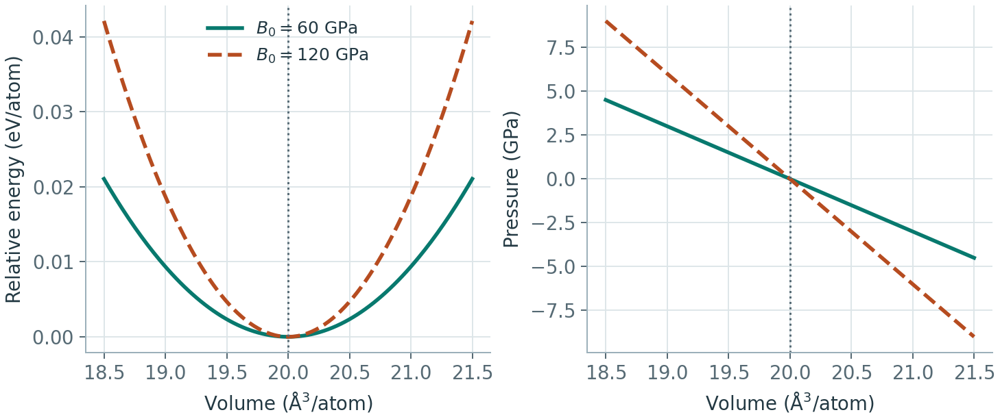
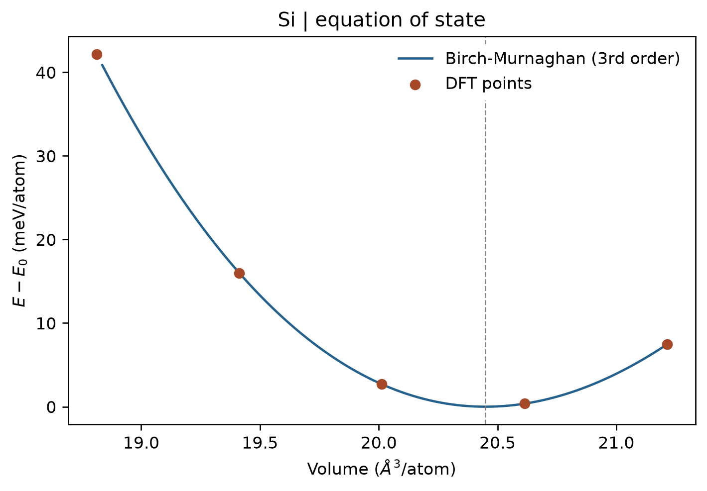

# VASP 能量—体积曲线与状态方程

**适用环境：Windows、macOS、Linux（准备输入与绘图）；Linux + PBS（VASP、VASPKIT）。**

在一组固定体积下计算总能量，再用状态方程拟合，可以求同一晶相的平衡体积和体积模量。它考察的是给定结构分支，不能代替不同晶相、磁态之间的搜索与比较。

## 准备与提交

以两个原子的金刚石型硅原胞为例，案例包括 [POSCAR](../../../examples/vasp/minimal/equation-of-state/POSCAR)、[INCAR](../../../examples/vasp/minimal/equation-of-state/INCAR)、[KPOINTS](../../../examples/vasp/minimal/equation-of-state/KPOINTS)、[run.py](../../../examples/vasp/minimal/equation-of-state/run.py)、[job.pbs](../../../examples/vasp/minimal/equation-of-state/job.pbs) 和 [postprocess.py](../../../examples/vasp/minimal/equation-of-state/postprocess.py)。依赖见 [requirements.txt](../../../examples/vasp/minimal/equation-of-state/requirements.txt)。

按 [POTCAR.spec](../../../examples/vasp/minimal/equation-of-state/POTCAR.spec) 准备授权 Si 势，加载 VASP、MPI、VASPKIT 与 Python 环境后提交：

```bash
qsub job.pbs
```

脚本按原胞体积的 0.94、0.97、1.00、1.03、1.06 倍生成五份结构，使用 `ENCUT=450 eV`、`EDIFF=1E-8` 和 $7\times7\times7$ Γ 中心网格计算。**体积比例不是边长比例**：体积变为 $r$ 倍时，晶格向量应乘 $r^{1/3}$。

本例的硅内部坐标受对称性约束，因此每个体积直接做单点即可。一般多原子晶体应在每个固定体积下先弛豫内部坐标；非立方晶体还要明确是否允许晶胞形状变化，避免混用不同约束下的能量。

## 用 VASPKIT 拟合

后处理从各子目录收集体积和 VASP 的 `e_0_energy`，写出 `energy-volume.dat` 与 `EOS.in`，再通过 [vaspkit.in](../../../examples/vasp/minimal/equation-of-state/vaspkit.in) 调用 `205`。本例选择三阶 Birch–Murnaghan 方程，由 VASPKIT 完成拟合，Python 只组织数据与绘图。

拟合给出平衡体积 $V_0$、极小值能量 $E_0$ 和体积模量

$$
B_0=V_0\left.\frac{\partial^2 E}{\partial V^2}\right|_{V_0}.
$$



示意中两组曲线的平衡体积相同。能量曲率较大的一组在相同体积变化下产生更大的压力变化，因此体积模量更高。压力曲线由能量对体积的负导数得到。

先确认扫描区间覆盖能量极小值，再看数据是否平滑，以及拟合参数对体积范围、点数和计算精度是否稳定。五点扫描适合快速演示，正式结果通常需要更多采样；各点的截断能和 k 网格保持一致。曲线平滑之后，仍需检查这些参数依赖。

VASPKIT 的日志按本例两原子胞报告 $V_0$、$E_0$，而 `ENERGY_VOLUME_DFT.dat`、`ENERGY_VOLUME_FIT.dat` 按**每原子**归一化，读取时要看表头。若从硅原胞体积换成立方常规胞晶格常数，本例有 $a=(4V_0)^{1/3}$。

## 结果图

[plot.py](../../../examples/vasp/minimal/equation-of-state/plot.py) 将 VASPKIT 的原始点和拟合曲线画在同一图中，能量相对拟合极小值平移，不另做拟合或平滑。已有结果时执行 `python3 postprocess.py` 可重新拟合并绘图；只重画图则执行 `python3 plot.py`。



图中横轴和纵轴均按每原子归一化，虚线标出平衡体积。该小案例使用 PBE、450 eV 截断能和 7×7×7 k 网格。

## 温度和压力的影响

这里的静态电子能量曲线不包含零点振动与有限温度振动自由能。热膨胀需要多个体积下的声子自由能，在准简谐近似中最小化 $F(V,T)$；单个体积的[简谐热容](../振动与热力学/VASP热容计算.md)不能直接给出温度相关晶格常数。

给定静水外压时，应比较或最小化 $H=E+pV$。使用 VASP 的 `PSTRESS` 做晶胞弛豫时，其单位为 kbar，且离子优化中会加入压力—体积能量项，不能再把带该项的输出无条件当作零压内能重复加 $pV$。具体行为见 [PSTRESS 官方说明](https://vasp.at/wiki/PSTRESS)。
