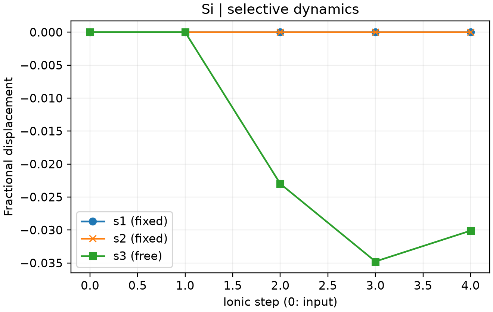

# VASP 选择性结构优化

**适用环境：Linux + PBS（VASP）；Windows / macOS / Linux 可准备结构、绘图。**

表面或局部结构优化常需冻结部分原子。`POSCAR` 的 `Selective dynamics` 允许逐原子选择自由分量，与[固定晶胞基矢](VASP固定晶格优化.md)是两种不同约束。

## 只释放一个方向

[最小案例](../../../examples/vasp/minimal/selective-relaxation)固定硅原胞中的第一个原子，让第二个原子只沿第三晶格方向放松。输入包括 [POSCAR](../../../examples/vasp/minimal/selective-relaxation/POSCAR)、[INCAR](../../../examples/vasp/minimal/selective-relaxation/INCAR)、[KPOINTS](../../../examples/vasp/minimal/selective-relaxation/KPOINTS)与 [PBS 脚本](../../../examples/vasp/minimal/selective-relaxation/job.pbs)。

```text
Selective dynamics
Direct
0 0 0 F F F
.25 .25 .28 F F T
```

`T` 表示可变，`F` 表示冻结。这里选择的是晶格基矢方向，即使坐标写成 Cartesian，标志的定义也不变。

本例使用斜晶胞，第三晶格方向同时含有笛卡尔 x、y 分量。因此，`F F T` 允许的运动方向并非笛卡尔 z 轴。

准备授权 Si `POTCAR`，安装 [依赖](../../../examples/vasp/minimal/selective-relaxation/requirements.txt)，加载 VASP 后执行：

```bash
qsub job.pbs
```

`ISIF = 2` 保持晶胞不变，`IBRION = 2` 优化原子位置。[后处理](../../../examples/vasp/minimal/selective-relaxation/postprocess.py)检查整条轨迹中所有冻结分量、自由方向的实际位移与受力投影，并调用 [plot.py](../../../examples/vasp/minimal/selective-relaxation/plot.py)。已有输出可单独运行 `python3 postprocess.py`。

## 检查约束



图展示第二个原子的分数坐标位移。四步后，自由的第三分量变化约 −0.03011，两个冻结分量保持不变，自由方向受力约为 0.00643 eV/Å。参数为 450 eV、`3×3×3` 网格，用来检查约束流程。

固定分量上可存在反作用力，不要求其原始受力也趋近零。应确认自由方向收敛，并结合实际物理问题判断被冻结区域是否合理。编辑结构或改变原子顺序后，也要重新核对约束对象。

参考：[VASP 的 POSCAR 格式](https://vasp.at/wiki/POSCAR)。
