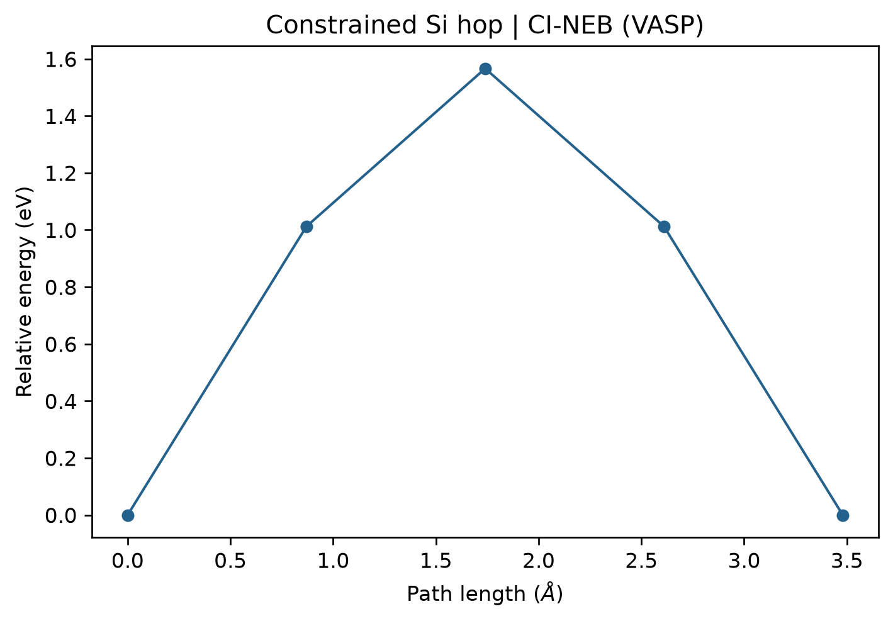

# VASP CI-NEB 过渡态搜索

**适用环境：Windows、macOS、Linux（准备结构与绘图）；Linux + PBS（VTST 版 VASP、VTST 脚本）。**

NEB 用一串结构连接初态和末态，优化最小能量路径；CI-NEB 让最高能量的中间点沿路径爬坡，以逼近鞍点。原子顺序、周期映像和初始路径，与优化参数一样重要。

## 模型与文件

本例在 7 原子的硅周期小胞中固定六个背景原子，让另一个 Si 在两个局部能谷之间迁移。这个受约束模型便于快速学习流程；真实缺陷计算还需检查超胞、电子采样、磁态及邻近原子的弛豫。

| 文件 | 用途 |
| --- | --- |
| [POSCAR.initial](../../../examples/vasp/minimal/neb/POSCAR.initial)、[POSCAR.final](../../../examples/vasp/minimal/neb/POSCAR.final) | 同一晶胞、同一原子顺序的初末态猜测，含固定原子标记 |
| [INCAR.endpoint](../../../examples/vasp/minimal/neb/INCAR.endpoint)、[KPOINTS](../../../examples/vasp/minimal/neb/KPOINTS) | 在固定晶胞中优化端点 |
| [INCAR.neb](../../../examples/vasp/minimal/neb/INCAR.neb) | CI-NEB 参数 |
| [POTCAR.spec](../../../examples/vasp/minimal/neb/POTCAR.spec) | 授权势的元素顺序 |
| [run.py](../../../examples/vasp/minimal/neb/run.py)、[job.pbs](../../../examples/vasp/minimal/neb/job.pbs) | 组织端点、VTST 插值和 NEB 计算 |
| [postprocess.py](../../../examples/vasp/minimal/neb/postprocess.py)、[plot.py](../../../examples/vasp/minimal/neb/plot.py) | 调用 VTST 提取路径并绘图 |

准备支持 VTST 的 VASP 和 [VTST 脚本](https://theory.cm.utexas.edu/vtsttools/scripts.html)，使 `nebmake.pl`、`nebbarrier.pl` 可从作业环境调用。Python 依赖见 [requirements.txt](../../../examples/vasp/minimal/neb/requirements.txt)。

授权 Si 势可用 VASPKIT `104` 显式选择。本例根目录没有名为 `POSCAR` 的文件，准备势文件时可先复制 `POSCAR.initial` 为 `POSCAR`，再使用 [vaspkit-potcar.in](../../../examples/vasp/minimal/neb/vaspkit-potcar.in)。

## 提交与计算顺序

按集群实际程序名修改 `job.pbs` 中的 `VASP_EXEC`，加载 VASP、MPI、Python 与 VTST 脚本环境后提交：

```bash
qsub job.pbs
```

本例申请 3 个 MPI 进程，`IMAGES=3` 表示三个中间点，目录排列为：

```text
00/  初态
01/  中间点
02/  中间点
03/  中间点
04/  末态
```

`run.py` 先分别优化 `initial/` 和 `final/`，确认端点收敛，再调用：

```bash
nebmake.pl initial/CONTCAR final/CONTCAR 3
```

优化后的端点应仍属于计划研究的两个局部能谷。如果端点优化改变了局部构型，应重新确认研究的迁移过程，不能仅凭优化成功就继续。

通常先确定共同晶胞，再在该晶胞中优化两个端点；不要分别优化出不同晶胞后直接做普通固定晶胞 NEB。周期体系还要检查原子跨边界的映像，线性插值不应让原子走远路或相互穿过；复杂路径可借助 ASE 的 IDPP 等成熟工具准备。

## 关键参数

```text
IBRION = 3
POTIM = 0
IOPT = 3
IMAGES = 3
LCLIMB = .TRUE.
SPRING = -5
EDIFFG = -0.03
```

这里 `IOPT=3` 使用 VTST 的优化器，不能将这些参数直接套给没有 VTST 支持的 VASP。`SPRING<0` 对应 NEB 的弹簧约束；原版 VASP 的相关行为见 [SPRING 手册](https://vasp.at/wiki/SPRING)。

NEB 阶段的总 MPI 进程数应能按中间点分组。本例每个中间点使用一个进程；增加进程时还需合理设置每组内部的并行参数。若端点已完成，可用 `python3 run.py --stage neb --ranks 3` 继续，但必须保持结构和电子设置一致。

## 检查势垒与结果图

检查所有中间点的电子收敛、NEB 收敛和固定原子约束。固定原子上的原始受力可以较大，不能用所有原子未投影的最大受力代替 NEB 在自由度上的收敛判据。

后处理调用 `nebbarrier.pl` 写出 `neb.dat`，其中包含路径累计距离、相对初态的能量和切向力等。正向势垒为最高点能量减初态能量，反向势垒则减末态能量；端点能量不等时两者不同。



本例使用 7 原子固定晶胞、Γ 点与 350 eV 截断能。图中标出实际计算的五个构型，仅用线段连接，不通过平滑曲线虚构更多采样点。已有结果时，执行 `python3 postprocess.py` 可重新提取并绘图，`python3 plot.py` 则只重画图。

得到路径最高点后，通常还应检查其构型和振动模式，以确认目标过渡态。迁移势垒本身也不足以确定扩散系数：速率表达式 $k=\nu\exp[-E_a/(k_BT)]$ 还需要尝试频率，扩散系数另受跳跃网络、维度与相关因子影响，不能只凭一个势垒给出可靠的 $D$。
