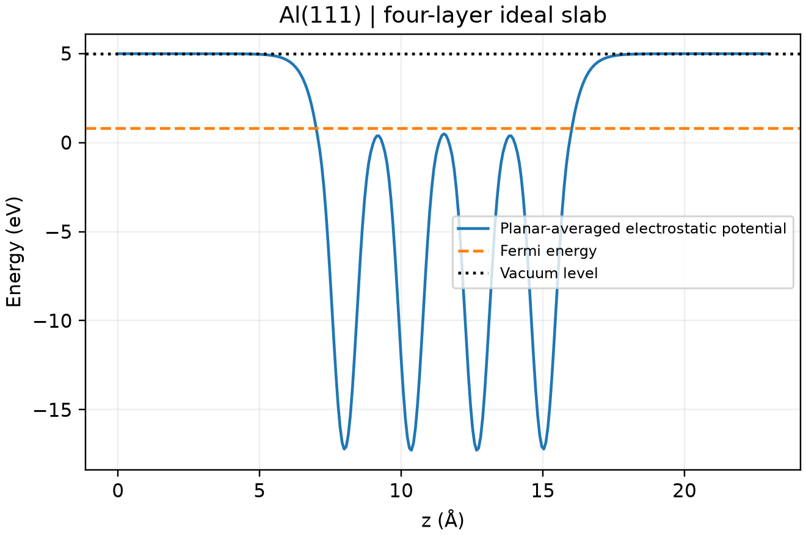

# VASP 功函数计算

**适用环境：Linux + PBS（VASP）；Windows / macOS / Linux 可绘图。**

金属表面功函数为 `Φ = Evac − EF`。真空能级必须从远离表面的平坦势区取得，并与同一次计算的费米能使用相同参考。

## Al(111) 小薄膜

[最小案例](../../../examples/vasp/minimal/work-function)使用四层理想 Al(111)、总计约 16 Å 真空，提供 [POSCAR](../../../examples/vasp/minimal/work-function/POSCAR)、[INCAR](../../../examples/vasp/minimal/work-function/INCAR)、[KPOINTS](../../../examples/vasp/minimal/work-function/KPOINTS)和 [PBS 脚本](../../../examples/vasp/minimal/work-function/job.pbs)。

```text
LVHAR = .TRUE.
LVACPOTAV = .TRUE.
IDIPOL = 3
LDIPOL = .TRUE.
DIPOL = 0.5 0.5 0.5
```

`LVHAR` 输出离子与 Hartree 静电势，避免真空区交换相关势带来的不便；`LVACPOTAV` 是较新 VASP 的原生真空势平均功能。本例在 VASP 6.5.1 上使用。z 方向为表面法向，偶极参考位于晶胞中心。

准备授权 Al `POTCAR`，安装 [依赖](../../../examples/vasp/minimal/work-function/requirements.txt)，加载 VASP 后执行 `qsub job.pbs`。[后处理](../../../examples/vasp/minimal/work-function/postprocess.py)用 ASE 读取 `LOCPOT`，沿面内方向平均，在两端各 2 Å 区间检查平台并取均值；同时与 VASP 原生真空势核对，再由 [plot.py](../../../examples/vasp/minimal/work-function/plot.py)绘图。

## 检查真空平台



本例 450 eV、`7×7×1` 网格下，两侧平台约 4.9848 eV，费米能约 0.81005 eV，功函数约 4.1748 eV。两侧相同符合对称薄膜的预期；非对称吸附表面则可能有不同功函数，不应强制要求两侧一致。

四层未弛豫薄膜仅演示提取过程。正式结果需测试层数、真空、面内 k 点及表面弛豫。半导体还需考虑费米能位置、掺杂和带弯曲，不机械套用金属薄膜的解释。

VASPKIT `426` 也可提取平面平均势；输出文件名随版本可能为 `POTPAVG.dat` 或 `PLANAR_AVERAGE.dat`。使用前确认输出有完整的有限数值网格，再按所选真空平台取参考，不能仅凭程序退出码判断提取成功。

参考：[VASP 功函数指南](https://vasp.at/wiki/Computing_the_Workfunction)、[LVACPOTAV](https://vasp.at/wiki/LVACPOTAV)。

## 电势、电子势能与零点怎样区分

静电势是空间函数，定义为单位正试探电荷的静电能。若用电压量纲的 $\varphi$ 表示，电子的静电势能为 $U_e=-e\varphi$，其中 e 为正的元电荷。物理电场为 $\mathbf E=-\nabla\varphi$；对电子势能求导时，符号和电荷因子应相应转换。不要把一张“势图”的梯度直接当成电场而不核对所绘制的量。

本篇 `LOCPOT` 路线使用 eV 单位的势数据，并与电子能量参考求差。`LVHAR`、`LVTOT` 和 `WRT_POTENTIAL` 决定输出包含哪些项；纯电子 Hartree 项、离子加 Hartree 静电项、含交换相关的局域有效势不是同一个量。自旋极化或非共线输出还可能包含多个数据块，应按版本和打印设置选取目标标量场，见 [LOCPOT 定义](https://vasp.at/wiki/LOCPOT)。

### 跨程序的势文件可以直接比较吗？

CP2K 的 `V_HARTREE_CUBE` 有自身约定：该 QS/GPW 打印项含电子与离子总密度产生的势，手册注明与通常物理静电势符号相反。跨程序比较时，逐项核对符号、势的组成、单位及共同参考，而不是给所有名为 Hartree 的文件统一取负号。还需先做 Hartree、eV 等单位换算；对应说明见 [CP2K 势网格](https://manual.cp2k.org/cp2k-2026_2-branch/CP2K_INPUT/FORCE_EVAL/DFT/PRINT/V_HARTREE_CUBE.html)。

### 改变势的零点会改变功函数吗？

周期势的整体常数由计算约定确定。在同一电子能量约定下，同时平移真空参考与费米能不会改变功函数：

$$
(E_{\mathrm{vac}}+C)-(E_F+C)=E_{\mathrm{vac}}-E_F.
$$

因此不能直接用两个独立任务中某个网格点的裸势值相减来判断功函数变化。每个表面应先用本任务的平坦真空区和费米能求差，再比较；若分析界面势阶或带边对齐，则另行定义相容的真空、体相平均势或其它参照。对带净电荷、施加外场或电势补偿的 slab，还需说明电荷补偿和边界条件；倾斜真空势不能任意取一段平均后当作无场平台。

分子静电势常以无穷远为零，核吸引积分或有限点电荷模型也有相应的非周期定义。这种结果不自动等于周期泊松问题的解。Multiwfn 2026.7.15 的主功能 `1` 周期路径不输出 ESP，不能直接套用孤立分子的核位置菜单；已有周期势 Cube 时可按网格坐标插值或作切片，但网格插值不会补出欠缺的边界、核区重构或势能分量。

同一表面上的平均势、正负面积和极值范围要在相同零点和表面定义下比较。原子拟合电荷、局部表面均值以及核位置的约定势也应分别命名，见[近核与原子位置的势](../../计算化学/赝势密度、补芯与近核分析.md#原子位置的势不是原子电荷)。这些局部指标可以辅助解释吸附位点，不能单独替代功函数、吸附能或反应势垒。
