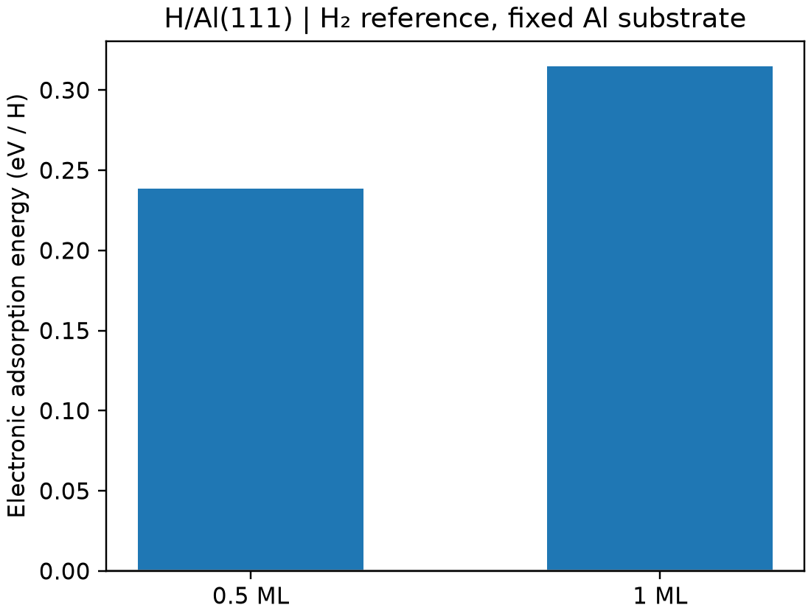

# H 在 Al(111) 上的吸附能

**适用环境：Linux + PBS（VASP）；Windows / macOS / Linux 可绘图。**

以 H/Al(111) 为例，吸附能定义为

$$E_\mathrm{ads}(n)=E(\mathrm{slab}+n\mathrm H)-E(\mathrm{slab})-\frac n2E(\mathrm H_2).$$

这里以气相 H₂ 为参考，负值表示放热；改用孤立 H 原子参考会得到不同数值。

## 输入与提交

[最小案例](../../../examples/vasp/minimal/adsorption-energy)包含 [洁净表面](../../../examples/vasp/minimal/adsorption-energy/POSCAR.clean)、[半覆盖](../../../examples/vasp/minimal/adsorption-energy/POSCAR.half)、[全覆盖](../../../examples/vasp/minimal/adsorption-energy/POSCAR.full)和 [H₂](../../../examples/vasp/minimal/adsorption-energy/POSCAR.h2)。两表面位点晶胞含 8 个 Al，固定全部 Al，仅优化 H；0.5 ML 与 1 ML 分别对应 1、2 个 H。

使用 [INCAR.clean](../../../examples/vasp/minimal/adsorption-energy/INCAR.clean)、[INCAR.ads](../../../examples/vasp/minimal/adsorption-energy/INCAR.ads)、[INCAR.h2](../../../examples/vasp/minimal/adsorption-energy/INCAR.h2)，以及 [薄膜 k 网格](../../../examples/vasp/minimal/adsorption-energy/KPOINTS.slab)和 [分子 k 网格](../../../examples/vasp/minimal/adsorption-energy/KPOINTS.h2)。准备授权的 `potentials/Al/POTCAR`、`potentials/H/POTCAR`，安装 [依赖](../../../examples/vasp/minimal/adsorption-energy/requirements.txt)，加载 VASP 后提交 [job.pbs](../../../examples/vasp/minimal/adsorption-energy/job.pbs)：

```bash
qsub job.pbs
```

[run.py](../../../examples/vasp/minimal/adsorption-energy/run.py)顺序计算四个状态，[postprocess.py](../../../examples/vasp/minimal/adsorption-energy/postprocess.py)核对电子与几何收敛、固定原子位移及参考态，再用 [plot.py](../../../examples/vasp/minimal/adsorption-energy/plot.py)绘图。能量统一取最终 XML 的 `e_0_energy`；金属高斯展宽的这一能量仍需检查展宽收敛。

## 读图与改进



450 eV、薄膜 `4×7×1` 网格下，每 H 吸附能分别约 +0.2387、+0.3150 eV。两者相对于 H₂ 均吸热。该模型固定了理想基底，只比较 fcc 位点；实际研究应优化允许弛豫的表层，并检查吸附位点、层数、横向尺寸、k 点与自旋态。

VASPKIT 可辅助构建薄膜，VESTA 可检查位点与周期镜像；能量差的参考态、化学计量与归一化仍需自行明确。

## 平均吸附能与继续加一个 H 的代价

上式的 $E_\mathrm{ads}(n)$ 是晶胞中加入 n 个 H 的总吸附能。每 H 的平均值为 $E_\mathrm{ads}(n)/n$；从 n−1 个 H 再加入一个 H 的增量为

$$
\Delta E_\mathrm{ads}^{\mathrm{inc}}(n)
=E(\mathrm{slab}+n\mathrm H)-E(\mathrm{slab}+(n-1)\mathrm H)
-\frac12E(\mathrm H_2).
$$

按前述舍入后的结果，第二个 H 的增量约为 `2×0.3150−0.2387=0.3913 eV`，并非 1 ML 时的平均值 `0.3150 eV/H`。该差值仍只比较本例指定的 fcc 构型和固定基底，不能替代其它排布或覆盖度的搜索。改变参考为孤立 H 时，两种能量都要同时改写；电化学吸附自由能还需加入相应化学势、温度及电势条件。

## 固定几何相互作用能与弛豫吸附能

对一般吸附物 A，先用同一理论设置和固定参考态区分两个过程。设复合物的几何为 $R^*$，拆出的表面与吸附物坐标为 $R_S^*$、$R_A^*$，独立参考结构为 $R_S^0$、$R_A^0$：

$$
\Delta E_\mathrm{int}
=E_{S+A}(R^*)-E_S(R_S^*)-E_A(R_A^*),
$$

$$
\Delta E_\mathrm{def}
=\left[E_S(R_S^*)-E_S(R_S^0)\right]
+\left[E_A(R_A^*)-E_A(R_A^0)\right].
$$

在组成、电荷、自旋、边界和能量约定一致时，相对于这两个独立参考的吸附能为 $\Delta E_\mathrm{int}+\Delta E_\mathrm{def}$。

**拆出片段后要不要重新优化？** 这取决于要计算的量。保持复合物中的几何直接求差，得到相互作用能；将片段另行优化为独立参考后再求差，则计入对应的形变过程。若采用 H₂ 等解离参考，还需按反应式计入该参考到吸附片段的变化，不能直接套用孤立 A 的表达式。

电子能差与实验吸附焓、自由能也要分别比较。零点能、热修正、气相标准态与吸附物受限自由度按目标过程处理，见[分子与周期热力学的区别](../../计算化学/分子热力学量与标准态.md)。周期模型的层数、真空、覆盖度、位点和数值设置，应对目标吸附能及位点排序做收敛检查，见 [VASP 表面说明](https://vasp.at/wiki/Surfaces%2C_thin_films%2C_and_2D_materials)。

## 用有限簇补充周期表面分析时

周期 slab 适合保留覆盖度、表面周期性和能带环境；从中截取有限簇可用于特定局部方法或波函数分析，但会增加边缘、有限电子数和环境截断的误差。直接在簇上提高理论级别，并不能保证比已收敛的周期模型更准确。

1. 从目标周期构型保留吸附物和周围基底，记录原子映射、横向范围、层数及冻结区域。分别扩大横向范围和厚度，检查中心结构、局部电荷、吸附能及位点排序，而不预设固定原子数或“三层就够”。
2. 按材料选择边缘钝化或嵌入方案，检查人造边缘态及其与吸附区的耦合。纯金属即使不使用加氢钝化，也仍有低配位边缘、有限尺寸能级和电荷响应问题；固定边缘坐标只约束几何，不能恢复体相电子环境。
3. 给复合物与片段分别定义电荷和自旋，检查合理候选电子态。偶数电子只允许某些自旋计数，不保证闭壳层或非磁基态；不为降低计算难度而随意改变簇组成、缺陷或电荷。
4. 用局域基组求相互作用能时，另查基组收敛与 [BSSE](../../计算化学/相互作用能与BSSE校正.md)。某个基组名称或较大尺寸本身不能证明误差已可忽略；色散方案和多体项也应在复合物、表面及吸附物中保持一致。
5. 若只在周期优化坐标上做簇单点，将结果标为该几何和边界下的局部模型性质；它没有重新验证周期体系的驻点、势垒或频率。密度图可与周期分析对照，不能仅用 NCI/IGMH 颜色直接读出吸附能或指定能量分量。

已有 CP2K 周期波函数时，可先使用[周期成键分析](../../CP2K/电子结构与响应/CP2K与Multiwfn的周期成键与拓扑分析.md)和[周期 NCI/IGMH](../../CP2K/电子结构与响应/CP2K周期NCI与IGMH的边界和网格.md)，避免仅为绘图而另建簇。原子位置、表面几何投影和 STM 信号也应分开解释，见[表面可视化检查](../../CP2K/基础与准备/CP2K结果文件与可视化.md#表面距离投影与-stm-的区别)。

### 二维基底的边缘贡献与覆盖度怎样检查

对石墨烯等二维基底，有限簇应在吸附物周围留下足够余量，并考虑优化时可能的滑移。记录最终吸附区域到边缘的最短距离，改变横向尺寸和边缘形状后比较中心结构、相互作用能与电子性质。冻结边缘只限制几何形变，钝化边缘也会改变局部化学组成；两者都不能自动证明中心电子结构等同于无限片层。

按原子分解的模型相互作用可帮助定位主要区域，但收敛应检查外围壳层贡献的总和，而非只看“每个边界原子的颜色很浅”。单个远端项衰减的同时，外围原子数在增加；此外，加大簇还会改变电子极化和边缘态，不能仅依靠固定电荷、成对加和的分解图证明量子吸附能已收敛。力场分解与 DFT 结果应分别命名，参数或某个总能的接近不构成所有吸附构型均适用的验证。

周期模型的对应检查是面内超胞和吸附物镜像距离。扩大晶胞但固定每胞吸附物数，会降低覆盖度，并改变吸附物之间的相互作用；每胞吸附物数量、排布和归一化同时记录。薄膜厚度、真空、电子采样和色散处理另行收敛，不能把有限簇增大与周期超胞增大当成完全相同的误差控制。

平行于表面的滑移或转动势能面较平缓时，绝对吸附能收敛不代表位点排序与迁移势垒已收敛。保留几种起点和代表构型，对微小能差提高数值精度；频率检查采用实际允许的自由度，不能为得到“无虚频”而随意删去模式。低频受限平移、转动的热力学解释，另按[受限自由度与标准态](../../计算化学/分子热力学量与标准态.md)处理。

相互作用的空间范围或总能较大，也不能单独判定为化学吸附：大接触面积上的分散贡献可累积成较大总吸引。结合局部结构、电子态变化、成键分析及具体脱附/反应路径解释，不以 NCI/IGMH 颜色、一个键长或总吸附能阈值作统一分类。
