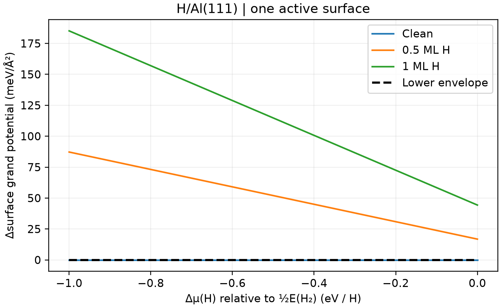

# 表面覆盖度与化学势

**适用环境：Linux + PBS（VASP）；Windows / macOS / Linux 可绘图。**

表面相图比较不同覆盖度在给定化学势下的稳定性。先列出候选结构，再把不同原子数转换到同一热力学参考。

## H/Al(111) 的三个候选覆盖度

沿用[吸附能案例](VASP吸附能计算.md)的洁净、0.5 ML、1 ML 表面，定义 $\Delta\mu_\mathrm H=\mu_\mathrm H-\frac12E(\mathrm H_2)$。相对于同一洁净薄膜的大势差为

$$\Delta\gamma_n=\frac{E_\mathrm{ads}(n)-n\Delta\mu_\mathrm H}{A}.$$

本例只有一个表面吸附，面积 $A=14.205\ \mathrm{Å}^2$，因此除以 `A`。双面相同吸附模型应按实际吸附原子数与两面面积重新定义，不能直接照搬。

## 提交与分析

[最小案例](../../../examples/vasp/minimal/surface-phase-diagram)提供 [吸附态 INCAR](../../../examples/vasp/minimal/surface-phase-diagram/INCAR.ads)、[洁净态 INCAR](../../../examples/vasp/minimal/surface-phase-diagram/INCAR.clean)、[H₂ INCAR](../../../examples/vasp/minimal/surface-phase-diagram/INCAR.h2)、[结构](../../../examples/vasp/minimal/surface-phase-diagram/POSCAR.full)、[k 网格](../../../examples/vasp/minimal/surface-phase-diagram/KPOINTS.slab)和 [PBS 脚本](../../../examples/vasp/minimal/surface-phase-diagram/job.pbs)。按吸附能笔记准备授权势与依赖后执行 `qsub job.pbs`；已有相同输入的四态计算可执行：

```bash
python3 run.py --reuse ../adsorption-energy
```

[postprocess.py](../../../examples/vasp/minimal/surface-phase-diagram/postprocess.py)扫描每 H 的相对化学势 −1 至 0 eV，[plot.py](../../../examples/vasp/minimal/surface-phase-diagram/plot.py)绘出各候选相及其下包络。



这个简化模型中，洁净表面在整个扫描区间最低，没有相变。形式上的两两交点均在正化学势区域，不能据此在图内添加相界。

实际相图需更全面的吸附位点、覆盖度与基底弛豫，以及适当的振动、气体或溶液自由能。这里的化学势尚未换算为温度、压力或电位。
