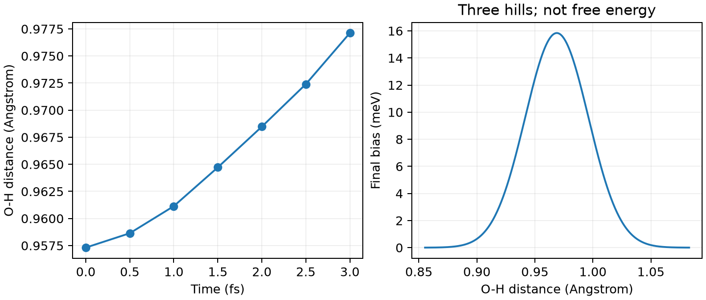

# CP2K Metadynamics 元动力学

**适用环境：Linux + PBS（CP2K）；Windows / macOS / Linux 可绘图。**

Metadynamics 通过在集体变量上累积高斯偏置，促进体系探索已访问区域之外的构型。先选能区分目标状态的变量，再设计加丘与采样参数。

## 水分子的 O—H 距离

[最小案例](../../examples/cp2k/minimal/metadynamics/)提供 [cp2k.inp](../../examples/cp2k/minimal/metadynamics/cp2k.inp)、[结构](../../examples/cp2k/minimal/metadynamics/structure.xyz)和 [PBS 文件](../../examples/cp2k/minimal/metadynamics/job.pbs)。与[约束 MD](CP2K约束分子动力学.md)一样，在 `SUBSYS/COLVAR/DISTANCE` 中选择原子 1、2；这里不固定距离，而是在 `MOTION/FREE_ENERGY` 下加入：

```text
&METADYN
  DO_HILLS .TRUE.
  NT_HILLS 2
  WW 0.0002
  &METAVAR
    COLVAR 1
    SCALE 0.05
  &END METAVAR
&END METADYN
```

`WW` 使用 Hartree，0.0002 Ha 约为 5.44 meV；距离变量的 `SCALE` 使用 bohr，0.05 bohr 约为 0.02646 Å。`NT_HILLS=2` 表示每两个 MD 步加丘。本例未采用扩展拉格朗日或 well-tempered 方案。

加载 CP2K、安装 [依赖](../../examples/cp2k/minimal/metadynamics/requirements.txt)后提交 `qsub job.pbs`。300 K、0.5 fs、六步仅用于观察偏置写入；生产采样应根据变量涨落与弛豫时间选择丘宽、丘高和更长的加丘间隔。

## 检查真实轨迹与偏置

[后处理](../../examples/cp2k/minimal/metadynamics/postprocess.py)合并 CP2K 分步输出的 `COLVAR`、`HILLS` 日志，将 bohr 换算为 Å，并与坐标轨迹交叉核对。[plot.py](../../examples/cp2k/minimal/metadynamics/plot.py)绘图。



本例在 1、2、3 fs 写出三个高斯丘，O—H 距离约从 0.9573 变化到 0.9771 Å。右图由实际丘参数重建，是最终偏置，不是收敛自由能，也不足以证明发生了化学反应。

正式自由能分析需充分访问相关亚稳态、检查反复跨越和独立重复。续算应完整保存 CP2K restart、波函数及偏置历史，并核对丘数与时间连续性。

参考：[CP2K METADYN](https://manual.cp2k.org/trunk/CP2K_INPUT/MOTION/FREE_ENERGY/METADYN.html)、[METAVAR](https://manual.cp2k.org/trunk/CP2K_INPUT/MOTION/FREE_ENERGY/METADYN/METAVAR.html)。
