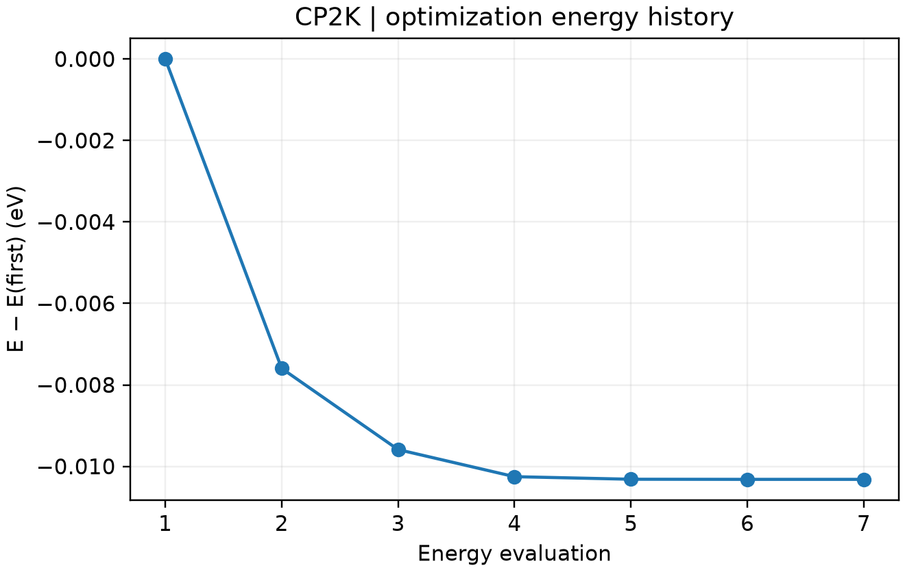

# CP2K 几何优化

**适用环境：Windows、macOS、Linux（查看和准备输入）；Linux + PBS（提交计算）。**

几何优化在固定晶胞内调整原子位置，使体系到达局部能量极小值。以水分子为例，先完成电子自洽，再由原子受力驱动结构变化。

## 准备与提交

用 Multiwfn 的 `cp2k` 功能选择结构优化任务，或使用案例中的 [cp2k.inp](../../examples/cp2k/minimal/geometry-optimization/cp2k.inp) 与 [structure.xyz](../../examples/cp2k/minimal/geometry-optimization/structure.xyz)。将 [job.pbs](../../examples/cp2k/minimal/geometry-optimization/job.pbs) 和[检查脚本](../../examples/cp2k/minimal/geometry-optimization/postprocess.py) 一并放入工作目录，加载集群 CP2K 环境后提交：

```bash
qsub job.pbs
```

本例保留非周期水分子的单点设置，将 `RUN_TYPE` 改为 `GEO_OPT`，并加入：

```text
&MOTION
  &GEO_OPT
    OPTIMIZER BFGS
    MAX_ITER 50
    MAX_FORCE 4.5E-4
  &END GEO_OPT
&END MOTION
```

`MAX_FORCE` 的默认单位为 Hartree/Bohr，`4.5E-4` 约合 0.023 eV/Å。优化还同时检查位移和均方根受力等条件，不能只看能量是否下降。大体系可考虑 LBFGS；算法选择应结合体系规模和收敛表现。

## 查看优化结果

检查 `cp2k.out` 是否出现 `GEOMETRY OPTIMIZATION COMPLETED`，并核对最后一步受力与电子收敛。`PROGRAM ENDED` 只能证明程序结束，不能替代优化收敛判断。

`geometry-optimization-pos-1.xyz` 保存优化轨迹，`geometry-optimization-FINAL-*.xyz` 保存最终结构。可以用 VMD、ASE 或其他结构工具查看键长变化；Multiwfn 也可读取最终 XYZ 做几何分析。文件名前缀由 `PROJECT` 决定。

如需固定原子，可在 `MOTION/CONSTRAINT/FIXED_ATOMS` 中按原子序号设置。振动分析前应进一步收紧几何和 SCF 阈值，避免把残余受力引起的误差当作低频振动。



水分子优化中的实际能量评估轨迹，以第一次评估为零点；线搜索可能包含同一优化步内的多次能量评估。 由配套 [plot.py](../../examples/cp2k/minimal/geometry-optimization/plot.py)读取实际输出生成，结果检查后自动绘图；需安装 [requirements.txt](../../examples/cp2k/minimal/geometry-optimization/requirements.txt) 中依赖。
