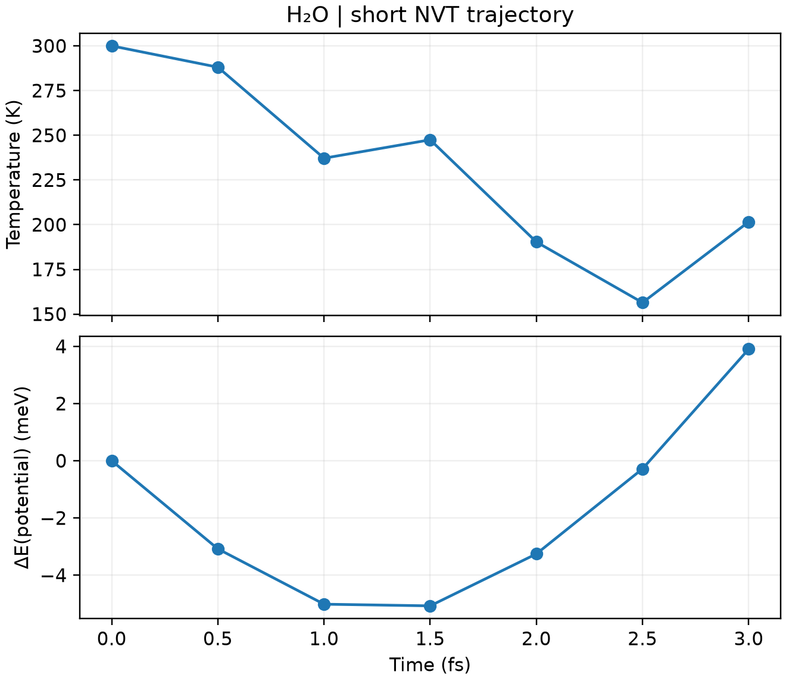

# CP2K 第一性原理分子动力学

**适用环境：Windows、macOS、Linux（查看和准备输入）；Linux + PBS（提交计算）。**

AIMD 在每个时间步计算电子结构和原子受力，再推进原子运动。这里以孤立水分子的短轨迹演示 NVT 输入、PBS 提交和输出检查。

## 输入与提交

先用 Multiwfn 的 `cp2k` 功能选择 `Molecular dynamics`，设置温度、时间步长和热浴。对应最小案例提供 [structure.xyz](../../examples/cp2k/minimal/molecular-dynamics/structure.xyz)、[cp2k.inp](../../examples/cp2k/minimal/molecular-dynamics/cp2k.inp)、[job.pbs](../../examples/cp2k/minimal/molecular-dynamics/job.pbs) 和[检查脚本](../../examples/cp2k/minimal/molecular-dynamics/postprocess.py)。

```text
&MOTION
  &MD
    ENSEMBLE NVT
    STEPS 6
    TIMESTEP 0.5
    TEMPERATURE 300
    &THERMOSTAT
      TYPE CSVR
      &CSVR
        TIMECON 20
      &END CSVR
    &END THERMOSTAT
  &END MD
&END MOTION
```

`TIMESTEP` 与 CSVR 的 `TIMECON` 默认单位都是 fs；温度单位为 K。含氢体系应从较小时间步长开始，并用短程 NVE 测试能量漂移。本例只运行 3 fs，用来检查流程，不足以讨论平衡温度、扩散或统计性质。

将上述文件放在集群工作目录，加载 CP2K 环境后提交 `qsub job.pbs`。

## 查看轨迹与能量

`molecular-dynamics-pos-1.xyz` 是坐标轨迹，`molecular-dynamics-1.ener` 包含步数、时间、动能、温度、势能等，列名和单位见文件表头。可用 VMD 播放轨迹，再用绘图工具检查温度和能量随时间的变化。

检查是否到达设定步数、每步电子计算是否收敛，以及结构是否出现异常接近或解离。NVT 的势能和动能会交换，并与热浴交换能量，不能要求物理总能像理想 NVE 一样严格守恒。

延长为生产计算时，应先平衡，再统计足够长的轨迹；保存 `.restart` 与波函数等续算所需文件，避免每次从新初速度开始。



六步、每步 0.5 fs 的实际 NVT 轨迹；势能以起始值为参考。单分子短轨迹的温度波动不能作为热平衡统计。 由配套 [plot.py](../../examples/cp2k/minimal/molecular-dynamics/plot.py)读取实际输出生成，结果检查后自动绘图；需安装 [requirements.txt](../../examples/cp2k/minimal/molecular-dynamics/requirements.txt) 中依赖。
