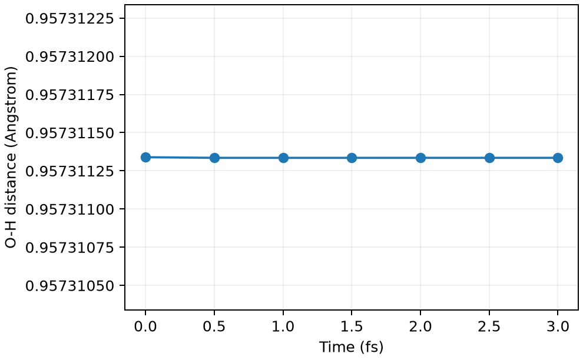

# CP2K 约束分子动力学

**适用环境：Linux + PBS（CP2K）；Windows / macOS / Linux 可绘图。**

约束一个集体变量，可以保留体系其他方向的运动。以水分子为例，固定一条 O—H 键长，另一条键和键角仍可变化。

## 定义距离与约束

[最小案例](../../examples/cp2k/minimal/constrained-md/)提供 [cp2k.inp](../../examples/cp2k/minimal/constrained-md/cp2k.inp)和 [structure.xyz](../../examples/cp2k/minimal/constrained-md/structure.xyz)。先在 `FORCE_EVAL/SUBSYS` 中定义：

```text
&COLVAR
  &DISTANCE
    ATOMS 1 2
  &END DISTANCE
&END COLVAR
```

再在 `MOTION/CONSTRAINT/COLLECTIVE` 中设置 `COLVAR 1`、`INTERMOLECULAR .TRUE.` 和 `TARGET`。这里 `COLVAR 1` 是第一项集体变量；原子序号从 1 开始。本例按全局原子编号应用约束，`INTERMOLECULAR` 不表示水被拆为两个真实分子。

`TARGET` 使用距离的内部单位 bohr，对应初始键长约 0.95731134 Å；修改结构时应同步换算。`SHAKE_TOLERANCE=1E-8` 控制约束迭代精度。

## PBS 计算与检查

安装 [依赖](../../examples/cp2k/minimal/constrained-md/requirements.txt)，加载 CP2K 并确保能找到基组、赝势数据后，执行 `qsub job.pbs`（[PBS 作业](../../examples/cp2k/minimal/constrained-md/job.pbs)）。本例采用 300 K CSVR 温控，0.5 fs 步长，共六步。

[后处理](../../examples/cp2k/minimal/constrained-md/postprocess.py)检查初始及六步 SCF、能量时间轴，并从真实轨迹重新计算键长；[plot.py](../../examples/cp2k/minimal/constrained-md/plot.py)绘图。



本例七帧轨迹的最大距离误差约 4×10⁻⁹ Å，说明约束已生效。如此短的轨迹只检查功能；生产计算需先平衡，并测试时间步长、约束精度和统计长度。

若目标是沿反应坐标求自由能，应安排多个窗口并分析约束平均力及几何修正。把距离固定在一个值并不能直接得到反应势垒。

参考：[CP2K COLLECTIVE 约束](https://manual.cp2k.org/trunk/CP2K_INPUT/MOTION/CONSTRAINT/COLLECTIVE.html)。
