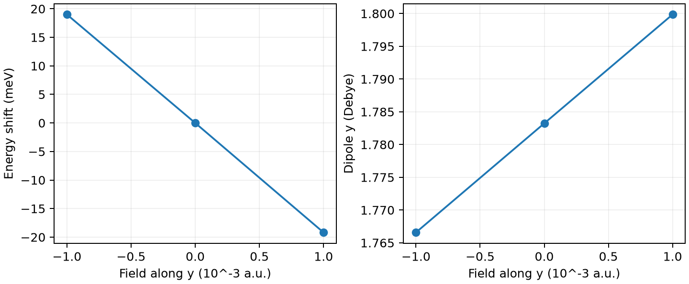

# CP2K 静电场响应

**适用环境：Linux + PBS（CP2K）；Windows / macOS / Linux 可绘图。**

对固定几何的孤立分子施加正、负小电场，可用偶极和能量的有限差分求极化率。以水分子的 y 方向为例：

$$\mu_y=-\frac{\partial E}{\partial F_y},\qquad
\alpha_{yy}=\frac{\partial\mu_y}{\partial F_y}=-\frac{\partial^2E}{\partial F_y^2}.$$

这里保持原子位置不变，得到电子响应；若每个电场下重新优化几何，还会包含结构弛豫的贡献。

## 定义静电势

[最小案例](../../examples/cp2k/minimal/electric-field/)采用非周期水分子 [structure.xyz](../../examples/cp2k/minimal/electric-field/structure.xyz)，提供 [负场](../../examples/cp2k/minimal/electric-field/cp2k.minus.inp)、[零场](../../examples/cp2k/minimal/electric-field/cp2k.zero.inp)和 [正场](../../examples/cp2k/minimal/electric-field/cp2k.plus.inp)输入。`DFT/EXTERNAL_POTENTIAL` 设置线性静电势：

```text
&EXTERNAL_POTENTIAL
  FUNCTION -F*(Y-Y0)
  PARAMETERS F Y0
  VALUES 0.001 9.44863062312885
&END EXTERNAL_POTENTIAL
```

不指定 `UNITS` 时使用 CP2K 内部原子单位：`F=0.001` 约为 0.05142 V/Å，`Y0` 为 bohr，等于晶胞中心的 5 Å。该势沿 y 递减，对应正 y 电场。此处为中性分子，参考原点不会改变总偶极；带电体系需另行处理原点和外场下的受力。

静态非周期场使用 `EXTERNAL_POTENTIAL`；`DFT/EFIELD` 面向时变场，周期体系的有限场则有独立的 Berry 相位方案，不宜直接套用此输入。

## PBS 作业与后处理

加载 CP2K，并使其能够找到 `BASIS_MOLOPT`、`GTH_POTENTIALS` 数据文件；安装 [依赖](../../examples/cp2k/minimal/electric-field/requirements.txt)后提交 [job.pbs](../../examples/cp2k/minimal/electric-field/job.pbs)：

```bash
qsub job.pbs
```

[run.py](../../examples/cp2k/minimal/electric-field/run.py)顺序执行三个场强。输入开启 `MOMENTS ON` 和 `PERIODIC .FALSE.`，在输出中打印非周期偶极。[后处理](../../examples/cp2k/minimal/electric-field/postprocess.py)将 Debye 转为偶极原子单位，分别计算能量二阶差分与偶极一阶差分，并检查两者是否一致。[plot.py](../../examples/cp2k/minimal/electric-field/plot.py)绘图。



本例零场偶极约 1.7832 Debye，能量与偶极两种差分得到的 $\alpha_{yy}$ 均约 6.5467 原子单位（体积单位为 bohr³）。这些数值对应本例的 PBE、基组和固定几何设置，定量使用前应检查基组与场强收敛。

水有永久偶极，因此正负电场的能量变化不必对称。极化率由曲率或偶极斜率取得，不能直接把一侧能量差当成极化率。本例只计算一个方向；完整张量需沿三个方向施场，记录全部偶极分量，并检查场强、基组、积分网格与 SCF 阈值收敛。

参考：[CP2K EXTERNAL_POTENTIAL](https://manual.cp2k.org/trunk/CP2K_INPUT/FORCE_EVAL/DFT/EXTERNAL_POTENTIAL.html)、[MOMENTS](https://manual.cp2k.org/trunk/CP2K_INPUT/FORCE_EVAL/DFT/PRINT/MOMENTS.html)。
