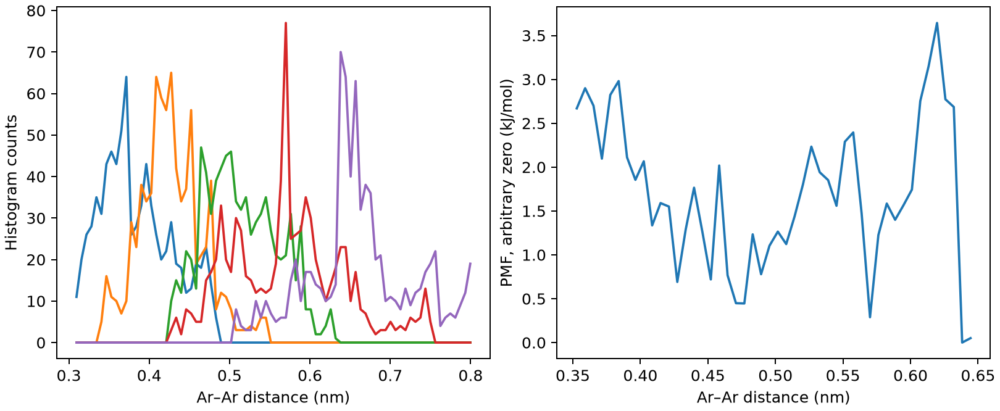

# GROMACS伞形采样与平均力势

**适用环境：Linux + PBS 运行计算；Windows / macOS / Linux 可准备输入与分析结果。**

伞形采样在反应坐标上设置多个偏置窗口，帮助探索普通 MD 难以跨越的区域。WHAM 合并重叠窗口并去除已知偏置，得到指定坐标的平均力势。

## 方法与物理量

窗口通常使用 U_i(ξ)=k_i(ξ−ξ_i)²/2。需要相邻窗口有足够重叠，并使每个窗口中与 ξ 正交的慢自由度也得到采样；只看到反应坐标覆盖不等于体系全部平衡。

距离坐标的概率还包含几何测度。径向 PMF 与直接的两体势不是同一个量；若要去除球壳的 r² 因子，必须明确相应 Jacobian 修正和参考定义。

## 最小模型与输入

210 个 TIP3P 水和两个中性 LJ Ar 粒子，2 nm 立方盒。五个窗口中心为 0.350、0.425、0.500、0.575、0.650 nm，弹簧常数 1000 kJ mol⁻¹ nm⁻²，每窗口最小化后采样 10 ps。所有窗口水数与拓扑一致，只改变第二个 Ar 的初始位置与偏置中心。

[案例目录](../../examples/gromacs/minimal/umbrella-sampling/)包含以下科学输入：

[em.mdp](../../examples/gromacs/minimal/umbrella-sampling/em.mdp)、[stages.json](../../examples/gromacs/minimal/umbrella-sampling/stages.json)、[w0.gro](../../examples/gromacs/minimal/umbrella-sampling/w0.gro)、[w0.mdp](../../examples/gromacs/minimal/umbrella-sampling/w0.mdp)、[w0.ndx](../../examples/gromacs/minimal/umbrella-sampling/w0.ndx)、[w0.top](../../examples/gromacs/minimal/umbrella-sampling/w0.top)、[w1.gro](../../examples/gromacs/minimal/umbrella-sampling/w1.gro)、[w1.mdp](../../examples/gromacs/minimal/umbrella-sampling/w1.mdp)、[w1.ndx](../../examples/gromacs/minimal/umbrella-sampling/w1.ndx)、[w1.top](../../examples/gromacs/minimal/umbrella-sampling/w1.top)、[w2.gro](../../examples/gromacs/minimal/umbrella-sampling/w2.gro)、[w2.mdp](../../examples/gromacs/minimal/umbrella-sampling/w2.mdp)、[w2.ndx](../../examples/gromacs/minimal/umbrella-sampling/w2.ndx)、[w2.top](../../examples/gromacs/minimal/umbrella-sampling/w2.top)、[w3.gro](../../examples/gromacs/minimal/umbrella-sampling/w3.gro)、[w3.mdp](../../examples/gromacs/minimal/umbrella-sampling/w3.mdp)、[w3.ndx](../../examples/gromacs/minimal/umbrella-sampling/w3.ndx)、[w3.top](../../examples/gromacs/minimal/umbrella-sampling/w3.top)、[w4.gro](../../examples/gromacs/minimal/umbrella-sampling/w4.gro)、[w4.mdp](../../examples/gromacs/minimal/umbrella-sampling/w4.mdp)、[w4.ndx](../../examples/gromacs/minimal/umbrella-sampling/w4.ndx)、[w4.top](../../examples/gromacs/minimal/umbrella-sampling/w4.top)。

结构写在坐标文件或各输入的原子/晶胞段；`stages.json` 列出计算阶段。配套 [run.py](../../examples/gromacs/minimal/umbrella-sampling/run.py) 顺序组织任务，[job.pbs](../../examples/gromacs/minimal/umbrella-sampling/job.pbs) 提交作业，[postprocess.py](../../examples/gromacs/minimal/umbrella-sampling/postprocess.py) 检查结果并绘图。

## 参数与提交

加载单节点 thread-MPI GROMACS，`GMX_EXEC` 指定 `gmx`。本例每窗口使用 2 个 OpenMP 线程，拓扑引用安装中的 AMBER99SB-ILDN/TIP3P；外部 MPI 构建需相应调整启动器。

| 设置 | 含义 |
| --- | --- |
| `pull-coord1-type umbrella` | 固定中心谐势偏置 |
| `geometry distance` | 两个单原子组的三维距离 |
| `start no/init` | 直接使用指定窗口中心，不再叠加初始距离 |
| `rate 0` | 不是非平衡持续拉伸 |
| 自定义 index | 同时包含 AR1、AR2 和温控使用的 System |

此例用原生 pull code 和 gmx wham，不依赖额外增强采样插件。

在干净案例目录安装[Python 依赖](../../examples/gromacs/minimal/umbrella-sampling/requirements.txt)并提交：

```bash
python3 -m pip install -r requirements.txt
qsub job.pbs
```

PBS 中的资源语法和软件加载方式按集群调整。计算结束后自动执行后处理；若只分析已保存的结果，运行 `python3 postprocess.py`。各阶段独立保存输出，便于定位失败步骤。

## 结果与判断

后处理丢弃前 2 ps，调用 `gmx wham`，同时输出 PMF 与五条直方图，并检查每对相邻窗口至少有非零重叠。图仅绘制窗口中心覆盖的 0.35—0.65 nm，避免把低计数边缘的尾部当成可信极小值；PMF 零点人为平移，不影响自由能差。

本例未事先做充分 NPT 密度平衡。小例展示可连通的窗口和去偏置流程，但 8 ps 有效采样远不足以给出可发表的溶质相互作用自由能。窗口只覆盖局部距离，也没有声称测得完整标准结合自由能。



图由案例后处理脚本读取实际计算输出生成。

## 扩展到实际研究

先用短预拉伸/预平衡建立窗口，再延长各窗口，检查重叠、迟滞与独立重复。复杂结合/膜穿越问题还涉及旋转、取向、位置约束、标准态及慢构象，不能由一条距离 PMF 直接读出标准结合自由能。

参考：[GROMACS 官方伞形采样教程](https://tutorials.gromacs.org/docs/umbrella-sampling.html)。
