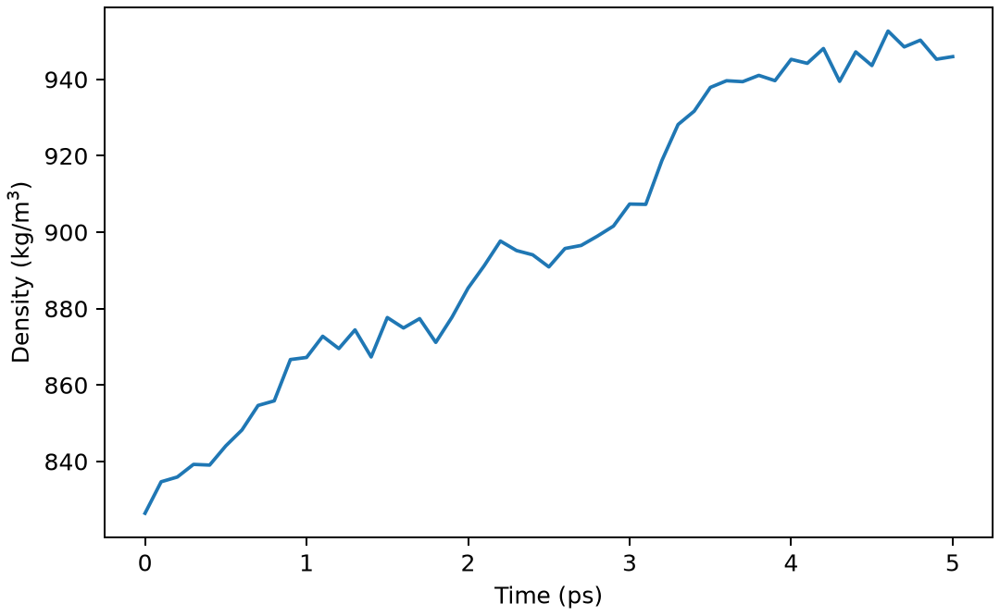

# GROMACS恒压动力学与密度

**适用环境：Linux + PBS 运行计算；Windows / macOS / Linux 可准备结构与分析结果。**

NPT 动力学通过压控调整盒子，适合平衡体相体系的密度。小体系的瞬时压力可以大幅涨落，应关注统计平均、体积与结构变化。

## 模型与计算思路

对同一 TIP3P 水盒先最小化和 5 ps NVT，再执行 5 ps NPT。生产输入通过 `grompp -t nvt.cpt` 读取检查点，并设置 `continuation=yes`、`gen-vel=no`。使用各向同性 C-rescale 压控，目标 1 bar。

## 准备输入与环境

[最小案例](../../examples/gromacs/minimal/npt/)包含：

- [structure.gro](../../examples/gromacs/minimal/npt/structure.gro)
- [topol.top](../../examples/gromacs/minimal/npt/topol.top)
- [em.mdp](../../examples/gromacs/minimal/npt/em.mdp)
- [nvt.mdp](../../examples/gromacs/minimal/npt/nvt.mdp)
- [npt.mdp](../../examples/gromacs/minimal/npt/npt.mdp)
- [run.py](../../examples/gromacs/minimal/npt/run.py)：组织计算步骤。
- [job.pbs](../../examples/gromacs/minimal/npt/job.pbs)：单节点 PBS 作业。
- [postprocess.py](../../examples/gromacs/minimal/npt/postprocess.py)：检查并提取结果。
- [requirements.txt](../../examples/gromacs/minimal/npt/requirements.txt)：Python 分析依赖。

在集群加载 GROMACS。此小例采用单节点 thread-MPI `gmx`、1 个 MPI 任务与 2 个 OpenMP 线程；`GMX_EXEC` 可指定相应入口。`topol.top` 引用安装中的 AMBER99SB-ILDN 与 TIP3P 定义，案例不复制力场文件。若集群只提供外部 MPI 构建，需要按[基础笔记](GROMACS基础知识.md)调整启动器，不能把 `gmx_mpi` 直接代入当前 `-ntmpi` 命令。

在案例目录安装 Python 依赖并提交：

```bash
python3 -m pip install -r requirements.txt
qsub job.pbs
```

作业结束后会自动执行后处理。重新分析已有输出时，可单独运行 `python3 postprocess.py`。PBS 中的软件加载方式与资源语法按集群配置调整；此例不需要多节点。

## 参数怎样选

| 设置 | 本例 | 选择依据 |
| --- | --- | --- |
| `pcoupl` | `C-rescale` | 随机体积重标定方案 |
| `pcoupltype` | `isotropic` | 体相水；膜体系等需另选自由度 |
| `tau-p` | 2 ps | 压力耦合时间，不是压缩率 |
| `compressibility` | 4.5e−5 bar⁻¹ | 水的近似设置；其他模型需核对 |
| `ref-p` | 1 bar | 与 GROMACS 压力单位一致 |
| 温度 | 300 K、v-rescale | 压控不替代温控 |

## 结果与检查

后处理从 `.edr` 提取密度、温度和势能，核对 NPT 时间为 5 ps。图可看到密度对初始盒子的响应；后半段平均值仅作短程流程检查，不能作为已收敛的水密度预测。

若盒子突然塌缩或膨胀，先检查初始结构、单位、力场和压力参数。对膜使用各向同性压控可能改变预期模型；不能照搬体相水的设置。

本例后半段平均密度约 930 kg/m³，图中仍可见从初态向高密度演化，5 ps 尚不足以作平衡密度结论。



图由案例的 `postprocess.py` 从计算输出生成。

正式研究应延长平衡，检查密度和结构不再系统漂移后再统计；压力误差需结合相关时间和独立样本，而非只看总帧数。

进一步了解方法与文件规则，可看[GROMACS 基础知识](GROMACS基础知识.md)。参考：[GROMACS 压控参数](https://manual.gromacs.org/current/user-guide/mdp-options.html)。
