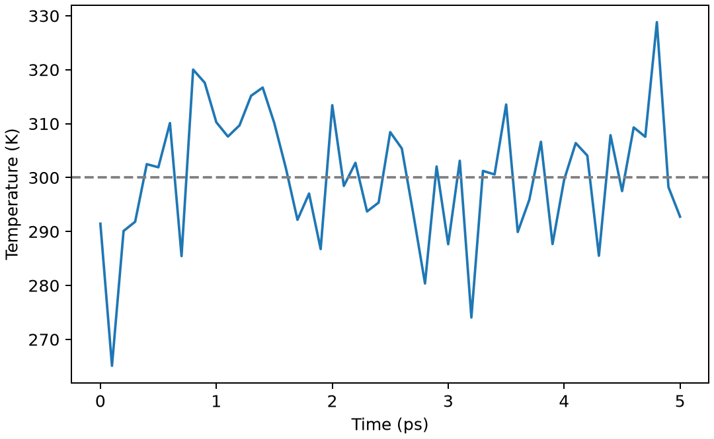

# GROMACS恒温动力学

**适用环境：Linux + PBS 运行计算；Windows / macOS / Linux 可准备结构与分析结果。**

NVT 动力学保持粒子数、体积与目标温度，可用于固定密度的平衡和取样。温度围绕目标值涨落是正常现象。

## 模型与计算思路

对 221 个 TIP3P 水的 2 nm 盒先最小化，再以 1 fs 步长运行 5000 步，即 5 ps。用 v-rescale 控温至 300 K，耦合时间 0.1 ps。这个短任务用于检查流程和温度响应，不用于宣布溶液已充分平衡。

## 准备输入与环境

[最小案例](../../examples/gromacs/minimal/nvt/)包含：

- [structure.gro](../../examples/gromacs/minimal/nvt/structure.gro)
- [topol.top](../../examples/gromacs/minimal/nvt/topol.top)
- [em.mdp](../../examples/gromacs/minimal/nvt/em.mdp)
- [nvt.mdp](../../examples/gromacs/minimal/nvt/nvt.mdp)
- [run.py](../../examples/gromacs/minimal/nvt/run.py)：组织计算步骤。
- [job.pbs](../../examples/gromacs/minimal/nvt/job.pbs)：单节点 PBS 作业。
- [postprocess.py](../../examples/gromacs/minimal/nvt/postprocess.py)：检查并提取结果。
- [requirements.txt](../../examples/gromacs/minimal/nvt/requirements.txt)：Python 分析依赖。

在集群加载 GROMACS。此小例采用单节点 thread-MPI `gmx`、1 个 MPI 任务与 2 个 OpenMP 线程；`GMX_EXEC` 可指定相应入口。`topol.top` 引用安装中的 AMBER99SB-ILDN 与 TIP3P 定义，案例不复制力场文件。若集群只提供外部 MPI 构建，需要按[基础笔记](GROMACS基础知识.md)调整启动器，不能把 `gmx_mpi` 直接代入当前 `-ntmpi` 命令。

在案例目录安装 Python 依赖并提交：

```bash
python3 -m pip install -r requirements.txt
qsub job.pbs
```

作业结束后会自动执行后处理。重新分析已有输出时，可单独运行 `python3 postprocess.py`。PBS 中的软件加载方式与资源语法按集群配置调整；此例不需要多节点。

## 参数怎样选

| 设置 | 本例 | 解释 |
| --- | --- | --- |
| `dt/nsteps` | 0.001 ps / 5000 | 总时长 5 ps |
| `tcoupl` | `v-rescale` | 恒温方法；分组与耦合时间按模型选择 |
| `gen-vel` | `yes` | 首次动力学按 300 K 生成速度 |
| `gen-seed` | 2026 | 固定初速度种子，不能保证跨平台轨迹逐位一致 |
| `pcoupl` | `no` | 盒子固定，不调节密度 |
| 坐标输出 | 每 100 步 | 此例为 0.1 ps；按分析需求调整 |

## 结果与检查

后处理用 `gmx energy` 提取温度和势能，检查最终时间为 5 ps、数据有限且后半段平均温度位于合理范围。温度曲线应在目标值附近涨落；温度正确还需结合结构、能量及目标量判断是否平衡。

用 VMD 等查看水盒，注意周期成像不能被误认为分子断裂。输出 `nvt.cpt` 含速度与耦合状态；后续任务用检查点传递状态，而不是从坐标重新生成速度。

本例后半段平均温度约 299.5 K，说明控温工作正常；是否充分平衡仍需结合其他量判断。



图由案例的 `postprocess.py` 从计算输出生成。

本例初始密度由坐标和盒体积决定，不会因 NVT 控温自动接近真实水密度。若研究压力平衡，应使用相应 NPT 方案。

进一步了解方法与文件规则，可看[GROMACS 基础知识](GROMACS基础知识.md)。参考：[GROMACS 模拟管理](https://manual.gromacs.org/current/user-guide/managing-simulations.html)。
