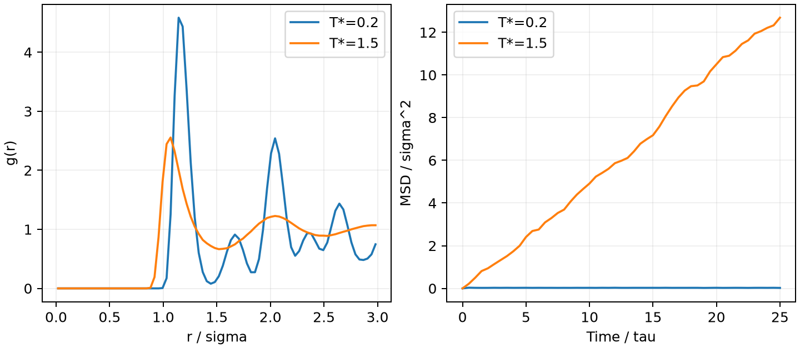

# LAMMPS 固液结构与径向分布函数

**适用环境：Linux + PBS（LAMMPS）；Windows / macOS / Linux 可绘图。**

径向分布函数 $g(r)$ 描述距参考粒子为 $r$ 的位置上出现其他粒子的相对概率。晶体有明显的壳层峰，液体通常保留近邻峰而远处相关减弱；结合 MSD，能更清楚地区分局部振动和持续扩散。

## 同密度的两个温度

[最小案例](../../examples/lammps/minimal/solid-liquid-rdf/)的 [in.lammps](../../examples/lammps/minimal/solid-liquid-rdf/in.lammps)使用 256 个 LJ 粒子、约化密度 0.85，分别在 $T^*=0.2$、1.5 下独立初始化。每个温度先平衡 5000 步，再采样 5000 步，步长为 0.005。

```text
comm_modify cutoff 3.3
compute radial all rdf 80 cutoff 3.0
fix rdf_output all ave/time 10 50 500 c_radial[*] file rdf.solid.dat mode vector
```

计算在 0—3σ 范围分 80 个距离区间，每 500 步形成一个平均块。势的截止半径为 2.5σ；RDF 范围更大时，需要把通信距离扩展到 RDF 截断加邻居表 skin。增加 RDF 范围不意味着延长势的作用范围。

加载 LAMMPS，安装 [依赖](../../examples/lammps/minimal/solid-liquid-rdf/requirements.txt)，提交 [PBS 作业](../../examples/lammps/minimal/solid-liquid-rdf/job.pbs)：

```bash
qsub job.pbs
```

## 同时看结构与运动

[后处理](../../examples/lammps/minimal/solid-liquid-rdf/postprocess.py)按实际行数解析 RDF 分块记录，平均十个采样块，并检查对应的 MSD 时间轴。[plot.py](../../examples/lammps/minimal/solid-liquid-rdf/plot.py)绘图。



低温曲线有清晰壳层峰，MSD 停留在约 0.02σ² 的振动尺度；高温峰形更宽，25 个约化时间后 MSD 约为 12.69σ²，表明粒子发生持续重排。OVITO 可进一步直观看轨迹，必要时结合结构识别和配位数。

这两个状态的比较不等于测出了熔点。连续加热可能出现过热，短时间内的晶体也可能仍被动力学困住；确定相变温度需更细温度采样、足够平衡和合适的共存或自由能方法。

LAMMPS 的标准 RDF 归一化基于全盒平均密度，适合这里的均匀体相。含大量真空的孤立团簇不能直接照搬相同的体相 $g(r)$ 解释。

参考：单斌、陈征征、陈蓉《计算材料学》配套仓库[第七章 7.11 体相熔化](https://github.com/stanfordbshan/CompMatBook/tree/main/edition-1-2023/Chapter07)；[LAMMPS compute rdf](https://docs.lammps.org/compute_rdf.html)。本例用重新编写的 LJ 小模型演示 RDF/MSD 分析。
